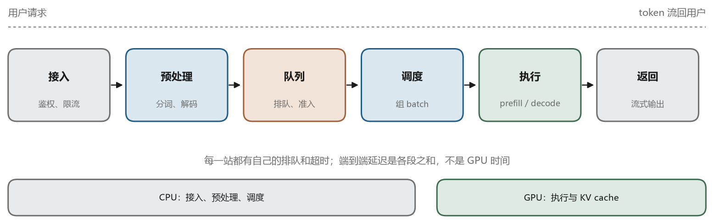

# 推理服务是怎么搭起来的

一个用户在手机上按下发送键，请求经过网络到达机房，穿过网关、鉴权、限流，被分到某台机器，排队，拼进一个 batch，送进 GPU，生成第一个 token，再一个 token 一个 token 地流回手机。中间任何一个环节出问题，用户看到的就是转圈、超时或者一句“服务繁忙”。

推理服务不是一个模型加一个 HTTP 接口。它要把前面讲的批处理、KV cache、引擎、显存管理串起来，还要处理排队、扩缩容、版本和故障。这一章按一个请求的路径走一遍，看看每一站发生了什么。

## 请求的一生

请求进来，第一站是**接入层**。它做 TLS 终止、鉴权、限流、路由。**TLS 终止**指的是把加密连接在最外层解开，后面走明文，省掉重复的解密开销。限流不是可选项，GPU 的容量有限，没有限流，突发流量会把队列撑爆，所有请求一起超时。

第二站是**预处理**。文本要分词，图像要解码、缩放、归一化。这些操作有的在 CPU 上做，有的搬到 GPU 上做。CPU 上做灵活，但会增加延迟；GPU 上做快，但会占用显存和流。大批量图像服务通常把解码和归一化放在 GPU，用独立的流和计算重叠。这里的选择会直接影响端到端：解码占 20 毫秒、计算占 30 毫秒，两个串行就是 50 毫秒，重叠起来可能只要 35 毫秒。

第三站是**队列**。请求不会刚好在 GPU 空闲时到达，需要一个队列缓冲。队列的长度、超时时间、优先级策略，决定了突发流量下的行为。队列太短，请求被拒绝；队列太长，延迟飙升，最后还是超时。队列的作用像水库：上游来水不均匀，靠它把波动抹平，但水库满了就会溢出来。

第四站是**调度与执行**。调度器按批处理策略组 batch，把请求送进引擎。prefill 和 decode 分开调度，长 prompt 可能被切成块。执行时，KV cache 按分页分配，完成的请求释放块，新请求申请块。

第五站是**后处理与返回**。生成的 token 要 detokenize，变成文本；流式返回要按块推送，让用户尽早看到第一个字。**detokenize** 是把 token 编号还原成文字，分词的反向操作。返回路径上的序列化、压缩、网络抖动，也会影响用户感知的延迟。流式返回尤其重要：用户看到第一个字之后，对总时长的容忍度会高很多。

把这条路径画出来，最大的价值是能定位问题。用户说“很慢”，先问是哪一段：连接建立慢、首字慢、还是中途卡。三段对应的优化手段完全不同，混在一起讨论就会变成互相猜测。一个具体的分法是把延迟拆成连接、排队、prefill、decode 四段，分别统计 P50 和 P99。四段里哪一段的 P99 最高，就先动那一段。

## 队列与准入

队列不是一个先进先出的数组，它要处理几种现实情况。

请求的优先级不同。付费用户、交互式请求、批处理任务，应该有不同的队列或权重。一个后台的批量任务如果把队列占满，交互式用户就会全部超时。**优先级队列**允许高优先级的请求插队，代价是低优先级请求可能被饿死，所以要配合配额或最大等待时间。

请求的截止时间不同。有的请求可以等几秒，有的必须在一秒内返回。调度器可以按截止时间排序，也可以直接拒绝已经注定超时的请求，避免它们占用资源。这个做法叫**提前拒绝**，听起来浪费，实际是保护：一个已经超过截止时间的请求，算完也没人要，不如把算力让给别人。

请求的大小不同。一个 32K 上下文的请求占的 KV cache 是短请求的几十倍，如果按请求数限流，显存会被长请求吃光。按 token 数或预估显存做准入控制，更准确。**准入控制**（admission control）是在请求进入系统之前就判断“接不接”，它比进了系统再排队更有效。

队列还要处理**背压**。当下游变慢，队列开始积压，接入层要早点拒绝或降级，而不是让请求在队列里等到超时。背压的信号可以是队列长度、GPU 利用率、P99 延迟，任何一个超过阈值就触发。**降级**可以是用更小的模型、更短的输出、或者直接返回缓存的结果。背压的意义在于：与其让所有用户都等到超时，不如让一部分用户快速失败，保住另一部分的体验。

这里有一个反直觉的经验：在过载时，最差的做法是“什么都接”。系统会进入一种状态，所有请求都在排队，每个都在超时边缘，吞吐接近于零。这时候正确的动作是拒绝一部分，让剩下的跑完，整体吞吐反而更高。这个现象在压测时最容易重现：把限流阀调低，反而看到了更高的有效吞吐，因为每个请求都能在超时之前完成。

## 模型加载与显存

模型加载看起来是一次性的工作，实际会影响启动速度、扩容速度和显存峰值。

最直接的方式是把整个权重读进显存。简单，但启动慢，扩容时要等几分钟。大模型可以用**内存映射**，把权重文件映射到虚拟内存，按需读入；也可以用**分层加载**，先加载前几层，开始处理请求，后面的层在后台加载。

**权重分块**是另一种思路。把大权重切成块，只把当前需要的块放进显存，其他块留在主机内存或磁盘，用时再换入。它适合显存小于模型大小的场景，代价是 PCIe 传输。如果每一层都要换入换出，传输时间可能超过计算时间；如果块很大、复用很高，换入换出可以摊薄。这个思路和操作系统的交换分区是同一个道理。区别在于，操作系统的换入换出有很好的预取，而推理的访问模式更规律：要么一层一层往下走，要么固定重复某几层，所以预取也可以做得很好。

权重分块和 kernel 里的分块不是一回事。后者是为了提高缓存命中率，把矩阵切成适合 shared memory 的小块，数据仍在显存里；前者是为了省显存，把权重放到更远的存储层次。两者都叫 tiling，但解决的不是一个问题。混淆这两个概念，会在和同事讨论时各说各话。还有一个容易忽略的点：权重分块会让量化变难，因为量化通常需要看到完整的张量才能定 scale，所以如果既要分块又要量化，格式要提前定好，不能分完块再想量化的事。

多模型共存时，显存要预留。每个模型有自己的权重、workspace 和 KV cache，还要留出碎片和峰值余量。把多个模型塞进一张卡，不能只看权重之和，要看峰值。一个模型在 prefill 时的激活峰值，可能比它的权重还大。这就是为什么“两个 30 GB 的模型塞进 80 GB 的卡”经常失败：账面够，实际峰值不够。一个实用的做法是给每个模型单独测一遍峰值，再把峰值相加，而不是把权重相加。

## 扩缩容、灰度与可观测

线上流量有高峰和低谷。扩缩容的依据不能是 CPU 利用率，应该是队列长度、TTFT、GPU 利用率这些更贴近服务的指标。原因是 CPU 利用率和 GPU 服务的瓶颈关系很弱：一个 GPU 打满的服务，CPU 可能只用了一成。

扩容的速度受模型加载时间限制。一个几十 GB 的模型，从拉镜像到能处理请求，可能要几分钟。高峰期临时扩容来不及，通常要提前预留，或者用更小的模型做降级。**预留容量**是提前开好的机器，成本高但响应快；**弹性扩容**成本低，但只在缓慢上涨的流量里有效。

灰度发布是模型上线的标准做法。新版本先接一小部分流量，对比延迟、错误率、业务指标，确认没问题再扩大。模型版本要和引擎版本、量化配置、预处理版本一起管理，任何一个变了，都要重新灰度。**灰度**的关键是“可比较”：新旧版本的流量要能分开统计，否则数字混在一起，看不出差异。

回滚要快。新版本出问题时，能在几分钟内切回旧版本，而不是重新构建、重新加载。这要求旧版本的模型和引擎文件还在，配置能快速切换。很多团队的教训是：新版本上线顺利，就把旧版本的镜像删了，一周后出问题，只能临时重建，重建的版本还和当时不完全一样。

可观测性由三样东西组成。**指标**看趋势，包括 QPS、P50/P99 延迟、TTFT、TPOT、队列长度、GPU 利用率、显存占用、错误率。**日志**看个案，一个请求为什么慢，要能查到它经过哪些环节、排队多久、batch 多大、KV cache 命中多少。**追踪**看链路，把网关、预处理、推理、后处理的耗时分开，定位是哪一段变慢。

还有一个容易忽略的指标是**输入分布**。线上请求的长度、分辨率、语言分布变了，模型的延迟和精度都会变。监控输入分布，比监控输出更能提前发现问题。比如某天开始多了很多超长请求，那是产品侧改了交互，服务侧要提前扩容，而不是等报警。

## 现成的服务系统

前面讲的机制，现成的系统大多已经实现，不需要从零写。

**vLLM** 把 PagedAttention、连续批处理、前缀缓存做成了默认路径，支持 Hugging Face 上的大多数模型，适合快速搭一个 LLM 服务。**SGLang** 用 RadixAttention 管理前缀缓存（Zheng 等，2023），在多轮对话、few-shot、固定系统提示的场景下命中率很高。**TensorRT-LLM** 走编译式路线，把模型编译成针对特定 GPU 的引擎，延迟和吞吐更好，代价是构建时间和硬件绑定。**Triton Inference Server** 更像一个多模型服务框架，负责模型仓库、动态批处理、ensemble 和监控，底层可以接 TensorRT、ONNX Runtime、PyTorch 等后端。

选哪个，取决于三件事。模型结构是否被支持，目标硬件是否有优化，团队是否愿意维护一套编译和发布流程。先用现成系统跑通，再针对瓶颈做定制，比一上来自己写调度器更稳。自己写调度器的团队，最后往往会重新实现一遍 PagedAttention 和连续批处理，只是少了两年打磨。这也不是说不能自己写，而是说要把“什么时候自己写”想清楚：只有在你的流量模式或模型结构有特殊之处，现成系统确实支撑不了，自己写才有意义。而且即便要写，也应该只写差异部分，其余复用现成组件。一个团队花半年重写调度器，最后发现差异只在“按租户优先”，那就是把时间花错了地方。

用现成系统也要知道它的边界。它们的默认配置是针对“平均场景”调的，你的流量可能长得很不一样。比如一个全是短请求的客服机器人，默认的最大 batch 可能过大，导致排队；一个全是长文档的摘要服务，默认的块大小可能太小，寻址开销过高。上手第一件事是把默认配置按自己的流量重新压测一遍。压测不是拿一百个一样的请求跑，而是按真实的长尾分布生成请求，否则测出来的数字和线上相差很远。真实流量里，长短请求之比、并发度、到达间隔都是波动的，压测要模拟这些波动，而不是用恒定的参数。一个简单有效的办法是录制一段真实流量按原速回放，比任何合成流量都接近真实。

下一章把视角拉远，看云、边、端三种部署形态，各自受什么约束。
