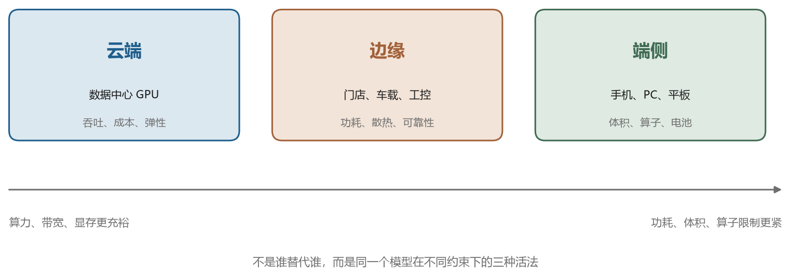

# 云、端、边：部署形态的选择

同一个模型，放在云端 GPU 上，还是放在门店的盒子里，还是塞进手机，答案完全不同。云端有充足的显存和带宽，可以跑大模型、大批量；边缘设备功耗有限，散热差，但离用户近；手机有 NPU，能效高，但算子支持不全，应用体积也受限制。

部署形态决定了优化的方向。云端更在意吞吐和成本，边缘更在意功耗和稳定性，端侧更在意体积和启动速度。这一章把三种形态的约束摊开，看看同一个模型在不同地方要怎么改。

## 云端

云端的主力是数据中心的 GPU。显存大，带宽高，Tensor Core 齐全，可以跑 fp16、fp8、int8 的矩阵乘。机器通过高速互联组成集群，模型可以切到多张卡上，请求可以分到多台机器上。

云端的优势是弹性。流量高峰时多加几张卡，低谷时释放。但弹性受模型加载时间限制，一个几十 GB 的模型从冷启动到能服务，可能要几分钟。所以云端服务通常保留一定的冗余容量，或者用更小的模型做降级。

成本是云端最现实的约束。一张 A100 或 H100 按小时计费，不管利用率多少。提高吞吐、降低单请求成本，是云端优化的主线。批处理、连续批处理、KV cache 复用、量化，都是围绕这个目标。

云端还要处理多租户。同一张卡可能跑多个模型，或者一个模型服务多个客户。显存隔离、流优先级、请求隔离要做好，否则一个客户的突发流量会影响其他客户。

## 边缘

边缘设备放在离用户近的地方，比如门店、工厂、路口、车载。它们的算力不如数据中心，功耗和散热受限，通常没有专业的机房环境。

边缘的第一道约束是功耗。一个车载盒子可能只有几十瓦的预算，GPU 的峰值功耗不能超过这个数。功耗限制会直接压低频率，峰值算力看起来不错，持续跑一会儿就降频。

第二道是内存。边缘设备的显存或统一内存通常只有几 GB 到十几 GB，模型要量化到 int8 甚至 int4 才能放下。KV cache 和中间结果的预算也很紧，批处理不能开太大。

还有可靠性。边缘设备可能无人值守，断电、网络抖动、温度过高都要能恢复。服务要能自动重启，模型要能本地加载，不能依赖云端每次都下发。

边缘的优化重点是小模型、低功耗、稳定运行。蒸馏、剪枝、量化在这里比在云端更常用，因为资源真的不够。推理引擎要能适配不同的加速器，不能只支持 CUDA。

## 端侧

端侧指手机、平板、PC 这类用户设备。它们的优势是离用户最近，没有网络往返，隐私数据不出设备。劣势是算子支持、应用体积和电池。

手机的 NPU 通常只支持有限的算子集和量化格式。一个在 PyTorch 里很普通的操作，比如某种激活函数或归一化，到了 NPU 上可能没有对应实现，只能回退到 CPU，速度断崖式下降。端侧部署的第一件事，往往是让模型能被 NPU 的编译器接受。

应用体积也是约束。一个 7B 模型 int4 量化后还有 3.5 GB，手机应用装不下。端侧模型通常小得多，几百 MB 到一两 GB，还要考虑下载、更新、存储空间。

电池和发热决定持续性能。手机不能长时间跑满 NPU，否则发热降频。端侧推理要控制单次时长，或者分批处理，避免持续高负载。

端侧的优化重点是模型小型化、算子兼容、启动速度。量化几乎必用，蒸馏和剪枝也常见。推理框架要能利用 NPU，同时保留 CPU 回退路径。

## 同一套技术，不同的优先级

三种形态用的技术是同一套，排序却不一样。

云端最先算的是吞吐账。批处理、连续批处理、KV cache 复用、权重和 KV 的量化，都是为了在同样的卡上接更多请求。单次延迟只要满足 SLO，多一点少一点不是第一位。扩容和降级也是云端的手段，流量高峰时加机器，低谷时释放。

边缘最先算的是功耗和散热账。一个盒子在夏天闷在配电间里，连续跑几个小时，频率会掉下来。优化目标不是峰值算力，而是持续算力，以及在温度、电压波动下不出错。量化和剪枝在这里比在云端更常用，因为内存和功耗都紧。模型更新要能远程推送，失败了要能回滚，不能靠人到现场。

端侧最先算的是体积和兼容账。应用商店对安装包大小有要求，用户对下载等待没有耐心。模型要小，启动要快，算子要能被 NPU 接受。一个在云端很普通的算子，到了手机上可能没有实现，只能回退到 CPU，速度差一个数量级。所以端侧部署的第一件事往往是算子兼容性检查，而不是性能调优。

同一个模型，在云上是 fp16 加动态批处理，在边缘是 int8 加固定 batch，在端侧是 int4 加静态形状，三套配置对应三种约束。把它们混着用，通常两头不讨好。

## 怎么选

选择部署形态，先看四个因素。

**延迟**。用户能接受多少毫秒。云端加网络往返，通常几十到几百毫秒；边缘可以做到几十毫秒；端侧可以做到几毫秒，但模型小。

**带宽和成本**。每次请求要传多少数据，云端按流量和算力收费，边缘和端侧一次性投入。视频、图像这类数据量大的场景，边缘和端侧更有优势。

**隐私**。数据能不能出设备。医疗、金融、个人照片，往往要求本地处理，端侧或边缘是唯一选择。

**更新频率**。模型迭代快，云端更新最方便；边缘要远程推送；端侧要跟随应用版本，更新慢。

很多系统是混合的。端侧做初步筛选，把不确定的样本传到云端；边缘做实时推理，云端做批量训练和复杂模型；云端做主力，边缘做容灾。混合部署的复杂度在于版本一致性和数据回流，不是简单的叠加。

下一章把前面所有技术放进一个完整的优化流程，看一个项目从基线到上线要经过哪些步骤。
