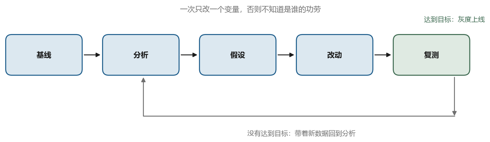

# 一次完整的优化：从基线到上线

一个业务团队找到部署工程师，说模型太慢，希望“快一倍”。问现在多快，回答是“大概两三秒”；问 P99 多少，不知道；问输入尺寸和 batch，也不确定。这种情况下，任何优化都没有意义，因为不知道起点，也不知道终点。

一个可复现的优化流程，第一步不是改代码，是把基线定下来。这一章按顺序走一遍这个过程，不绑定具体项目，也不编造加速比。每一步的收益取决于模型、硬件和实现，但顺序和判断方法是通用的。

**基线**（baseline）是改动之前的原始数字，包括延迟、吞吐、显存和精度。它的作用像体检报告：没有它，后面的“好多了”都只是感觉；有了它，每一次改动都能算清楚代价和收益。

## 定基线

基线要回答四个问题。

**服务承诺是什么**。延迟目标、吞吐目标、可用性目标，最好有分位数，比如 P99 小于 300 毫秒，或者 TTFT 小于 500 毫秒。没有目标，优化就没有终点。**可用性目标**通常写成“几个 9”，比如 99.9% 的请求成功，它决定了你能容忍多少失败和重试。一个 99.9% 的目标意味着一千次请求里只能有一次失败，这个数字会直接影响多副本、重试和超时的设计。

**负载是什么**。输入的形状分布、batch 大小、请求到达速率、并发数。用一个有代表性的压测集，不要只用一张样例图跑一百遍。有代表性的意思是：长度分布、内容类型、并发水平都接近线上，最好直接录制一段真实流量。如果做不到录制，就把真实流量按长度分桶，每桶取几个代表性的样本，再按真实比例混合。

**现在跑多快**。端到端延迟的 P50、P95、P99，吞吐，显存峰值，GPU 利用率。测量要在稳定的机器上，预热够，重复多次，记录方差。如果同一份配置连测三次差异超过 5%，说明测量方法本身有问题，先把测量搞稳。测量不稳的典型原因是没预热、频率波动、机器上还有别的任务在跑，这三种都会被误当成“优化效果”。

**结果对不对**。优化不能只看速度，还要有一个数值对齐的基准。保存一批输入的浮点输出，之后每次改动都对比余弦相似度、最大误差或者任务指标。**余弦相似度**衡量两个向量的方向是否一致，值接近 1 说明输出几乎没变。对生成任务，还要看输出的长度分布和重复率，因为量化可能让模型变得“话多”或“卡住”。

这四件事做完，才有一个可以比较的起点。后面每改一次，都用同一套基准复测。基准本身也要版本化：输入集、参考输出、测量脚本，三样东西一起打标签，否则三个月后你分不清是模型变了还是基准变了。还有一个细节：参考输出要保留到小数点后六位，不要只存分类标签。标签只能告诉你“结果对不对”，小数位能告诉你“量化误差有多大”，后者在做混合精度时至关重要。

## 拆时间

基线有了，下一步是把端到端时间拆开。

先看整体时间线，分清 kernel、拷贝、空隙、同步各占多少。再看 kernel 内部，哪些是计算瓶颈，哪些是带宽瓶颈，哪些是启动开销。最后看显存，峰值出现在哪一层，KV cache 占多少，workspace 占多少。这三步的顺序不能反，因为如果端到端里有一半不是 kernel，看 kernel 内部就是白费力气。这也是为什么性能分析工具分两层：一层看时间线，一层看单 kernel。

拆完之后，按占比排序。占 5% 的部分，优化到零也只有 5% 的收益；占 40% 的部分，哪怕只快 20%，端到端也有 8%。先做占比大的，不要被“这个 kernel 看起来很复杂”带偏。这个算术不难，但能避开最常见的浪费：很多人喜欢从自己最熟悉的地方下手，而不是从最痛的地方下手。

拆时间还有一个副产品：它会暴露一些“不该存在”的东西。比如一段每帧都在跑的预处理，实际结果只依赖固定的参数；一次多余的设备同步，只是为了让日志好看；一个张量被反复在主机和设备之间搬。这些东西往往一删就掉一大块，收益比精细优化 kernel 高得多。

排序时还要考虑一个问题：哪些是“工程可改”的。有些瓶颈在依赖库里，短期改不了；有些在服务代码里，一改就见效。把“不可改”的部分从账上扣掉，剩下的才是真正的工作量。这一步很现实，它能防止团队把时间花在“优化别人家的库”上。

拆时间的时候要区分“稳态”和“冷启动”。稳态是服务跑了一段时间之后的性能，冷启动包含加载、编译、分配。线上用户感受到的多数是稳态，但扩容、故障恢复、版本切换的时候，用户会遇到冷启动。这两类数字要分开测，优化也要分开做。冷启动的优化方向是“少加载、多复用”：权重用内存映射、引擎文件预构建、容器预热；稳态的优化方向是“少搬运、少启动”：融合、批处理、调 kernel。两者混在一起优化，往往两边都做不好。

## 先做无损的

无损或近无损的优化，应该排在前面。它们不改变模型的数学含义，风险低，收益确定。

第一步是图清理。删掉 dropout、drop_path、训练专用的分支，折叠常量，固定形状，缓存位置编码。这些改动通常不掉精度，能让图小一圈。

第二步是融合。Conv+BN+ReLU、Gemm+Mul/Add、Scale+Linear、ConvAdd，能合的合掉。融合失败的地方，看看是不是布局或中间结果消费者的问题，能不能通过调整图结构让它可融合。很多时候只需要把残差分支提前或推后一层，一个原本不能融合的结构就打开了。

第三步是布局和引擎。把 NCHW 换成 NHWC，减少 transpose；换一个更适合目标硬件的引擎；打开静态形状和 CUDA Graph。把 NCHW 换成 NHWC，减少 transpose；换一个更适合目标硬件的引擎；打开静态形状和 CUDA Graph。这些改动可能影响精度末位，但通常不需要重新训练。如果团队里有人怀疑“换引擎会改变结果”，拿前面存好的参考输出去比，几分钟就能有答案。

这一轮做完，端到端通常能降一截，具体多少取决于原来的图有多脏。如果原图已经经过引擎优化，这一轮的收益会小很多。判断“脏不脏”有一个简单的办法：数一数图里的节点数，和模型的理论层数比。如果节点数是理论值的五倍以上，说明有大量可以消除的东西。这个办法不需要任何工具，打印一下图就能数。

这一轮还有一个隐性收益：它让后面的优化变简单。图干净了，量化校准更准，因为不会有训练专用的节点干扰统计；调度更稳，因为不会有一堆奇怪形状的小算子。很多团队跳过这一步直接做量化，结果精度怎么调都不对，回头一看是图里还有 dropout。回头一看是图里还有 dropout。

这一轮还有一个心理上的作用：它很快就能看到结果，能把团队的信心建起来。如果一上来就做量化，可能一周都在调精度，没人知道进展在哪里。先拿到一轮确定的收益，后面的长活才有人愿意干。所以顺序比单项优化更重要，这也是整章反复强调的一点。

## 再动精度，最后动调度

精度优化的收益大，风险也大，放在第二轮。

先试 fp16 或 bf16。大多数推理任务能直接接受，精度损失很小，带宽和算力都省一半。唯一要注意的是数值范围，fp16 容易溢出，bf16 范围大但精度低，按模型选。

再试 int8 PTQ。选一个贴近线上的校准集，跑一遍敏感度分析，看看哪些层掉点最多。敏感层保留 fp16，其余层 int8，做混合精度。这一步通常能再省一半带宽，算力也有提升。不过要注意，int8 的精度损失不是线性的，有些模型在 8 位下几乎无感，有些模型光敏感层就占了三成，混合精度省下的有限。

如果 int8 掉点不可接受，再考虑 QAT 或更精细的量化方法。QAT 要训练，成本高，但它能把精度拉回来。低比特的 int4、fp8 也可以试，但要确认硬件支持，以及 kernel 的实际效率。

每一轮量化之后，都要跑精度回归。不能只看一个平均指标，要看分层、分长度、分任务的结果。量化误差往往集中在长尾，平均值看不出来。

单次推理优化到一定程度，端到端的瓶颈会转到服务层。如果吞吐不够，考虑连续批处理、动态 batch、KV cache 分页和前缀共享。如果延迟不够，考虑减少排队、提高优先级、把 prefill 和 decode 分开。如果显存不够，考虑量化 KV cache、权重分块、多卡切分。

服务层的改动影响面大，要在压测环境里验证。批处理参数、队列长度、超时时间，都会影响 P99。一个在平均延迟上很漂亮的配置，可能让 P99 变得不可接受。这也是为什么服务层的改动要放在最后：服务层的改动要放在最后：它需要前面几步先把单次推理的成本降下来，否则 batch 开不大，调度怎么调都没空间。

顺序不能随意交换。先做调度再量化，会出现“batch 刚调好，量化又把显存需求改了”的返工；先量化再清图，校准统计会被无关节点污染。上面这个顺序是从失败案例里总结出来的：无损的在前，因为风险低；精度的在中，因为收益大；调度的在后，因为依赖前两者的结果。

## 上线、复盘与一张清单

优化做完，先在灰度环境验证，再逐步放量。

灰度要看三类指标：性能、精度、业务。性能看延迟和吞吐，精度看对齐和任务指标，业务看点击、转化、投诉。任何一类异常，都要能快速回滚。灰度的时间不宜太短，一次只放 5% 流量跑十分钟，很难看出长尾问题，至少要看一整天的波动周期。

上线之后，监控不能停。输入分布会变，流量会变，硬件会老化，今天的最优配置几个月后可能不是最优。把基线、配置、profile 存档，下次出问题时能快速对比。

复盘的时候，记录三件事：哪些改动有效，哪些无效，哪些引入了新问题。无效的改动也是收获，它说明瓶颈不在那里。下一次遇到类似的模型，可以少走弯路。

复盘还有一个副产品：它能积累一份“这个模型类别的性能画像”。做过三个类似的视觉模型之后，你会知道这一类模型通常卡在哪里、量化后掉几个点、什么形状最不友好。这份经验比任何通用文档都有用。

动手之前要确认的几件事：基线、负载、精度基准都有；测量脚本能一键跑完；旧版本的模型和配置还在，能回滚。这几件事少一件，后面都会变成麻烦。尤其是“旧版本的配置还在”这一条，出问题时它就是救命的。很多团队把回滚当成“应该有”的东西，直到真出事才发现旧镜像已被清理、旧引擎文件已过期。

拆时间时先看端到端，再看 kernel，最后看显存；优化顺序先无损，再精度，最后调度；每次只改一个变量，改完复测，记录配置；上线前灰度，上线后监控。这些不是规定，是把“凭感觉优化”变成“有据可查”的最短路径。

这套流程不保证每次都能快一倍，但它能保证你知道为什么快、为什么慢，以及下一次从哪里开始。对一个团队来说，后一件事比前一件事重要得多：一次快一倍可能是运气，能重复地找到瓶颈才是能力。
