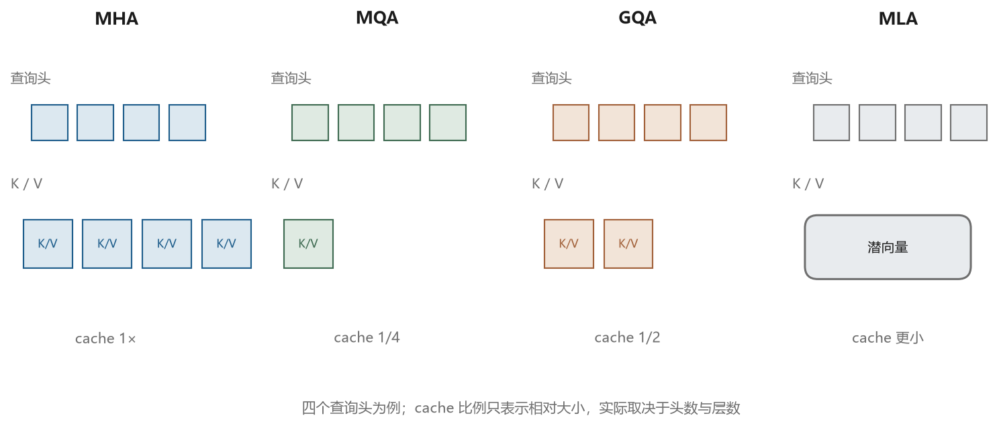

# 注意力变体：MQA、GQA、MLA 与更省的注意力

一个 7B 模型，32 个注意力头，序列长度 4096，fp16 下每个请求的 KV cache 大约 2 GB。并发 16 路就是 32 GB，一张 80 GB 的卡扣掉权重，剩下的空间刚好够用。如果把 KV 头从 32 个减到 8 个，同样 16 路并发只占 8 GB，省下来的显存可以接更多请求，或者把上下文拉得更长。

这不是靠量化做到的，而是换了一种注意力结构。模型训练时就把 Key 和 Value 的数量定死了，部署时不能随便改。理解这些变体，才能看懂一张卡为什么能接 8 路而不是 16 路，也才能判断一个模型是不是“为推理优化过”。

先建立一点必要的背景。**注意力**（attention）是 Transformer 的核心机制：每个位置都要和其他位置“对一对眼神”，决定该看谁、看多重。做这件事需要三组向量：**Query**（查询，我现在要找什么）、**Key**（键，我这里有什么）、**Value**（值，如果真的关注我，我能提供什么）。**头**（head）是注意力并行工作的通道数，多头就像多个人同时从不同角度看同一段话。

## KV cache 是被谁撑大的

标准多头注意力里，每个查询头都有一套自己的 Key 和 Value。32 个头就是 32 份 K、32 份 V。生成每个 token 时，所有头都要把之前所有 token 的 K/V 读一遍，算一遍注意力。

KV cache 的大小和头数成正比。头数减半，cache 减半；头数减到 1，cache 降到三十二分之一。这就是 MQA 和 GQA 的出发点。它们不改注意力的计算方式，只改“多少个查询头共享同一套 K/V”。

可以用一个类比理解这件事。想象 32 个同事各自记录会议纪要，每人一本笔记本，会议室里就堆了 32 本。如果让他们共用一本，纪要变少了，但每个人的关注点不同，共用一本就得互相妥协，记不下那么多细节。MQA 和 GQA 就是在“笔记本数量”和“每人能看到多少细节”之间找平衡。共用一本纪要时，每个人的问题也得先统一：“我们到底关心什么？”这就是为什么共享 K/V 会影响模型表达能力——它强迫不同头用同一种方式看待上下文。

这里要解决什么问题？问题是长上下文和高并发的显存成本。KV cache 随长度线性增长，随并发线性增长，两个方向一乘，显存很快就顶住了。减头数是最直接的办法，因为它不改模型的其他部分，只改 K/V 的共享方式。

代价是什么？代价是表达能力。每个查询头本来可以用自己的一套 K/V 去表达“我关心什么”，共享之后，这个自由度被压缩。头数减得越狠，压缩越厉害，模型质量掉得越多。

什么时候不该用？如果任务对细节极其敏感，比如精确的代码生成、长文档的细节问答，或者模型本身很小、头数本来就不多，减 KV 头数的损失会更明显。这种情况下，更好的办法是量化 KV cache，而不是改结构。

还有一个容易被忽略的细节：KV cache 不是只占显存，它还占带宽。decode 阶段每生成一个 token，就要把整个 cache 读一遍。所以减头数不仅省显存，还直接提高了 decode 速度。这两个收益叠在一起，才是 GQA 在推理模型里普遍使用的原因。

## MQA 与 GQA

**MQA**（multi-query attention，多查询注意力）让所有查询头共享一套 Key 和 Value。cache 最小，解码时读的 K/V 最少，速度最快。代价是表达能力下降，每个头只能用同一份上下文信息，训练时也更难收敛。一些早期的推理优化模型用过 MQA，但在大模型上，质量损失通常不能忽略（Shazeer，2019）。

**GQA**（grouped-query attention，分组查询注意力）是折中。把查询头分成若干组，每组共享一套 K/V。比如 32 个查询头分成 8 组，每组 4 个头共享一套 K/V，cache 降到四分之一。Llama 2 的 70B、Llama 3 系列都用了 GQA（Ainslie 等，2023），质量和 MHA 接近，推理成本低很多。

GQA 的组数是一个超参数。组数越少，cache 越小，质量风险越大；组数越多，越接近 MHA。训练时就要定下来，不能部署时临时改。把一个已经训练好的 MHA 模型改成 GQA，需要继续训练一段时间，让模型适应共享的 K/V，这叫 **uptraining**。它的成本比从头训练低，但远不是“改个参数”那么简单。

MQA 和 GQA 的收益在 decode 阶段最明显，因为它们减少的是解码时读的 K/V 数量。在 prefill 阶段，注意力的计算量更大，减少 K/V 头数带来的访存收益相对没那么突出。所以评判一个模型用 GQA 值不值，要看它的使用场景是长输出还是长输入。还有一个细节：GQA 的头数通常选择能整除查询头数的值，比如 32 头配 8 组、4 头一组，这样每组大小一致，kernel 实现简单，不会出现“最后一组只有两个头”的碎形状。形状整齐对 kernel 很重要，不整齐时会退到通用实现，性能差一截。

什么时候不该用？如果模型尺寸很小、层数很少，KV cache 本来就不是瓶颈，改 GQA 的收益有限，还要付出重新训练的成本。如果推理框架对 GQA 的支持不好，反而可能走到慢路径，得不偿失。

GQA 的组数选择有一个经验范围：查询头数与 KV 头数之比通常取 4 到 8。比值太小（比如 2）省得不多，比值太大（比如 16）质量风险明显。这个范围不是定理，但很多模型的实践落在这里。另一个参考是总 cache 大小：如果按 GQA-8 算下来单请求 cache 已经降到了模型权重的十分之一以下，再继续减头数的收益就没那么大了。

## MLA：把 K/V 压成一个潜向量

**MLA**（multi-head latent attention，多头潜注意力）走了另一条路。它不减少 K/V 的头数，而是把每个 token 的 K/V 压缩成一个低维潜向量，缓存这个潜向量，而不是完整的 K/V。生成时再从潜向量还原出各个头的 K/V。**潜向量**可以理解成一个压缩后的“摘要”，存的不是原文，而是能还原原文的那一小段编码。

DeepSeek-V2 是 MLA 的代表（DeepSeek-AI，2024）。它把 K/V 的维度压得很低，同时用一个解耦的旋转位置编码处理位置信息。推理时，一部分投影矩阵可以吸收进相邻的权重，减少运行时计算。它的目标是在保持 MHA 表达能力的同时，把 KV cache 降到 GQA 的水平甚至更低。

MLA 解决的是同一个问题，但思路相反。GQA 是“少存几份”，MLA 是“每份存得小一点，用的时候再展开”。后者保留了全部的头，所以表达能力不受损，代价转移到了“解压”的计算上。

代价是什么？实现复杂。它不是一个标准的注意力算子，很多推理引擎没有现成的 kernel，需要专门适配。选模型时，如果看到“MLA”，要确认目标引擎支持，否则可能只能跑回框架的通用路径，收益打折。另外，解压本身要算，虽然算得不多，但它让注意力的访存模式变得不那么常规，对 kernel 优化不友好。所以 MLA 的收益要打一个折扣：理论上的 cache 优势，实际要靠专门的实现才能兑现。这也是为什么同一个模型在不同引擎上的表现可能差一倍。

什么时候不该用？如果你的引擎或硬件对 MLA 没有专门优化，硬上 MLA 往往拿不到论文里的收益。另外，MLA 的收益主要体现在长上下文和高并发，短请求、低并发的场景里，它的复杂度带来的维护成本可能超过收益。

还有一个实际考虑：MLA 的模型通常和特定的推理实现绑定。换引擎、换硬件时，需要重新验证性能，不能假定优化会自然延续。如果你的技术栈变动频繁，这一点要提前想清楚。如果你的服务需要同时支持多种模型，优先选那些引擎支持面广的注意力结构，而不是单方面追求理论上的 cache 最小。

## 滑动窗口、线性注意力与混合模型

除了减少 K/V 的头数，还有几种思路是减少“要看多远”。

**滑动窗口注意力**只让每个 token 看前面固定长度的窗口，比如 4096 个 token。窗口之外的 token 不进 KV cache，cache 大小不随总长度增长。代价是长程依赖变弱，通常要配合少数全局 token 或者分层窗口来补。**窗口**的意思是“只看最近的若干位置”，就像读一篇文章时只记住最近几段。

**线性注意力**把 softmax 注意力换成一种可以增量计算的形式，状态大小固定，不随序列长度增长。它在长序列上很省，但表达能力和训练稳定性不如标准注意力。**状态空间模型**（如 Mamba）也是固定状态，推理时像 RNN 一样一步步更新（Gu 等，2023）。

**混合模型**把 Transformer 层和 Mamba/线性注意力层交替堆叠（Lieber 等，2024），用少数全注意力层保住长程能力，其余层用固定状态。这类模型在长上下文和流式场景下很有吸引力，但推理引擎要同时支持两种层，调度和 kernel 都更复杂。

这几条路的共同点是：它们都在改“记忆的形状”。标准注意力是“把每个字都记下来”，滑动窗口是“只记最近几页”，线性注意力和状态空间是“只记一份不断更新的摘要”。记忆越省，能回忆的细节越少，这就是它们共同的代价。

什么时候不该用？如果任务依赖精确的长距离指代，比如“把第 3 段的第 2 条和第 20 段的第 5 条对照”，滑动窗口和固定状态都会丢信息。如果业务要求可复现的输出，Mamba 这类模型的数值行为在不同长度下差异较大，调参会更麻烦。

这几类模型的部署还有一个共同难点：调度器不熟悉它们的 cache 形状。标准 Transformer 的 cache 是“层、头、序列、头维”四个维度，分页、前缀共享都按这个假设写。换了线性注意力，cache 变成了一个固定大小的状态矩阵，分页和前缀共享的逻辑都要重写。它也强迫工程师改变思考习惯：以前关心的“序列长度”变成了“状态大小”，以前的“分页”变成了“状态切换”，以前的长上下文优化手段很多都不适用了。

## 对部署的影响

注意力变体不是“换个参数”那么简单，它同时改变了模型、cache 布局和 kernel。

第一，KV cache 的大小变了，并发能力和最大上下文跟着变。部署前要按实际头数和层数重新算账，不能套用标准 MHA 的公式。一个常见的错误是拿 32 头的公式去估一个 GQA-8 的模型，结果显存预算高估了四倍，白白少接了请求。

第二，分页和前缀共享的块大小要重新调。GQA 的 K/V 头数少，每个 token 的 cache 更小，块可以装更多 token；MLA 的潜向量布局又不一样。块大小设错，会影响寻址开销和碎片率，这类问题不会报错，只会在吞吐上体现。

第三，引擎支持决定实际收益。一个模型在论文里省了四倍 cache，如果引擎没有对应的 kernel，只能走通用实现，速度可能还不如标准注意力。选模型和选引擎要一起看，不能分开决策。一个实用的做法是先跑通，再测端到端，最后才看理论收益——理论收益再大，跑不起来也是零。

第四，质量评估不能只看公开榜单。GQA 和 MLA 在不同任务上的损失不一样，长上下文、多语言、代码生成要分别测。公开榜单的题目往往偏短、偏通用，掩盖了长上下文上的差异。

最后一件事是成本核算。用了 GQA 或 MLA，同样一张卡能接更多请求，但模型本身可能要用更多的训练资源才能达到同样质量。这个成本差异通常被忽略，因为它不体现在推理账单上，而体现在训练预算里。做长期决策时，要把两边一起算。一个粗糙的判断是：如果推理量是训练量的成百上千倍，优先按推理成本选结构；如果模型只训一次、服务几百万用户，这个取舍几乎总是倒向推理。

注意力结构是模型设计的一部分，不是部署时能随便换的开关。能做的是：选模型时看它的注意力类型，选引擎时确认支持，部署时按真实 cache 大小算并发。下一章讲另一种不改模型结构、靠“猜下一个词”来加速解码的办法。
