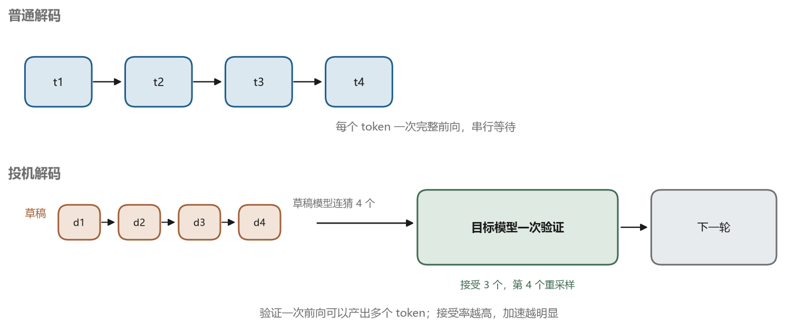

# 投机解码：用小模型换大模型的速度

大模型生成文字，是一个 token 一个 token 往外吐的。每吐一个 token，都要把整个模型跑一遍，读一遍全部权重，算一次注意力。GPU 的算力大部分时间在等显存，真正做乘加的时间很少。batch 小的时候，这种浪费尤其明显。

投机解码换了一个思路：先用一个小模型快速猜出后面几个 token，再让大模型一次性验证这几个猜测。猜对了就一次接受好几个，猜错了就退回去重来。大模型的前向次数没有增加，但每次前向能产出多个 token，解码速度就上去了。

这一章讲它为什么能成立、什么时候不work，以及部署时要注意什么。

## 解码为什么慢

自回归生成是串行的。第 `t` 个 token 依赖前 `t-1` 个 token，不能并行。每生成一个 token，GPU 要做一次完整的前向，读一遍权重和 KV cache，算一次矩阵乘。计算量不大，访存量很大，属于典型的带宽瓶颈。

提高 batch 能把权重读取摊薄，但单请求的延迟不会因此变好，反而可能更差。投机解码针对的是单请求延迟：在不增加大模型前向次数的前提下，让每次前向多产出几个 token。

## 草稿与验证

投机解码有两个模型。一个是**目标模型**，也就是原来那个大模型；一个是**草稿模型**，通常小得多，速度快，质量差一些。

流程是这样的。草稿模型先根据当前上下文，连续猜出 `k` 个 token，比如 4 个。目标模型把这 4 个 token 连同原上下文一起做一次前向，一次算出每个位置的概率分布。然后从第一个位置开始比较：如果目标模型也认为这个 token 是合理的，就接受；一旦某个位置的目标分布和草稿不一致，就从这个位置重新采样，后面的猜测全部丢掉。

一次验证最多能接受 `k+1` 个 token（`k` 个草稿加一个目标模型自己采的）。接受多少个，取决于草稿模型和目标模型的相似程度，也就是**接受率**。接受率越高，加速越明显。

投机采样（speculative sampling）有一个重要性质：只要在拒绝时按修正后的分布重新采样，最终输出的分布和目标模型单独采样完全一致。也就是说，它不改变模型的质量，只是换了一种采样方式。这一点和量化、剪枝不同，后者都会改变数值结果。

## Medusa、EAGLE 与树状验证

最早的投机解码需要一个独立的草稿模型，部署时要同时加载两个模型，显存和工程复杂度都上去了。后来的方法想办法把草稿“长”在目标模型上。

**Medusa** 在目标模型上加了几个额外的预测头，每个头预测未来第 1、2、3 个 token。这样不需要单独的草稿模型，只多了一点参数。多个头可以产生一棵候选树，目标模型用树状注意力一次验证多条路径。

**EAGLE** 用目标模型的隐藏特征作为草稿的输入，预测下一个特征而不是 token，再把特征映射成 token。它的接受率通常比独立小模型更高，因为草稿和目标共享了更多信息。

**Lookahead decoding** 不走草稿模型，而是用 Jacobi 迭代之类的办法同时生成多个候选，再用注意力验证。它的实现更复杂，适用面也窄一些。

这些方法的共同点是：用一次目标模型前向验证多个候选，把“串行”变成“并行验证”。候选越多，验证的注意力计算越重，所以候选树不能无限大，通常控制在几个到十几个。

## 什么时候有效

投机解码不是万能的，效果取决于四个条件。

**接受率**。草稿和目标越像，接受率越高。领域越专、输出越固定，接受率越高；开放对话、创意写作，接受率低。

**batch 大小**。batch 小的时候，解码是带宽瓶颈，投机解码的收益最大；batch 大的时候，GPU 已经被多个请求喂饱，验证多个候选反而增加计算，收益变小甚至为负。

**草稿成本**。草稿模型不能太贵，否则猜的代价超过了省的。独立小模型、额外预测头、特征草稿，成本依次不同。

**引擎支持**。投机解码需要引擎支持草稿模型、候选树、验证 kernel 和拒绝重采样。不是所有引擎都有，支持的引擎也不一定支持所有模型结构。

还有一个容易忽略的成本：草稿模型也要占显存。一个 1B 的草稿加一个 70B 的目标，显存预算要重新算。草稿模型的 KV cache 也要管理，虽然小，但不是零。

## 部署要点

第一，草稿和目标必须用同一个分词器。分词器不一致，token 对不上，验证无从谈起。

第二，接受率要监控。上线前用真实流量测，不要只用公开评测集。接受率下降，加速比会跟着下降，延迟会反弹。

第三，超时要按最坏情况设。投机解码的验证是一次前向，失败要重来，尾延迟可能比普通解码高。

第四，不是所有请求都值得投机。短输出、高并发、计算密集的场景，普通解码可能更稳。可以按请求类型路由，长输出、低并发走投机，短请求走普通路径。

投机解码代表了一类思路：不改模型、不改数值，只改生成的组织方式。下一章换一个维度，看模型大到一张卡放不下时，怎么把计算切到多张卡上。
