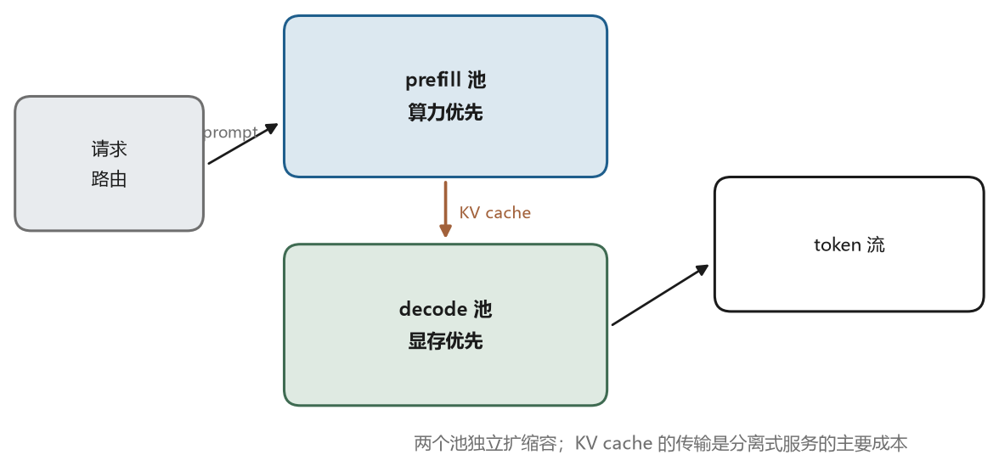

# 并行与分离：一张卡放不下之后

一个 70B 参数的模型，fp16 权重 140 GB，一张 80 GB 的卡装不下。即使量化到 int8，70 GB 也只是勉强放下权重，KV cache 和中间结果没有空间。要让这种模型跑起来，必须把计算切到多张卡上。

切法有几种。按层切、按矩阵切、按专家切、按请求阶段切。每一种切法的通信模式、适用场景和代价都不一样。这一章把这几种切法摊开，重点不是教你配多少卡，而是让你看懂一个多卡部署方案在切什么、瓶颈在哪里。

## 张量并行：把一层切开

张量并行（tensor parallelism，TP）切的是单个算子内部的矩阵。一个大的矩阵乘，把权重按列或按行切成几块，分到几张卡上，每张卡算一部分，再把结果拼起来。

以矩阵乘为例，权重按列切，每张卡拿到一部分输出通道，各自算出一部分结果，最后拼接。或者按行切，每张卡算一部分累加，最后做一次 all-reduce 把结果加起来。一层里通常有两次 all-reduce（注意力和 MLP 各一次），前向两次，反向再两次；推理只有前向。

TP 的通信量很大，每层都要同步。它要求卡之间有高速互联，比如 NVLink。走 PCIe 或普通以太网，通信会把收益吃光。所以 TP 通常限制在单机 8 卡以内，跨机很少用纯 TP。

TP 的好处是单层延迟低，因为一层的工作被分摊到多张卡上。坏处是通信频繁，卡越多，同步开销越大。TP 的并行度一般不超过 8，再大就得不偿失。

## 流水并行：把层切开

流水并行（pipeline parallelism，PP）切的是层。模型的前几层放在第一张卡，中间几层放第二张，最后几层放第三张。一张卡的输出传给下一张，像工厂的流水线。

朴素流水线的问题是气泡。第一张卡算的时候，后面的卡在等；最后一张卡算的时候，前面的卡在等。为了让所有卡都忙起来，要把一个 batch 切成多个 micro-batch，让它们在不同的流水段上重叠。气泡的比例大约是“段数减一”除以“micro-batch 数”，micro-batch 越多，气泡越小，但显存和调度复杂度也上去。

PP 的通信量比 TP 小，只在段与段之间传激活，适合跨机。它的问题是延迟，因为一个请求要穿过所有段才能出结果。PP 适合大模型、大 batch、追求吞吐的场景，不适合低延迟的单请求。

## 专家并行：MoE 的切法

混合专家模型（mixture of experts，MoE）把 FFN 拆成很多个专家，每个 token 只激活其中几个。专家多了，模型参数量可以做得很大，但每个 token 的计算量不变。

专家并行（expert parallelism，EP）把不同的专家放到不同的卡上。一个 token 经过路由器，选中几个专家，它的特征要被发送到对应专家所在的卡，算完再送回来。这是一次 all-to-all 通信，通信量和被选中的专家数量、token 数有关。

EP 的难点是负载均衡。路由器如果总把 token 发给少数几个专家，那几张卡就会过载，其他卡闲着。训练时通常加负载均衡损失，推理时靠路由策略和容量因子控制。EP 适合专家数量远大于单卡数量的 MoE 模型，跨机部署很常见。

## PD 分离：把预填充和解码分开

大模型推理有两个阶段。**prefill** 把整段输入 prompt 一次算完，计算密集，适合大 batch、高算力；**decode** 逐 token 生成，访存密集，适合小 batch、低延迟。两个阶段的资源需求相反，放在同一张卡上会互相干扰。

PD 分离（prefill-decode disaggregation）把两个阶段放到不同的机器池。prefill 池专门算 prompt，算完把 KV cache 传给 decode 池；decode 池专门生成 token，按自己的节奏调度。两个池可以独立扩缩容，prefill 用高算力卡，decode 用大显存卡。

KV cache 的传输是 PD 分离的核心成本。一个长 prompt 的 KV cache 可能有几 GB，要通过高速网络传过去。传得慢，decode 池就要等；传得快，网络成本又高。实际系统会用分层缓存、压缩、就近路由来减少传输。

PD 分离的代表工作有 DistServe、Splitwise、Mooncake 等。它们解决的问题不同，有的侧重调度，有的侧重 KV 传输，有的侧重缓存复用。共同点是：把“算 prompt”和“生成 token”当成两种不同的工作负载来对待。

## 并行的代价

多卡不是免费的。每加一种并行，就多一层通信、多一个故障域、多一套配置。

通信是第一位的。TP 每层 all-reduce，EP 每层 all-to-all，PP 每段传激活，PD 传 KV cache。任何一种通信慢了，整体都会被拖住。选并行方案之前，先看卡间互联的带宽和延迟。

负载均衡是第二位的。TP 要求每张卡算一样多的活，PP 要求每个段耗时接近，EP 要求专家负载均匀。任何一处不均，都会出现“一张卡忙死，其他卡闲着”的情况。

故障域是第三位的。卡越多，单卡故障的概率越高。一个 64 卡的任务，假设单卡每天故障概率是 1%，任务每天至少有 47% 的概率遇到一次故障。推理服务要有容错和重试，不能假设所有卡一直健康。

最后一件事是软件复杂度。并行策略要和模型结构、引擎、调度器配合。换一个模型，TP/PP/EP 的切法可能要重调。没有一套配置能通吃所有模型。

多卡解决的是“放不下”和“算得慢”的问题。下一章换一个角度，看一个服务怎么同时装下很多个模型，或者很多个微调版本。
