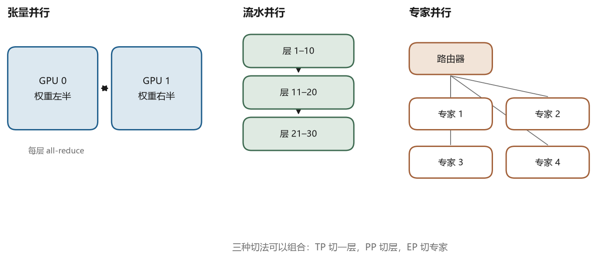

# 并行与分离：一张卡放不下之后

一个 70B 参数的模型，fp16 权重 140 GB，一张 80 GB 的卡装不下。即使量化到 int8，70 GB 也只是勉强放下权重，KV cache 和中间结果没有空间。要让这种模型跑起来，必须把计算切到多张卡上。

切法有几种。按层切、按矩阵切、按专家切、按请求阶段切。每一种切法的通信模式、适用场景和代价都不一样。这一章把这几种切法摊开，重点不是教你配多少卡，而是让你看懂一个多卡部署方案在切什么、瓶颈在哪里。

**并行**在这里指的是“把一个模型的活分给多个设备同时干”。一说并行就要问两个问题：切的是什么，切完之后要付多少通信成本。这两个问题回答清楚了，方案的好坏基本就定了。切得越细，单卡负载越轻，但通信越频繁；切得越粗，通信越少，但负载越不均衡。

## 张量并行：把一层切开

**张量并行**（tensor parallelism，TP）切的是单个算子内部的矩阵。一个大的矩阵乘，把权重按列或按行切成几块，分到几张卡上，每张卡算一部分，再把结果拼起来。

以矩阵乘为例，权重按列切，每张卡拿到一部分输出通道，各自算出一部分结果，最后拼接。或者按行切，每张卡算一部分累加，最后做一次 all-reduce 把结果加起来。**all-reduce** 是“所有卡把自己的部分加起来，再把总和发给所有卡”的集合通信操作，它的开销随卡数和数据量增长。一层里通常有两次 all-reduce（注意力和 MLP 各一次），前向两次，反向再两次；推理只有前向。

TP 解决什么问题？解决“单层的矩阵太大，一张卡放不下或者算不快”。一个 8192×8192 的权重矩阵，一张卡要读很久，切成 8 份，每张卡读一部分，时间短了，而且各卡的带宽是并行的。

怎么做？切矩阵有几个约定俗成的方式：按列切（每个卡持有部分输出维度，各自算出部分结果，最后拼接）或者按行切（每个卡持有部分输入维度，各自算出部分和，最后 all-reduce）。实际模型里通常交替使用，让通信次数最少。这个技巧叫“行列交替切分”，目的是让相邻两层的切法配合，少一次通信。

代价是什么？通信量很大，每层都要同步。它要求卡之间有高速互联，比如 NVLink。走 PCIe 或普通以太网，通信会把收益吃光。所以 TP 通常限制在单机 8 卡以内，跨机很少用纯 TP。

TP 的好处是单层延迟低，因为一层的工作被分摊到多张卡上。坏处是通信频繁，卡越多，同步开销越大。TP 的并行度一般不超过 8，再大就得不偿失。这个上限不是理论值，而是 NVLink 的带宽和延迟决定的：8 卡之内，一次 all-reduce 的延迟还能被计算掩盖；超过之后，同步就成了瓶颈。

什么时候不该用？如果你的模型单卡放得下、延迟也够，用 TP 只是白白增加通信和故障点。如果卡间只有 PCIe，TP 的收益会大打折扣，此时不如考虑流水并行。最后一个判断依据是张量形状：如果每张卡分到的矩阵块小得喂不饱 Tensor Core，TP 就只是在增加开销。

## 流水并行：把层切开

**流水并行**（pipeline parallelism，PP）切的是层。模型的前几层放在第一张卡，中间几层放第二张，最后几层放第三张。一张卡的输出传给下一张，像工厂的流水线。

朴素流水线的问题是气泡。第一张卡算的时候，后面的卡在等；最后一张卡算的时候，前面的卡在等。为了让所有卡都忙起来，要把一个 batch 切成多个 micro-batch，让它们在不同的流水段上重叠。**气泡**（bubble）指的就是 GPU 空转的那段时间。气泡的比例大约是“段数减一”除以“micro-batch 数”，micro-batch 越多，气泡越小，但显存和调度复杂度也上去。

用数字感受一下。4 段流水、4 个 micro-batch，气泡比例大约是 3/4，也就是四分之三的时间在空转，非常糟糕；把 micro-batch 加到 16，气泡降到 3/16，接近两成，可以接受。所以在 PP 里，micro-batch 的数量是一个关键参数，它直接决定了你会浪费多少算力。

PP 解决什么问题？解决“模型层数太多，一张卡放不下所有层”的问题。它切的是层，每层的权重只存在一张卡上，所以显存压力被均摊，而且通信只发生在段与段之间，量很小。

代价是什么？延迟和气泡。一个请求要穿过所有段才能出结果，所以单请求延迟会增加；气泡则是为了填满流水线而付出的代价。PP 适合大模型、大 batch、追求吞吐的场景，不适合低延迟的单请求。

什么时候不该用？如果 batch 很小（比如在线单请求），micro-batch 数量上不去，气泡会吃掉大部分收益。这也是流水并行在交互式服务里用得少的原因：它的甜点场景是离线批处理和大规模生成。所以 PP 很少单独使用，通常和 TP 分层组合：段内用 TP，段间用 PP，两边各取所长。这时候要么用 TP，让每段的计算量足够大。另一个替代方案是交错流水（interleaved pipeline），把模型切成更多小段后交叉放回各卡，让每张卡手里都有好几段，气泡能小很多，代价是通信变多。交错流水在文献里效果很好，但实现复杂，不是所有引擎都支持，选之前先确认工具链。

## 专家并行：MoE 的切法

**混合专家模型**（mixture of experts，MoE）把 FFN 拆成很多个专家（Fedus 等，2021），每个 token 只激活其中几个。专家多了，模型参数量可以做得很大，但每个 token 的计算量不变。**专家**就是一组独立的小 FFN，路由器决定每个 token 走哪几个。

**专家并行**（expert parallelism，EP）把不同的专家放到不同的卡上。一个 token 经过路由器，选中几个专家，它的特征要被发送到对应专家所在的卡，算完再送回来。这是一次 all-to-all 通信，通信量和被选中的专家数量、token 数有关。**all-to-all** 是“每个卡都把自己的数据分发给所有其他卡”的通信模式，比 all-reduce 更复杂，对网络的要求也更高。

EP 解决什么问题？解决“参数量太大、但单 token 计算量可控”的矛盾。MoE 的聪明之处在于，它的参数量可以极大，但每个 token 只碰其中一小部分，所以单 token 的计算成本不会暴涨。EP 让这些专家分布到多张卡上，从而在有限显存里装下巨大的参数量。换句话说，MoE 换的是“宽的模型”，而不是“深的模型”。这个区别很重要：深的模型可以靠 PP 切开，宽的模型只能靠 EP 切开。选并行方案时，先看一眼模型是深还是宽。

代价是什么？负载均衡和通信。路由器如果总把 token 发给少数几个专家，那几张卡就会过载，其他卡闲着。训练时通常加负载均衡损失，推理时靠路由策略和容量因子控制。**容量因子**是每个专家最多接多少 token 的上限，超出的 token 会被丢弃或转到别的专家。

什么时候不该用？如果模型的专家数不多，或者流量很小，EP 的通信开销和复杂度不划算。专家数少的时候，一张卡放得下几个专家，all-to-all 就变成了卡间来回拷数据，几乎没有收益。另外，如果业务对输出稳定性要求极高，MoE 的路由会带来额外的不确定性，某些 token 被分到不同专家，输出可能不一致。这个差异通常是可接受的，但在敏感业务里要专门评估。

## PD 分离：把预填充和解码分开

大模型推理有两个阶段。**prefill** 把整段输入 prompt 一次算完，计算密集，适合大 batch、高算力；**decode** 逐 token 生成，访存密集，适合小 batch、低延迟。两个阶段的资源需求相反，放在同一张卡上会互相干扰。

这种干扰有多严重？一个长 prompt 的 prefill 可能占住 GPU 几百毫秒，期间所有 decode 请求都停下来，用户感觉输出“卡住了一下”。反过来，decode 请求多的时候，prefill 排队，新用户的首字延迟变长。两类请求互相拖累，谁都不满意。

**PD 分离**（prefill-decode disaggregation）把两个阶段放到不同的机器池。prefill 池专门算 prompt，算完把 KV cache 传给 decode 池；decode 池专门生成 token，按自己的节奏调度。两个池可以独立扩缩容，prefill 用高算力卡，decode 用大显存卡。

它解决什么问题？解决“两种负载互相干扰”和“资源无法按需配置”两个问题。分开之后，每个池都按自己的瓶颈优化：prefill 池追求算力和高利用率，decode 池追求低延迟和显存容量。

怎么做？关键在 KV cache 的传输。prefill 算完的 KV cache 要通过高速网络传给 decode 池，传输的时机、格式、压缩都要设计。一个长 prompt 的 KV cache 可能有几 GB，传得慢，decode 池就要等；传得快，网络成本又高。实际系统会用分层缓存、压缩、就近路由来减少传输。

代价是什么？网络和复杂度。多了一次跨机传输，多了一套调度逻辑，多了一个失败点。如果 KV cache 传输失败，整个请求就白算了。另外，两个池的容量配比需要调：prefill 池太小，首字延迟长；decode 池太小，生成速度上不去。

什么时候不该用？如果流量小、prompt 短、模型不大，分离带来的复杂度远大于收益。单池就能满足 SLO 的时候，不必为了“先进架构”而上分离。而且分离之后，监控也变复杂：一个请求的耗时分布在两个池里，只看单池指标无法判断整体体验。

PD 分离的代表工作有 DistServe、Splitwise、Mooncake 等（Zhong 等，2024；Patel 等，2023；Qin 等，2024）。它们解决的问题不同，有的侧重调度，有的侧重 KV 传输，有的侧重缓存复用。共同点是：把“算 prompt”和“生成 token”当成两种不同的工作负载来对待。

## 并行的代价

多卡不是免费的。每加一种并行，就多一层通信、多一个故障域、多一套配置。

通信是第一位的。TP 每层 all-reduce，EP 每层 all-to-all，PP 每段传激活，PD 传 KV cache。任何一种通信慢了，整体都会被拖住。选并行方案之前，先看卡间互联的带宽和延迟。一个实用的判断是：如果一次通信的时间和一次计算的时间接近，这个并行就不划算。

负载均衡是第二位的。TP 要求每张卡算一样多的活，PP 要求每个段耗时接近，EP 要求专家负载均匀。任何一处不均，都会出现“一张卡忙死，其他卡闲着”的情况。PP 的段划分尤其需要小心：按层数平均分不等于按计算量平均分，因为不同层（比如注意力和 FFN）的耗时并不一样。

故障域是第三位的。卡越多，单卡故障的概率越高。一个 64 卡的任务，假设单卡每天故障概率是 1%，任务每天至少有 47% 的概率遇到一次故障。算法很直接：0.99 的 64 次方约等于 0.53，也就是有一半概率全部正常，另一半概率至少坏一张。推理服务要有容错和重试，不能假设所有卡一直健康。

最后一件事是软件复杂度。并行策略要和模型结构、引擎、调度器配合。换一个模型，TP/PP/EP 的切法可能要重调。没有一套配置能通吃所有模型。很多团队的实际情况是：并行配置写在一个配置文件里，每次换模型都要重新调，调好之后不敢动，因为没人记得当初为什么这么配。

还有一个容易被忽略的代价是“规模不经济”。并行度越高，通信占比越大，单位算力的有效利用率越低。两张卡跑出 1.8 倍，四张卡可能只有 3 倍，八张卡也许只有 5 倍（这几个数字只是示意，实际情况因模型和互联而异）。这条曲线在选配置时必须心里有数，否则容易做出“加卡反而更贵”的决定。把这个曲线实测出来，比任何理论分析都有用，因为它包含了你的模型形状、互联带宽和调度的所有细节。

多卡解决的是“放不下”和“算得慢”的问题。下一章换一个角度，看一个服务怎么同时装下很多个模型，或者很多个微调版本。
