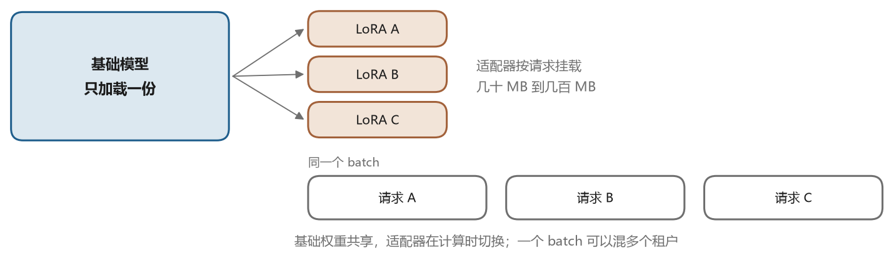

# 多模型与多 LoRA：一个服务装下很多个版本

一个平台有二十个客户，每个客户都想要自己的写作风格。最直接的做法是训练二十个模型，每个模型一份权重。70B 的模型 fp16 是 140 GB，二十份就是 2.8 TB，机房放不下，成本也受不了。

实际做法通常是一个基础模型加二十个 LoRA 适配器。基础模型只加载一份，每个客户挂一个很小的适配器，切换成本从“换整个模型”降到“换几十 MB 的参数”。这一章讲这种多模型服务怎么组织，以及它带来的新问题。

先分清两个概念。**基础模型**（base model）是那个通用的大模型，权重不变，所有客户共享；**适配器**（adapter）是那个小的增量补丁，每个客户一份，决定“说什么风格、做什么任务”。这种结构与前面的低秩分解形式相似，但目的完全不同：一个是压缩存储，一个是表达差异。

## LoRA 是什么

**LoRA**（low-rank adaptation，低秩适配）是一种微调方法。它冻结基础模型的权重，在部分层旁边加两个小矩阵，用低秩的方式学习增量。基础权重不动，只训练这两个小矩阵。

为什么这样能work？因为微调要学的不是“通用能力”，而是“从通用能力到特定任务的那一点偏移”。偏移的信息量远小于从零学一遍通用能力，所以一个低秩的增量就够表达。这个假设在大量实践中成立，也是 LoRA 能成为主流微调方法的原因。反过来说，如果一个任务的“偏移”很大（比如把中文模型变成法文模型），低秩就不够用了。

推理时，LoRA 的增量可以合并进基础权重，变成一个新的完整权重；也可以不合并，在计算时动态加上去。合并之后没有额外延迟，但一个基础模型只能对应一个合并后的版本；不合并可以随时切换，代价是每次计算多一次低秩乘法。

**合并**（merge）就是把 `BA` 加到 `W` 上，得到一个等效的新权重。它的好处是推理路径干净，坏处是失去了“按请求切换”的能力。**不合并**则相反，灵活，但每次前向都要多算一次小矩阵乘，还要多读一次适配器权重。

LoRA 的参数量很小，通常只有基础模型的千分之一到百分之一。一个 70B 模型的 LoRA 可能只有几百 MB，甚至几十 MB。它适合“同一个基础模型、很多个定制版本”的场景，比如不同客户、不同语言、不同任务。这个场景在 SaaS 产品里很普遍：同一个底座，每家企业要一点自己的语气和术语，完全不需要各自维护一个大模型。

它解决什么问题？解决“版本多、每个版本流量小”的成本问题。如果每个版本都要一整份权重，显存和加载时间都不允许；用适配器，一份基础权重就能撑起很多版本。

什么时候不该用？如果只有一个版本、流量很大，直接合并 LoRA 或者全量微调更简单，推理路径也更快。如果版本之间差异很大，LoRA 的低秩假设不成立，效果会明显不如全量微调。

## 多 LoRA 服务

多 LoRA 服务的核心是共享基础权重，按请求挂不同的适配器。

一个请求进来，带上租户 ID 或适配器 ID。调度器把请求和对应的 LoRA 一起送进 batch。同一个 batch 里可能有多个不同的 LoRA，kernel 要能在计算时按请求切换适配器，或者把同一适配器的请求放在一起算。**租户**（tenant）在这里指一个独立的客户，有自己的数据、配额和配置。

**S-LoRA** 和 **Punica** 是这类系统的代表（Sheng 等，2023；Chen 等，2023）。它们把 LoRA 权重放在显存或主机内存里，按需加载，用一个统一的 kernel 处理不同适配器的 batch。vLLM 也支持多 LoRA，把适配器当成一种可缓存的资源。

多 LoRA 的难点在三点。

第一，适配器缓存的容量。适配器多了，显存放不下，要换入换出。换入换出有延迟，热门适配器要常驻，冷门的按需加载。**适配器缓存**的设计和操作系统的内存缓存是同一个问题：容量有限，要决定谁留下、谁换出。

第二，batch 内的异构。不同适配器的秩可能不同，权重形状不一样，kernel 要能处理这种不规则。秩统一的系统简单，秩异构的系统灵活但慢。**秩**（rank）在这里指 LoRA 矩阵的宽度，秩越大，参数越多，表达力越强。

第三，公平性。一个大租户的流量可能占满 batch，小租户的请求排队。调度器要按租户配额或者权重分配，不能只看先来后到。公平性问题在业务上很敏感：一个小客户如果总是排队，他很快就会去别家。

代价是什么？复杂度从训练转移到了服务。训练阶段，每个客户训一个 LoRA 不算难；服务阶段，你要管理适配器的加载、缓存、切换、隔离、配额，工作量可能比训练本身还大。

什么时候不该用？如果适配器数量很少（比如三五个），每个都常驻显存，直接合并 LoRA 更简单。如果适配器很大（接近基础模型的十分之一），缓存的收益就不明显了。还有一种极端情况：每个适配器只有几十个请求，缓存永不命中，反而不如专用小模型。

## 模型路由与级联

多模型不只是“同一个模型的多版本”，也可能是“不同大小的模型”。一个平台可以同时部署小模型、中模型、大模型，按请求的难度路由。

**路由**是根据请求的特征选模型。简单问题走小模型，复杂问题走大模型。路由可以基于规则，比如按输入长度、任务类型；也可以基于模型，比如用一个小分类器判断难度。

**级联**（cascade）是先走小模型，小模型置信度不够再升级到大模型。级联能省成本，因为大多数请求在小模型就解决了；代价是延迟，因为升级要多走一次。级联的关键是置信度估计，估不准就会出现“该升级的没升级，不该升级的升级了”。

路由和级联都需要一个反馈信号。线上的点击、采纳、人工审核，都可以用来判断小模型的输出够不够好。没有反馈，路由只能靠离线评测，效果会漂。**漂**的意思是，随着流量和内容变化，原本准确的判断慢慢失准，而没有人察觉。

它们解决什么问题？解决“平均成本”和“最差体验”的矛盾。全部用大模型，成本高；全部用小模型，难题目答不好。路由和级联让大多数请求走便宜路径，少数难题走昂贵路径，平均成本降下来，最差体验还能接受。

代价是什么？路由本身有成本（分类器要跑），级联有延迟（多一次往返），而且两者的效果依赖判断准确率。如果判断准确率只有七成，省下的成本可能被答错带来的损失抵消。

什么时候不该用？如果请求难度很均匀（要么都简单，要么都难），路由没有意义。均匀难度下，小模型答不好时大模型也得答，路由器只是个额外开销。另一个限制是模型数量：同时维护三个模型已经是团队上限，再多就很难保证每个都有足够的调优和监控。如果业务对一致性要求极高（同样的输入必须得到同样的回答），路由会引入不确定性，因为同一个请求可能被分到不同模型。一个实用的折中是只对“无状态、低风险”的请求做路由，对高风险请求固定走大模型。

## 多租户与版本

多模型服务通常也是多租户服务。每个租户有自己的模型版本、适配器、配额和数据。

隔离要做在几个层面。显存上，适配器和 KV cache 要按租户隔离，不能互相挤占；调度上，要按配额分配 batch 名额；数据上，prompt 和输出不能串租户；版本上，每个租户的适配器要能独立升级和回滚。

**配额**（quota）是每个租户能用多少资源的硬约束，通常按 QPS、token 数或并发数计。没有配额，一个大客户就能把整个池子占满，其他客户全部排队。配额设计要留余量，因为流量是波动的，卡得太死会让正常业务也受影响。

版本管理比单模型复杂。基础模型升级，所有适配器都要重新验证；适配器升级，只影响对应租户。上线时要能按租户灰度，出问题只回滚一个租户，不影响其他人。

这里有一个具体的麻烦：基础模型升级时，老适配器可能不再兼容。LoRA 是挂在特定层上的，如果基础模型的层结构变了，适配器就对不上。所以基础模型升级不是“换个权重”那么简单，往往要重新训练所有适配器。这个成本在规划时要算进去，否则会出现“基础模型升了，二十个客户全部要重训”的局面。一个缓解办法是尽量不改动层结构，只升级权重和训练数据，这样适配器的兼容性能保住一部分。

数据隔离还需要格外小心。同一个 batch 里混着不同租户的请求，如果模型把别人的前文当成了自己的上下文，就会造成数据泄露。这不是模型“有意”泄露，而是实现细节没守住边界：比如前缀缓存按内容哈希共享，而哈希碰巧撞了，或者调度器把 KV 块复用时引用计数算错。这类问题很难重现，更难察觉，所以要做两类审计：一类是自动化的隔离测试，一类是输出日志的抽样检查。隔离测试可以用“带标记的假请求”验证：每个租户的专门标记不应出现在其他租户的输出里。

## 什么时候值得

多 LoRA 适合“基础模型相同、定制版本很多、每个版本流量不大”的场景。如果只有一个版本、流量很大，直接合并 LoRA 或者全量微调更简单。如果版本之间差异很大，LoRA 的表达能力不够，还是要单独训练模型。这不是妥协，而是 LoRA 本身的容量限制。

判断标准是“共享的部分有多大”。共享得多，LoRA 省得多；共享得少，LoRA 只是把复杂度从训练挪到了服务。

可以用三个数字做粗略判断：适配器数量、单适配器大小、单适配器 QPS。数量多、单个小、QPS 低，这是 LoRA 的甜点；数量多但 QPS 也高，就要考虑把热门适配器合并成独立模型；数量少，直接用独立模型更省心。

还要看一个指标：适配器切换的频率。如果每个请求的适配器都不一样，batch 内全是异构，kernel 效率会明显下降；如果流量集中在少数几个热门适配器上，批处理会舒服很多。还有一条不那么技术但很重要的判断：团队是否具备“服务化”的能力。多 LoRA 不是配置一下就能跑，它需要缓存管理、租户隔离、灰度发布、监控分桶。没有这些基础设施，多 LoRA 会变成一个持续消耗人力的项目，而不是一个一次投入的工程。

另一个容易被忽略的成本是“验证”。每个适配器上线前都要跑一遍评测，二十个适配器就是二十份工作量。如果每个版本还要灰度、看指标、回滚，人力投入会远超最初预期。所以多 LoRA 的决策里，一定要把“每个租户要占多少运营资源”算进去。两个信号值得警惕：一是“适配器数量 × 单次验证成本”超过了一个人月的投入，方案就该重新算账；二是如果只有一个客户的流量占了大半，把这个客户单独拆出去反而更划算。这两个信号不需要精确计算，粗估一下就能判断方向。

下一章看不只是模型数量多，输入本身也变长了：长上下文和多模态，会把显存和预填充成本推到另一个量级。
