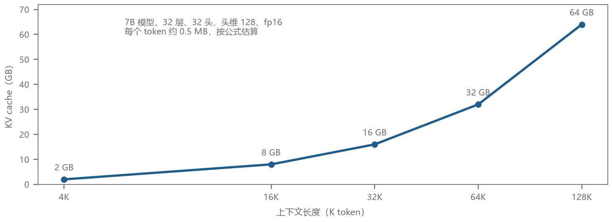

# 长上下文与多模态：输入变长之后

一个 128K 上下文的请求，7B 模型，32 层、32 头、头维 128，fp16 下 KV cache 大约是 64 GB。一张 80 GB 的卡，权重占 14 GB，剩下的空间只够放这一个请求，并发降到 1。如果再加一张图片，图片被切成几百个 token，prefill 的计算量又上去一截。

长上下文和多模态不是“把输入接长一点”那么简单。它们改变了显存、计算和调度的平衡，也改变了服务的设计。这一章把这两类负载放在一起看，因为它们经常同时出现：一个能看图的模型，往往也要能处理长文档。

## 长上下文的账

KV cache 随序列长度线性增长，注意力计算随长度平方增长。长度翻倍，显存翻倍，计算量翻四倍。128K 上下文，显存是 4K 上下文的 32 倍，计算量是 1024 倍。

prefill 阶段要把整段输入一次算完，计算量集中在注意力矩阵上。decode 阶段每个 token 都要读一遍全部 KV cache，带宽压力大。长上下文把两个阶段都推到了极限：prefill 算得久，decode 读得多。

## 让注意力看到更远

标准注意力的长度受限于训练时的位置编码和显存。要处理更长的输入，有几条路。

**位置插值**把训练时的位置范围拉伸到更长的范围，比如把 4K 的模型扩展到 32K。简单，但长距离的位置分辨率会下降。**YaRN** 之类的改进方法对不同频率的维度做不同的缩放，效果更好，但仍需要少量微调。

**RingAttention** 把长序列切成块（Liu 等，2023），分到多张卡上，每张卡算一块的注意力，块之间用环形通信交换 K/V。它把显存压力分散到多卡，代价是通信。**上下文并行**是同一类思路，把序列维切开。

**滑动窗口加全局 token** 只保留最近一段的 KV，再加几个全局 token 记住开头。**StreamingLLM** 发现保留开头的几个“注意力汇” token（Xiao 等，2023），能让模型在流式输入下保持稳定。这些方法能处理无限长的流，但会丢失中间部分的细节。

**检索增强**是另一条路。不把整本书塞进上下文，而是先检索相关段落，再送给模型。它把长上下文的问题转成检索质量问题，成本和延迟都低得多，但依赖检索的召回。

## 多模态的输入

图片、视频、音频进入模型之前，要先变成 token。

图片通常用一个视觉编码器（ViT 之类）切成 patch，每个 patch 变成一个 token。一张 1024×1024 的图，可能产生几百到几千个 token。分辨率越高、切得越细，token 越多，prefill 越贵。

视频是帧的序列。每秒抽几帧、每帧多少 token，决定了总 token 数。一个 10 秒的视频，可能产生几万个 token，比一段长文本还长。

音频用音频编码器变成特征序列，token 数取决于采样率和帧率。

多模态模型的部署通常分成两段：编码器在 GPU 上跑，把图片/视频变成 token；语言模型接在后面，做 prefill 和 decode。编码器可以是独立的服务，也可以是同一个进程里的一个阶段。分开的好处是编码器可以独立扩缩容，坏处是中间结果要传输。

## 部署影响

长上下文和多模态对服务的影响，主要在四个地方。

**显存**。KV cache 按长度线性增长，并发数要按最长请求算，不能按平均长度算。一个 128K 的请求进来，可能把整个池子的显存占满。调度器要限制单请求的最大长度，或者按长度分池。

**prefill 成本**。长 prompt 的 prefill 可能占掉几秒甚至几十秒的 GPU 时间。chunked prefill 把长 prompt 切成块，和 decode 交错执行，避免一个请求堵住所有人。分池、优先级、超时都要按 prefill 成本设计。

**缓存**。长上下文的前缀重复率高，系统提示、文档、多轮对话的历史，都可以做前缀缓存。缓存命中能省掉大量 prefill，是长上下文服务最重要的优化之一。

**SLO**。长上下文的 TTFT 和 TPOT 与短请求完全不同，不能用同一套 SLO。按请求长度分档，分别设目标，才能既保证体验又不浪费算力。

长上下文和多模态让“输入”变成了服务里最不可控的变量。下一章看另一类负载：模型不只要回答问题，还要推理、调用工具、按格式输出。
