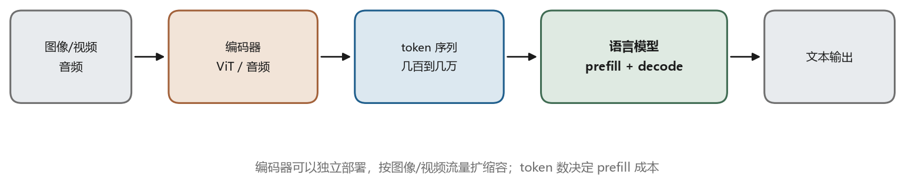

# 长上下文与多模态：输入变长之后

一个 128K 上下文的请求，7B 模型，32 层、32 头、头维 128，fp16 下 KV cache 大约是 64 GB。一张 80 GB 的卡，权重占 14 GB，剩下的空间只够放这一个请求，并发降到 1。如果再加一张图片，图片被切成几百个 token，prefill 的计算量又上去一截。

长上下文和多模态不是“把输入接长一点”那么简单。它们改变了显存、计算和调度的平衡，也改变了服务的设计。这一章把这两类负载放在一起看，因为它们经常同时出现：一个能看图的模型，往往也要能处理长文档。

先把两个词说清楚。**长上下文**（long context）指一次输入很长的文本，比如几万到几十万 token；**多模态**（multimodal）指输入不只有文字，还有图片、音频、视频。两者的共同点是“输入带来了远超从前的信息量”，而这正是服务里最不可控的变量。

## 长上下文的账

KV cache 随序列长度线性增长，注意力计算随长度平方增长。长度翻倍，显存翻倍，计算量翻四倍。128K 上下文，显存是 4K 上下文的 32 倍，注意力的计算量是 1024 倍。

为什么注意力是平方的？因为每个 token 都要和其他所有 token 算一次相关性，n 个 token 就是 n 乘 n 次。文本变长，两两配对的组合数按平方涨。而前馈层（FFN）的计算量是线性的，所以序列越长，注意力在总耗时里的占比越高。短上下文时，FFN 占比高；长上下文时，注意力反超。这也是长上下文最本质的困难：它不是“多一点数据”，而是“多很多计算”。一个常见的误解是“显存够大就能跑长上下文”，实际上计算和带宽会先撞墙。

prefill 阶段要把整段输入一次算完，计算量集中在注意力矩阵上。decode 阶段每个 token 都要读一遍全部 KV cache，带宽压力大。长上下文把两个阶段都推到了极限：prefill 算得久，decode 读得多。

它解决什么问题？解决“一次要处理很长的信息”的需求，比如读完整本合同、分析整个代码仓库、跟用户进行长时间的多轮对话。没有长上下文，这些任务只能靠切分和检索，效果和体验都打折扣。

代价是什么？显存、算力、延迟三样一起涨。一个 128K 的请求，prefill 可能要几秒到几十秒，这段时间里 GPU 被一个请求占住，其他请求都在等。并发也被显存卡死，一个长请求就能吃掉整张卡。实际上很多长上下文服务的并发数在个位数，这不是技术不够，而是资源的物理限制。

什么时候不该用？如果任务其实只需要文档的一小部分，长上下文是浪费。检索增强（先找相关段落再送进模型）能覆盖大部分“读文档”的需求，成本低一个数量级。长上下文应该留给那些“确实需要通读全局”的任务，比如总结全文、找跨章节的矛盾。这个判断标准很有用：如果任务只需要“读到少数几段”就能完成，就不需要长上下文。

## 让注意力看到更远

标准注意力的长度受限于训练时的位置编码和显存。要处理更长的输入，有几条路。

**位置插值**（position interpolation）把训练时的位置范围拉伸到更长的范围，比如把 4K 的模型扩展到 32K。简单，但长距离的位置分辨率会下降。**位置编码**是告诉模型“每个 token 排在第几位”的信息，拉伸之后，相邻位置的差别变小，模型分辨远近的能力下降。

**YaRN** 之类的改进方法对不同频率的维度做不同的缩放，效果更好，但仍需要少量微调。它的思路是：低频维度负责长距离，高频维度负责短距离，两者不该用同一种拉伸方式。这个改进不需要重新训练，只需要少量微调数据，是扩展上下文最常用的手段之一。

**RingAttention** 把长序列切成块（Liu 等，2023），分到多张卡上，每张卡算一块的注意力，块之间用环形通信交换 K/V。它把显存压力分散到多卡，代价是通信。**环形通信**指的是卡与卡首尾相连，一块数据依次传一圈，适合规则的大块传输。

**上下文并行**是同一类思路，把序列维切开。它和 RingAttention 的区别主要在实现细节：怎么切、怎么同步、怎么处理因果掩码。**因果掩码**是“每个位置只能看前面的位置”这个约束，切块之后要小心处理块边界。

**滑动窗口加全局 token** 只保留最近一段的 KV，再加几个全局 token 记住开头。**StreamingLLM** 发现保留开头的几个“注意力汇” token（Xiao 等，2023），能让模型在流式输入下保持稳定。**注意力汇**（attention sink）指的是模型习惯把一部分注意力放在开头几个 token 上，哪怕它们内容不重要；保留这几个 token，模型的分布就不会崩。

**检索增强**是另一条路。不把整本书塞进上下文，而是先检索相关段落，再送给模型。它把长上下文的问题转成检索质量问题，成本和延迟都低得多，但依赖检索的召回。

这几条路解决的是不同层面的问题。位置插值解决“模型没见过这么长”，RingAttention 解决“一张卡放不下”，滑动窗口解决“无限流式输入”，检索增强解决“其实不需要全文”。选哪条，取决于你的瓶颈在哪。

代价也要分开看。位置插值几乎无成本，但长距离精度会降；RingAttention 要更多卡和更快的互联；滑动窗口会丢中间信息；检索增强依赖一个额外的检索系统，且召回不好时效果反而更差。

什么时候不该用？如果任务要求“精确回忆中间某一段”，滑动窗口和固定状态都会失败。如果业务对延迟极敏感，RingAttention 的跨卡通信可能让首字延迟变长。如果检索系统本身不稳定，检索增强会把不确定性带进主链路。

## 多模态的输入

图片、视频、音频进入模型之前，要先变成 token。

图片通常用一个视觉编码器（ViT 之类）切成 patch，每个 patch 变成一个 token。**ViT** 是视觉 Transformer，把图片切成小块后按文本的方式处理；**patch** 就是那些小块。一张 1024×1024 的图，可能产生几百到几千个 token。分辨率越高、切得越细，token 越多，prefill 越贵。

视频是帧的序列。每秒抽几帧、每帧多少 token，决定了总 token 数。一个 10 秒的视频，可能产生几万个 token，比一段长文本还长。所以视频理解的第一道优化往往是“抽帧策略”：抽得少，信息丢；抽得多，成本爆炸。

音频用音频编码器变成特征序列，token 数取决于采样率和帧率。语音的 token 密度比文本高得多，一分钟语音可能是几千个 token，和一个中篇文档相当。

多模态模型的部署通常分成两段：编码器在 GPU 上跑，把图片/视频变成 token；语言模型接在后面，做 prefill 和 decode。编码器可以是独立的服务，也可以是同一个进程里的一个阶段。分开的好处是编码器可以独立扩缩容，坏处是中间结果要传输。

**编码器**（encoder）是把原始信号变成向量的那部分网络，它和语言模型的计算模式不同：编码器是一次性的大计算，语言模型是长序列的逐步生成。两者的资源画像不一样，混在一起会让调度变复杂。

代价是什么？token 数暴涨、显存压力、链路变长。一张高分辨率图片可能抵得上几千字文本，一个视频可能抵得上一本书。而且多模态请求的 token 数方差极大，短的几百、长的几万，调度器很难做均匀的批处理。

什么时候不该用？如果任务只需要“图片里有没有某个物体”，用一个小分类模型就够了，不必上多模态大模型。多模态大模型的价值在于“理解和推理”，不在于“识别”。还有一个反过来的判断：如果你的业务已经在做图像分类、目标检测这类任务，用专门的视觉模型通常比多模态大模型更便宜也更准。

## 部署影响

长上下文和多模态对服务的影响，主要在四个地方。

**显存**。KV cache 按长度线性增长，并发数要按最长请求算，不能按平均长度算。一个 128K 的请求进来，可能把整个池子的显存占满。调度器要限制单请求的最大长度，或者按长度分池。**按长度分池**是常见做法：短请求池和长请求池分开，各自按自己的分布调优，避免一个长请求把短请求挤死。

**prefill 成本**。长 prompt 的 prefill 可能占掉几秒甚至几十秒的 GPU 时间。chunked prefill 把长 prompt 切成块，和 decode 交错执行，避免一个请求堵住所有人。分池、优先级、超时都要按 prefill 成本设计。一个实用的规则是给 prefill 设一个“最长占用时间”，超过就切块，保证 decode 请求能穿插进来。

**缓存**。长上下文的前缀重复率高，系统提示、文档、多轮对话的历史，都可以做前缀缓存。缓存命中能省掉大量 prefill，是长上下文服务最重要的优化之一。一个文档问答系统，如果用户都在问同一份文档，前缀缓存能把首字延迟从几秒降到几百毫秒。

**SLO**。长上下文的 TTFT 和 TPOT 与短请求完全不同，不能用同一套 SLO。按请求长度分档，分别设目标，才能既保证体验又不浪费算力。一个常见的错误是给所有请求设同一个 TTFT 目标，结果长请求永远超标，团队被迫扩容，而短请求的容量被浪费。

还有一个容易被忽略的成本：长上下文让**故障影响面变大**。一个长请求占用 GPU 十几秒，如果它中途出错重试，这十几秒就白费了，重试又要十几秒。所以长请求要做断点或分段处理，不能“失败就从零开始”。另一个相关问题是重试的代价：一个长请求到了 decode 阶段才失败，重试意味着整个 prefill 重跑。

长上下文和多模态让“输入”变成了服务里最不可控的变量。应对的核心思路是分层：按长度分池、按类型分路、按阶段分资源。把这些分清楚，长请求就不会把整个系统拖垮。

下一章看另一类负载：模型不只要回答问题，还要推理、调用工具、按格式输出。
