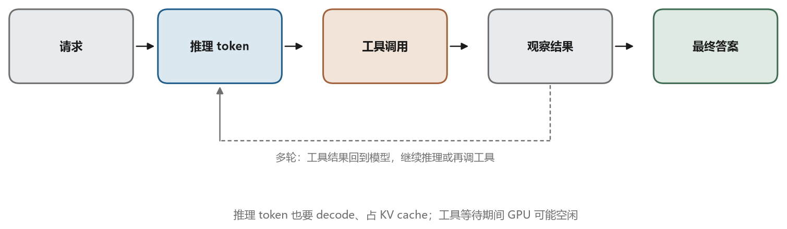

# 推理模型、Agent 与结构化输出

一个用户问“帮我分析这份财报，给出投资建议”。模型没有立刻回答，而是先写了 2000 个 token 的推理过程，再给出结论。另一个请求让模型查天气、订机票、发邮件，模型调了三个工具，每一步都要等工具返回。还有一个请求要求输出严格的 JSON，字段少一个，下游系统就解析失败。

这三类请求和“输入一段话、输出一段话”完全不同。它们把推理时间拉长，把一次请求变成多次交互，把输出变成有结构约束的东西。部署系统要跟着变。

## 测试时计算

推理模型（reasoning model）在回答之前会生成一段内部推理，也就是常说的思维链。这段推理也是 token，也要经过 decode，也要占 KV cache。一个 2000 token 的推理过程，成本可能是一次普通回答的几十倍。

测试时计算（test-time compute）的核心是：用更多的推理时间换更好的答案。它把成本从训练挪到推理，对部署的影响是 decode 时间变长、KV cache 变大、单请求的 GPU 占用时间变长。

为了控制成本，系统通常设一个推理预算，比如最多生成 4000 个 token。预算到了就强制收尾。也有系统并行采多条推理路径，再选最好的一条，这叫 best-of-n。并行能提高质量，但 GPU 成本也按倍数上涨。

对服务来说，推理模型的调度和普通模型不同。TTFT 可能很长，因为第一个可见 token 要等推理结束；TPOT 反而没那么重要，因为用户看不到中间过程。超时要按推理预算设，不能按普通请求设。

## Agent 服务

Agent 是把模型放进一个循环：模型决定下一步做什么，调用工具，拿到结果，再决定下一步。一个请求可能包含多轮模型调用和多次工具调用，持续时间从几秒到几分钟。

Agent 服务要处理几件事。

**状态**。多轮对话的历史、工具调用的结果、中间文件，都要保存。状态可以放在上下文里，也可以放在外部存储里。放在上下文里简单，但会撑大 KV cache；放在外部存储里省显存，但每次要重新拼 prompt。

**工具调用**。模型输出一个工具调用请求，服务去执行，再把结果送回模型。工具可能是搜索、数据库、代码执行、浏览器。每次调用都有延迟和失败概率，服务要处理超时、重试、降级。

**编排**。一个 Agent 可能调用多个子 Agent，或者把任务拆成多个步骤。编排层要管理依赖、并发、取消和预算。编排做得好，延迟低；做得不好，一个慢工具拖住整个请求。

**安全**。Agent 能执行代码、访问网络、读写文件，权限要隔离。沙箱、白名单、审计日志都是必需的，不能假设模型不会做错事。

Agent 的 GPU 利用率和普通服务不一样。模型调用之间有大段等待工具的时间，GPU 可能闲着。把多个 Agent 的模型调用交错调度，能提高利用率，但会增加单请求延迟。

## 结构化输出

很多下游系统要求模型输出 JSON、SQL、特定格式的表格。自由生成的文本经常多一个逗号、少一个括号，解析失败。

**约束解码**（constrained decoding）在每一步生成时，把不符合语法的 token 概率设为负无穷，只允许合法的 token。比如要求输出 JSON，生成到 `{` 之后，只允许键名或 `}`；生成字符串时，遇到引号才允许结束。这样生成的文本一定符合语法，不需要事后修。

约束解码的代价是每一步要多做一次掩码，可能打断 batch 的并行。不同请求的语法不同，掩码也不同，batch 内的异构会增加 kernel 复杂度。有些系统把语法编译成状态机，提前算好每个状态的合法 token，运行时只做查表。

结构化输出还需要校验。语法合法不代表语义正确，字段类型、取值范围、业务规则都要再检查。校验失败要重试或者降级，不能直接把错误结果传给下游。

## 部署影响

这三类负载把服务的复杂度推高了一截。

**SLO 要分类型**。普通问答、推理、Agent、结构化输出，延迟和成本差一个数量级，不能用同一套指标。按类型分池、分优先级，才能既保证体验又不浪费。

**成本要按请求算**。推理模型的成本可能是普通模型的几十倍，Agent 的成本取决于工具调用次数。按 token 计费不够，要按请求类型和实际消耗算。

**超时和取消要能传导**。一个 Agent 请求超时，要能取消正在跑的模型调用和工具调用，释放 GPU 和连接。没有取消机制，超时请求会继续占用资源。

**可观测性要更细**。一次请求可能包含多次模型调用、多次工具调用，要能按步骤追踪，定位是哪一步慢、哪一步错。

推理、Agent、结构化输出代表了模型从“回答问题”走向“完成任务”。下一章换一个完全不同的负载：扩散模型和视频生成，它们不生成 token，而是迭代去噪。
