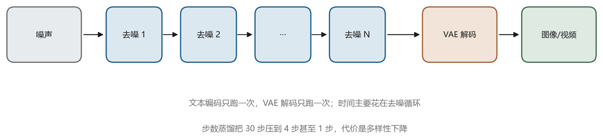

# 扩散模型与视频生成：另一类推理负载

一张图从噪声变成成品，要跑几十步去噪。每一步都是一次完整的网络前向，输入是当前噪声图和步数，输出是稍微干净一点的图。30 步就是 30 次前向，视频还要乘上帧数。一个 5 秒、24 帧每秒的视频，120 帧，每帧 30 步，就是 3600 次前向。

这类负载和大语言模型完全不同。它不生成 token，没有 KV cache，也没有自回归的串行依赖。它的瓶颈是计算量、显存和批处理，服务形态也不一样。

先把 **扩散模型**（diffusion model）说清楚：它训练时学着“把图片一步步加噪变成纯噪声”，推理时反过来，从纯噪声出发，一步步去噪，最后得到一张图。**去噪**（denoising）就是每一步让图“更像真实图片一点点”。它的思路像雕塑：从一块石头开始，每次去掉一点多余的部分，几十次之后成型。

## 扩散模型怎么生成

扩散模型的训练过程是加噪，推理过程是去噪。推理时从一个纯噪声开始，每一步让模型预测噪声，再按调度器减掉一部分，重复几十步，最后得到一张图。**调度器**（scheduler）决定每一步减多少噪声，不同调度器的效果和步数需求不一样。

模型主干通常是 UNet 或 DiT。**UNet** 有编码器、解码器、跳跃连接，适合图像：编码器把图缩小，解码器再放大，跳跃连接把细节接回来；**DiT**（diffusion transformer）用 Transformer 处理 patch，扩展性更好，适合高分辨率和视频。两者的取舍和视觉模型里卷积与 Transformer 的取舍类似。

除了主干，还有两个组件。**文本编码器**把 prompt 变成条件向量，**VAE** 把最终的低维表示解码成像素。文本编码器只跑一次，VAE 解码只跑一次，中间的去噪循环跑几十次。时间主要花在去噪循环上。

这里有一个关键的结构认识：**大部分计算发生在“低维空间”**。现代扩散模型不在像素空间去噪，而是在 VAE 压缩出来的潜空间里做，比如 64×64×4 的潜表示对应 512×512 的图像。**潜空间**（latent space）是压缩后的表示，维度小得多，所以每一步的计算量也小得多。这就是为什么 30 步去噪在几秒内能完成。

**无分类器引导**（classifier-free guidance，CFG）是提高 prompt 遵循度的常用手段。它同时算有条件和不含条件的预测，再按一个系数放大差异。代价是每次前向要算两遍，计算量翻倍。有些系统用蒸馏或者 batch 合并来减少这部分开销。**引导系数**越大，生成的图越贴合 prompt，但多样性下降、细节可能变硬。

它解决什么问题？解决“从文字生成图像”这类任务。它和语言模型的根本区别是：语言模型一次前向产出一个 token，扩散模型一次前向只让整张图“干净一点点”，所以必须迭代。

代价是什么？计算量大、步数多、显存高。一次 30 步的生成，等于 30 次（CFG 下 60 次）完整前向。视频还要乘帧数。这个计算量比一次语言模型前向大几个数量级。

什么时候不该用？如果任务只是“图像分类”或“图像修复的简单版本”，用专门的判别模型或小的生成模型更快。扩散模型的优势在于“高质量、多样化生成”，不在于“快速判断”。

## 步数就是成本

扩散模型的质量和步数相关。步数少，图会糊、细节少；步数多，质量好，但慢。最早的模型要 50 到 1000 步，后来的采样器把步数降到 20 到 50 步。**采样器**是“怎么从当前噪声走到下一步”的具体算法，好的采样器能用更少的步数达到同样的质量。

**步数蒸馏**进一步把步数压到 1 到 8 步。LCM（latent consistency model）、SDXL Turbo、Lightning 等方法（Luo 等，2023；Sauer 等，2023；Lin 等，2024），用教师模型指导学生模型，让学生在更少的步数里达到接近教师的质量。**蒸馏**在这里的意思是：学生学会“一步跨过去”，而不是“一小步一小步走”。**一致性模型**直接学习从噪声到图像的映射，一步生成。这些方法的共同假设是：多步去噪的轨迹可以被“抄近道”，不必老老实实走完每一步。

它解决什么问题？解决“步数就是成本”这个硬约束。步数从 30 降到 4，计算量降了将近八倍，延迟也从几秒降到一秒以内。对交互式产品（用户输入 prompt 就要看到图），这个差别决定了能不能做。

代价是什么？多样性下降。少步生成的图往往更“平均”，创意和细节不如多步。对商品图、头像这类要求稳定的场景，少步很合适；对艺术创作，多步仍然有优势。另外，蒸馏需要训练，需要一个好的教师模型，还需要评估“少步之后哪些能力丢了”。

什么时候不该用？如果产品定位是“高质量创作工具”，用户愿意等十秒换更好的图，那就没必要上少步蒸馏。如果业务要求极高的多样性（一次生成十个方案），少步模型的输出会同质化。少步模型还会放大 CFG 的影响，引导系数高一点就能出很“标准”的图，但也容易出典型构图和死板风格。

除了蒸馏，还有一类优化是“减少每步的成本”：用更小的主干、量化、把 CFG 的两遍合并成一遍。这些和语言模型的优化手段是相通的，只是作用的对象不同。实战中常见的折中是“起草加精修”：先四步出低分辨率草稿，用户满意再二十步出高清版；或者先生成四张让用户选一张再细化。这些方案把平均成本降下来，把高质量留给少数请求。

## 视频与多帧

视频生成在图像的基础上加了时间维。模型要保证帧与帧之间的连贯，通常用时间注意力或者 3D 卷积。计算量随帧数线性增长，显存也随帧数增长。**时间注意力**是让不同帧的同一位置互相关注，保证动作连贯；**3D 卷积**则是在时间维度上也做卷积。

视频的显存压力主要来自激活。每一帧的特征图都要保留，时间注意力还要在帧之间做全局交互。一个高分辨率、长视频的请求，可能一张卡只能跑一个。实际系统会降分辨率、抽帧、分块生成，再拼接。**分块生成**是把长视频切成几段分别生成，段与段之间用重叠帧对齐，避免接缝。这个做法很有效，但重叠部分要额外计算，而且运动一致性仍然可能出错。

它解决什么问题？解决“生成动态内容”的需求，比如广告短片、动画素材、产品演示。这类内容用图像模型逐帧生成会闪烁，必须建模时间关系。

代价是什么？计算量按帧数线性增长，显存也按帧数增长，延迟从秒级变成分钟级。而且质量对运动幅度很敏感：大幅度运动容易变形，小幅度运动容易呆板。这个特性意味着同一个模型在不同镜头上的可用性差异很大，产品设计上不能假设“输入什么都行”。

什么时候不该用？如果最终产出是静态图，视频模型是浪费。如果业务只需要“轻微动效”（比如让照片里的人眨眼），有更轻量的方案，不必上完整视频生成。

视频生成的延迟是秒级到分钟级，和聊天服务的几十毫秒完全不是一个量级。服务通常用异步任务：用户提交请求，系统排队，生成完再通知。队列、优先级、超时、失败重试都要按长任务设计。**异步任务**的意思是：请求不等待结果，先返回一个任务号，客户端之后来查或者等推送。

异步带来一个新的问题：任务状态管理。用户可能关掉页面、重复提交、取消任务。服务要能去重、能取消、能在失败时给出明确原因。这些在同步接口里都不是问题，在异步接口里全变成设计题。尤其是“取消”：一段已经算到一半的视频，取消时要能把显存和队列位置及时释放，否则取消反而变成了另一种浪费。

## 部署差异

扩散模型和语言模型在部署上有几个关键差别。

**没有 KV cache**。每次去噪是一次独立的前向，不依赖之前的 token。显存主要花在权重和激活上，不花在 cache 上。这也意味着“长上下文”的很多优化手段在这里不适用，反过来，“激活显存”成了主要矛盾。

**计算密集**。去噪循环是大量的卷积和矩阵乘，算力是主要瓶颈，量化、Tensor Core、FP8 都能直接受益。批处理能提高吞吐，但会拉长单张图的延迟。这一点和语言模型的 decode 阶段正好相反：那边是带宽瓶颈，这边是算力瓶颈。所以“把 batch 开大”在图像服务里通常很灵，在语言服务里却要小心。

**分辨率敏感**。分辨率翻倍，计算量翻四倍，显存也大幅上升。服务要按分辨率分档，不能用一个配置接所有请求。服务设计时需要把“步数 × 分辨率”限制在一个范围内，否则一个用户传高分辨率、要求高步数，就可能把整个池子占住。实际系统常见的是“先生成低分辨率，再超分”，用两段计算换整体成本下降。

**质量评估不同**。语言模型看 perplexity 和任务指标，图像看 FID、CLIP score、人工评分。**FID** 衡量生成图和真实图的分布距离，**CLIP score** 衡量图文匹配度。量化对图像的影响可能体现在细节、纹理、文字上，评估要专门设计。一个在 FID 上几乎无损的量化，可能在“手指数量”这种细节上明显变差。

还有一个容易被忽略的差异：**用户对质量的感知是非线性的**。语言模型输出一个小错误，用户可能不在意；图像里多一根手指，用户一眼就看出来。所以图像生成的量化容错度看起来高（指标掉得少），实际体验容错度低。评估时应额外加一类“细节检查”，比如文字渲染、手部结构、物体边界。

扩散模型和视频生成让“推理”这个词有了另一种含义：不是预测下一个 token，而是迭代地细化一个结果。理解了这一点，很多从语言模型带过来的直觉就要调整：批处理的意义变了，缓存的意义变了，瓶颈的位置也变了。

下一章看支撑这一切的硬件和数值格式，从 Hopper 到 Blackwell，从 FP8 到 FP4。
