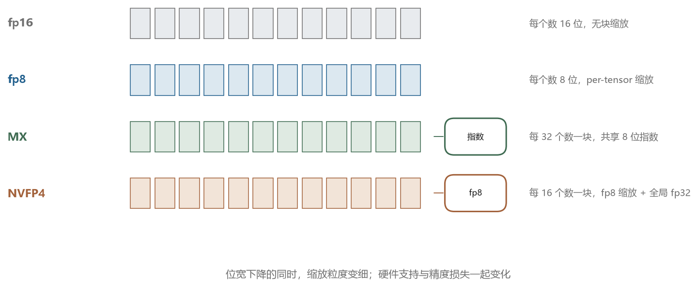

# 新一代硬件与数值格式

同样一个模型，在两代 GPU 上跑，速度可能差一倍，显存可能差一倍，能用的数值格式也不一样。硬件换代不只是“快一点”，它会改变哪些优化值得做。上一代卡上必须量化的模型，新一代卡可能用 fp8 就能放下；上一代卡上没有的 fp4 通路，新一代卡上可能成为默认选项。

这一章把最近几代硬件和数值格式放在一起看，重点不是背参数，而是理解它们各自解决了什么问题，以及部署时该怎么选。

先建立一个判断框架。看一代新硬件，问三个问题：它新增了什么数值格式？新增了什么互联能力？新增了什么软件接口？因为格式一变，上面几层的优化逻辑都跟着变：融合规则要对齐新格式，量化校准要重新做，性能模型要重新算。参数表上的算力数字是最后才看的，因为它只对“格式匹配、形状对齐”的情况成立。

## 从 Hopper 到 Blackwell

因为它是第一个把“低精度浮点”做成主流路线的代际。在此之前，低精度主要是 int8；fp8 之后，推理的默认精度开始从 fp16 往 fp8 迁。fp8 的张量核心算力是 fp16 的两倍，显存带宽也上了一档。H200 把显存换成 HBM3e，容量和带宽都比 H100 高，适合大模型和长上下文。NVLink 让多卡之间的带宽远高于 PCIe，张量并行才能真正跑起来。

**HBM3e** 是新一代高带宽显存的代号，主要变化是带宽更高、容量更大。对推理来说，这两点直接对应“decode 更快”和“能装更长的上下文”。这也是为什么长上下文服务总是先看着最新一代的卡：不是算力不够，是带宽和容量不够。一个具体的经验是：如果模型的瓶颈在 decode，换代带来的收益往往比换引擎大；如果瓶颈在 prefill，算力和 kernel 才是关键。

Blackwell 这一代（B200/GB200）增加了 fp4 的支持，把低比特又往下推了一格。它把 GPU 和 CPU 更紧密地连在一起（Grace Blackwell），用统一的内存语义减少数据搬运。显存继续用 HBM3e，容量和带宽再上一档，单机能放下的模型更大。**统一内存语义**指的是 CPU 和 GPU 访问同一块地址空间，数据不用来回拷。

它解决什么问题？每一代都在解决同一个矛盾：模型变大、上下文变长，而显存和带宽的增速跟不上。fp8 和 fp4 是在“每个数占多少字节”上做文章，NVLink 和统一内存是在“数据搬多远”上做文章，两者合起来，才能让更大的模型跑得动。换句话说，硬件进步的方向不是“算得更快”，而是“更容易把数据送到算的地方”。这个方向在过去几年越来越明显：算力早就过剩，堵车的地方在显存和互联。

代价是什么？新格式要求模型和工具链都跟上。fp8 需要校准、需要引擎支持、需要硬件原生通路；fp4 的要求更高。统一内存听起来很美，但它改变了数据布局的假设，很多旧的优化手段（比如显式拷贝重叠）会失效，甚至变成负优化。

什么时候不该用？如果模型本身小、上下文短、并发不高，上一代卡完全够用，新卡的优势发挥不出来。如果团队的工具链还没适配，新卡的算力可能一直躺在纸面上。

这些数字每年都在变，部署时不要背具体值，要看三个比例：显存容量与模型大小的比例，带宽与计算量的比例，卡间互联与单卡带宽的比例。三个比例决定了你能用什么并行策略、什么数值格式、什么 batch。

## FP4、MX 与微缩放

fp4 只有 4 位，能表示的数非常少。为了让它在模型上可用，业界定义了两种带缩放的格式。

**MX**（microscaling）把每 32 个元素分成一块，块内的元素是 4 位浮点（E2M1），块外有一个 8 位的共享指数。共享指数只表示 2 的整数次幂，乘上去只需要移位，硬件实现便宜。**E2M1** 的写法是“2 位指数、1 位尾数”，能表示的数只有寥寥十几个。

**NVFP4** 把块缩小到 16 个元素，缩放因子用 fp8（E4M3）表示，另外还有一个全局的 fp32 缩放。块更小，缩放更精细，精度更好，元数据也更多。

fp4 的精度损失比 fp8 大，通常需要更细的校准、更小心地处理 outlier。它适合权重和激活都相对温和的层，不适合第一层、最后一层、LayerNorm 这些敏感位置。实际部署往往是混合的：大部分层 fp4，少数层 fp8 或 fp16。

它解决什么问题？解决“权重和激活的存储与带宽还能不能再降一半”。在带宽瓶颈的 decode 阶段，这个收益是直接的：读的数据少一半，速度就可能接近翻倍。

代价是什么？精度、校准成本、工具链。fp4 的动态范围极窄，一个 outlier 就能让整块数据失真；校准要更细，通常要 per-block 而不是 per-tensor；工具链的支持也更不成熟，出了问题难查。还有一个现实：fp4 的校准要重做，不能沿用 fp8 的 scale，因为块粒度不同。

什么时候不该用？如果你的模型对数值敏感（比如某些音频、某些科学计算模型），或者你的业务指标对细节极其敏感，fp4 的风险很高。另外，如果硬件不支持 fp4 的矩阵乘通路，你只是省了显存，算力一点没变。

这里有一个容易混淆的点：fp4 的“4 位”不是均匀刻度，而是浮点刻度。它在大数附近的间隔大，在小数附近间隔小，所以它对“动态范围集中”的数据更友好。为什么微缩放对 fp4 是必须的？因为 4 位浮点的动态范围实在太窄。如果不分块，一个 outlier 就能把整个张量的共享指数拉高，其他数据全部落在最小刻度上，相当于被“量化成常数”。

## 其他加速器

GPU 不是唯一的选择。

**TPU** 是 Google 的专用加速器，矩阵乘单元大，互联强，适合大规模训练和推理。它的软件栈（XLA/JAX）和 GPU 不同，模型要能编译过去。

**LPU** 一类推理芯片用大容量 SRAM 和确定性调度，主打低延迟、高吞吐的 LLM 推理。它的显存小，模型要切分或者量化，软件生态也窄。**SRAM** 是比 HBM 更快但更贵更小的存储，放在芯片上，容量以百 MB 计。

**NPU** 广泛用在手机、PC、边缘盒子上。它能效高，但算子覆盖有限，模型要经过编译器转换，不支持的操作会回退到 CPU。这一点在手机端尤其明显：一个激活函数不支持，整个模型就可能慢三倍。

**其他专用芯片**（视频编解码、语音、传感器）通常只做一件事，部署时要和主模型配合，不能单独完成端到端任务。

选加速器不是选峰值算力，是选软件栈。一个算力很强但算子库不支持的芯片，实际表现可能不如一个算力一般但生态成熟的芯片。

它解决什么问题？解决“特定场景下能效比”的问题。手机要省电，数据中心要省电费，某一些推理任务要极低延迟，通用 GPU 在这些方向上不是最优。专用芯片的另一个优势是供应链可控性：某些场景下你只能用某个平台，这不是技术选择，而是商业和政治选择。比如车载场景要求确定性延迟，通用 GPU 的调度不确定性就成了问题；手机要求功耗低，通用 GPU 的能效比就吃亏。

代价是什么？生态。你要用它的编译器、它的算子库、它的调试工具，模型结构稍有变化就可能不支持。迁移成本往往被低估：从 GPU 迁到 NPU，工作量常常是“重做一个部署项目”。

什么时候不该用？如果你的模型迭代快、结构经常变，专用芯片的适配成本会一直追着你跑。如果你的团队没有对应平台的工程能力，踩坑的时间会远超省下的电费。专用意味着在某件事上很强，在其他事上很弱，你需要判断自己的负载落在那一边。

## 选硬件的账

选硬件时，按下面的顺序算账。

**显存容量**。模型权重、KV cache、激活、workspace，加起来能不能放下。放不下，其他都不用谈。这一步要用峰值算，不是用稳态算。显存峰值往往出现在 prefill 阶段或者大 batch 时，只看稳态会低估。

**显存带宽**。decode 阶段、逐元素算子、KV cache 读取都受带宽限制。带宽不够，算力再高也喂不饱。判断方法是看你的模型是不是带宽瓶颈：如果是，带宽就是第一优先级。

**算力与格式**。目标模型用什么数值格式，硬件对它的支持是不是原生。fp4 的算力数字很漂亮，但如果你的模型只能用 fp8，那个数字和你无关。**原生支持**的意思是硬件有专门的电路，不是靠软件模拟。

**互联**。多卡推理要看卡间带宽。NVLink、InfiniBand、以太网的差别很大，决定了 TP/EP 能开多大。如果只做单卡推理，这一项可以跳过。

**软件成熟度**。引擎、算子库、驱动、编译器的版本是不是匹配。新卡刚出来时，软件往往没跟上，实际性能可能不如上一代成熟卡。这不是保守，而是过去几年反复发生的事实。

**功耗与成本**。机房的供电、散热、机架密度都是约束。一张卡便宜，但功耗高、散热差，整体成本可能更高。能耗这一点常被低估：在大规模部署里，三年的电费往往超过卡本身的价格，能效比差一倍就是一笔不小的账。

把这几项排成顺序，是因为它们有依赖关系：显存放不下，带宽再好也没用；带宽不够，算力再强也发挥不出来；格式不支持，算力数字就是纸面值。反过来，如果前几项都满足，最后两项（软件和成本）才是真正决定“买不买”的因素。

硬件的选择没有标准答案，只有和模型、流量、预算匹配的方案。而且所有这些选择，最后都要回到第一章那张五层地图上：硬件属于执行层和数值层的交汇处，它的能力决定了上面几层能做什么。

下一章把前面所有内容收拢，给出 2026 年的技术地图和学习路径。
