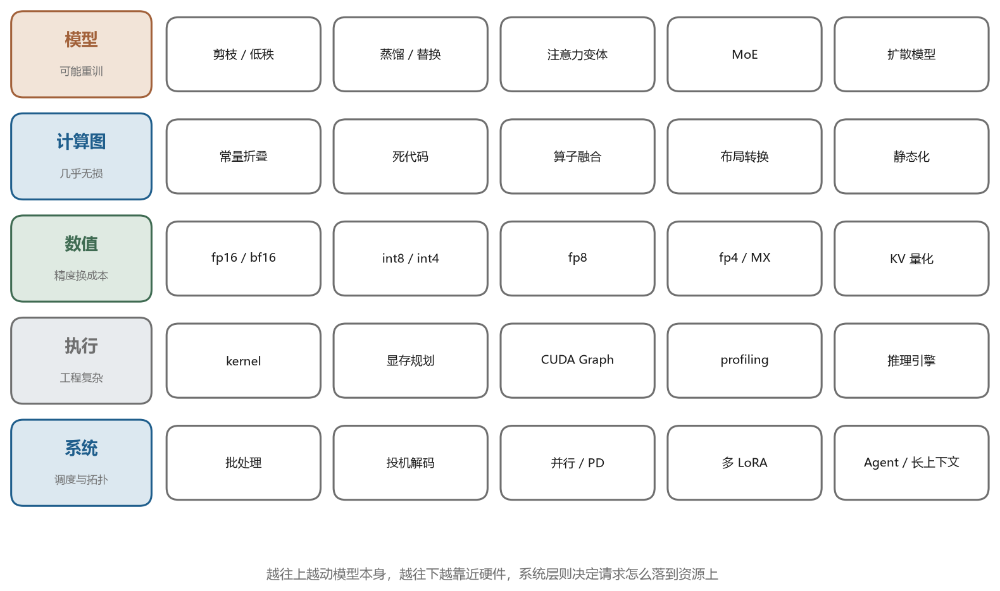

# 技术地图与学习路径

读到这里，你已经见过三十多种技术：算子融合、常量折叠、静态形状、fp16、int8、FP4、GPTQ、剪枝、低秩、蒸馏、连续批处理、PagedAttention、GQA、MLA、投机解码、张量并行、PD 分离、多 LoRA、长上下文、Agent、扩散模型。它们看起来分散，其实都能放回第一章那张图上：模型、计算图、数值、执行、系统。

这一章不再引入新东西，把这张图填满，再看遇到问题时怎么从图上找到入口。

## 五层地图

第一章画的是五层：模型、计算图、数值、执行、系统。今天的大模型部署，系统层已经不是“把 kernel 跑起来”那么简单。

**模型层**改的是结构和参数。剪枝去掉权重或通道，低秩分解换一种表示，蒸馏换一个小模型，结构替换把注意力换成卷积、把多分支合成单路。注意力变体（MQA、GQA、MLA）、MoE、扩散模型也属于这一层，它们从模型结构上改变计算量和 cache 大小。这一层的收益可能很大，代价是通常要重新训练，精度也不保证。

**计算图层**改的是计算的组织方式。常量折叠、死代码消除、算子融合、布局转换、静态化。这一层大多不改变数学含义，风险低，是优化的第一站。

**数值层**改的是每个数怎么存。fp16、bf16、int8、int4、fp8、fp4/MX，以及 KV cache 量化。量化要校准，低比特要处理 outlier，QAT 要训练。这一层的收益直接体现在带宽、显存和算力上，代价是精度。

**执行层**改的是单个 kernel 和一次前向怎么跑。kernel 选择、分块、并行、显存规划、CUDA Graph、profiling。这一层离硬件最近，优化空间常常最大。

**系统层**改的是请求怎么组织。批处理、连续批处理、PagedAttention、投机解码、张量/流水/专家并行、PD 分离、多 LoRA、长上下文缓存、Agent 编排、推理服务。这一层不改变模型和数值，只改变请求和资源的匹配方式，是今天大模型部署的主战场。

表 28-1　按层整理的主要技术

| 层 | 技术 | 解决什么 | 主要代价 |
|---|---|---|---|
| 模型 | 剪枝 | 去掉冗余权重或通道 | 可能重训，精度损失 |
| 模型 | 低秩分解 | 用两个小矩阵代替大矩阵 | 表达能力下降 |
| 模型 | 蒸馏 | 用小模型学大模型 | 需要教师和数据 |
| 模型 | 结构替换 | 换更快的算子或结构 | 精度损失，需验证 |
| 模型 | 注意力变体 | 减少 KV cache 和注意力计算 | 需重新训练，引擎要支持 |
| 模型 | MoE | 用很多专家扩大参数量 | 路由、负载均衡、显存 |
| 计算图 | 常量折叠、死代码消除 | 去掉不必要的工作 | 几乎无损 |
| 计算图 | 算子融合 | 减少访存和启动 | 受布局、精度、形状限制 |
| 计算图 | 静态化 | 固定形状，便于排内存 | 失去灵活性 |
| 数值 | fp16 / bf16 | 位宽减半 | 范围或精度下降 |
| 数值 | int8 / int4 | 进一步压缩权重和激活 | 需要校准，可能掉点 |
| 数值 | fp8 / fp4 / MX | 低比特浮点与微缩放 | 硬件支持，精度损失 |
| 数值 | KV cache 量化 | 省长上下文显存 | 误差随长度累积 |
| 执行 | kernel 优化 | 提高单算子效率 | 需要硬件知识 |
| 执行 | 显存规划、CUDA Graph | 降低峰值、减少启动 | 实现复杂 |
| 系统 | 批处理、PagedAttention | 提高吞吐、减少碎片 | 延迟上升 |
| 系统 | 投机解码 | 一次验证多个 token | 依赖接受率，高并发时收益小 |
| 系统 | 并行与 PD 分离 | 多卡、分离 prefill/decode | 通信、复杂度、故障域 |
| 系统 | 多 LoRA | 一个基础模型服务多个版本 | 适配器缓存、调度复杂 |
| 系统 | Agent、结构化输出 | 多步任务、格式约束 | 延迟、失败重试、编排 |

## 按症状选工具

遇到问题，先看症状，再决定从哪一层入手。

**延迟高**。先 profile，分清是计算、带宽、启动、排队还是 decode 串行。计算瓶颈，考虑量化、换算法、换更快的 kernel；带宽瓶颈，考虑融合、布局、减少中间张量；启动瓶颈，考虑融合、CUDA Graph、换引擎；排队瓶颈，考虑扩容、批处理策略、限流；decode 串行，考虑投机解码、GQA/MLA、更大的 batch。

**显存不够**。先看权重占多少，再看 KV cache 和激活。权重大，量化权重；KV cache 大，GQA/MLA、量化 KV、分页、减少并发；激活大，减小 batch、融合、静态化；权重比显存还大，考虑权重分块、张量/流水/专家并行。

**吞吐不够**。先看 GPU 利用率、batch 大小、排队长度。利用率低，先解决空隙和同步；batch 上不去，看显存和调度；多卡利用率不均，看并行策略和负载均衡；长 prompt 堵住 decode，考虑 chunked prefill、PD 分离。

**精度掉了**。先确认掉在哪一层、哪一类样本、哪一种长度。校准集不匹配，重新校准；某些层敏感，保留高精度；PTQ 不够，上 QAT；低位宽不行，退到 int8 或 fp16；长上下文掉点，检查 KV cache 量化和注意力实现。

**成本高**。看 GPU 利用率、吞吐、单请求成本、请求类型。利用率低，先解决排队和空隙；吞吐低，加 batch、连续批处理、KV 复用；模型太大，蒸馏或量化；流量波动大，用弹性伸缩和降级模型；多租户，按租户配额和优先级调度。

## 技术之间怎么组合

技术不是孤立的，顺序会影响效果。

通常先做模型结构和图上的优化，再做量化，最后做系统层。模型结构定了，图才好优化；图干净了，量化才好校准；权重和 KV 小了，系统层才有更多并发空间。

量化之后再做批处理和缓存。权重小了，显存能放更多请求；KV 量化之后，分页的块大小和并发策略要重调；投机解码要和 batch 大小一起调，高并发时可能关掉。

并行和 PD 分离放在最后。它们改变的是资源拓扑，配置一次影响全局。先单卡把模型跑好，再考虑多卡；先单池把调度跑顺，再考虑分离。

每一层优化都要复测。上一层省下的时间，可能让下一层的瓶颈暴露出来；上一层引入的转换，可能抵消下一层的收益。

## 学习路径

这一册建立了地图。接下来往哪走，取决于你的工作。

如果只是想把全貌看清楚，不打算动手，可以读第 1、2、4 章建立概念，再读第 11、12 章理解精度，第 16、17 章理解服务，然后从第 20 章读到第 27 章看当前的技术版图，最后回到这一章的地图。每章开头和结尾是结论，中间的例子可以跳过。

如果要做 kernel 级优化，需要深入 GPU 的构造、存储层次、roofline、GEMM、卷积、FlashAttention、Triton/CUTLASS 和性能分析。

如果要做量化，需要深入浮点与定点、校准、PTQ、QAT、fp8、fp4/MX、GPTQ、AWQ、SmoothQuant、剪枝、低秩、蒸馏和评估。

如果要做推理系统，需要深入计算图、融合规则、TensorRT/TVM/torch.compile、内存规划、CUDA Graph、连续批处理、PagedAttention、投机解码、并行、PD 分离和服务系统。

如果要做多模态、Agent 或扩散模型，需要额外看编码器、长上下文、约束解码、工具调用、扩散采样和视频生成。

这些方向之间有重叠，但深度不同。入门讲“是什么”，深入的材料讲“怎么做”和“为什么”。不需要按顺序读完，按工作需要选一个方向深入即可。

## 最后三个问题

以后听到任何一个优化手段，先问三个问题。

它改的是模型、数值，还是调度。改模型，看结构和参数；改数值，看格式、精度和硬件；改调度，看批处理、队列、并行和缓存。

它损失了什么。精度、灵活性、可维护性、构建时间、通信开销，总有一项要付出。没有代价的优化，通常收益也有限。

它在什么条件下才有效。硬件支持、形状匹配、算子覆盖、数据分布、并发水平，条件不满足，收益就会消失。

这三个问题，比记住任何一个 API 都有用。技术会更新，硬件会换代，这三个问题不会。
