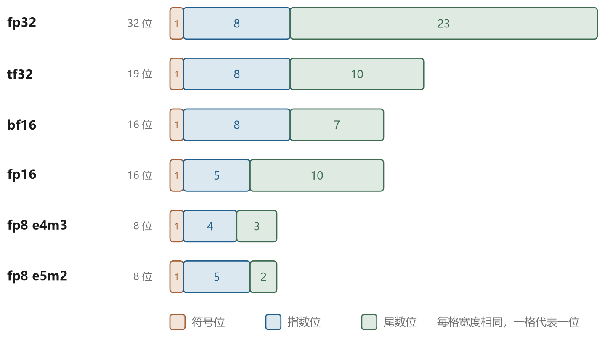

# 浮点数的内部

一个检测模型在 fp32 上跑得好好的，换成 fp16 之后离线指标只掉了 0.2 个点，团队认为可以接受。上线两周后，客服转来一批截图：夜间监控、画面几乎全黑。这类图片经过归一化，每个通道都除以一个接近零的标准差，激活值冲到了十万量级，fp16 的最大值只有 65504，第一层卷积的输出直接变成 inf，后面整条链路的输出全是 NaN。问题不在模型，在数字本身装不下。

同一个模型在 fp32 上完全正常，因为它有 8 位指数，能表示到 3.4e38。位宽从 32 降到 16 之后，少掉的是尾数还是指数，决定了你会遇到哪一类故障。这一章把浮点数的位拆开看，弄清范围、精度、位宽这三件事各自在哪里起作用。

## 三个字段拼出一个数

IEEE 754 的浮点格式把一段定长位分成三块：1 位符号、若干位指数、若干位尾数。以 fp32 为例，1 位符号、8 位指数、23 位尾数。一个规格化数的值由下式给出

$$
x = (-1)^{s} \cdot (1 + m) \cdot 2^{e - 127}
$$

其中 `s` 是符号位，`m` 是尾数位表示的 0 到 1 之间的小数，`e` 是指数字段按无符号整数解出来的值。指数存的是加了偏移的“阶码”，fp32 的偏移是 127，所以实际指数范围是 -126 到 127。尾数前面那个隐含的 1 不在位里，白送一位有效精度，fp32 因此有 24 位有效位。

把位摊开画出来，各格式的差别一眼可见。fp32 的尾数占了大半，bf16 反过来，指数位和 fp32 一样多，尾数只剩 7 位。fp8 的两种变体连方向都不同，e4m3 把位数花在尾数上，e5m2 花在指数上。

位布局还可以用一个具体例子钉住。fp16 的位串 `0 01111 0000000000` 解出来是 1.0，阶码 15 减去偏移 15 得 0，尾数全 0，所以是 1.0 乘 2 的 0 次方。把尾数最低位改成 1，得到 1.0009765625，这就是 fp16 在 1.0 附近的间隔。把阶码加到 30，尾数全 1，得到 65504，再往上一个码点就是 inf。`0 00000 0000000001` 是非规格化数里最小的一个，等于 2 的 -24 次方。这五个码点基本覆盖了调试时会遇到的全部边界，记住它们比记公式快。

符号位只占一位，却决定了整个负数半轴能不能表示，后面讲对称量化时它会被省掉，这是 int8 只有 255 个格点而不是 256 个的原因。

这种结构带来一个容易被忽略的性质：浮点数的绝对间隔随数值大小变化，相对间隔基本恒定。在 1.0 附近，fp32 的相邻可表示数间隔是 2 的 -23 次方，约 1.19e-7；在 1024 附近，间隔放大了 1024 倍，但相对间隔还是 1.19e-7。换言之，浮点在整个动态范围里保持大致相同的有效数字位数，这正适合神经网络里那种跨好几个数量级的权重分布。定点数没有这个性质，这一点留到下一章。

## 范围比精度更早出问题

fp16 的指数只有 5 位，偏移 15，实际指数范围 -14 到 15。规格化数的最大值是 65504，最小值是 6.1e-5。整个可表示范围横跨约 9 个数量级，而 fp32 横跨约 77 个。

神经网络的激活分布很少乖乖待在 9 个数量级里。注意力分数在 softmax 之前要除以 `sqrt(d)`，序列长、头维大、温度低的时候，logits 能轻松上到几百分；LayerNorm 在方差极小的通道上会把输出放大到上千；残差累加随着层数增加不断抬高数值的量级。这些都不是训练不收敛的病态情况，而是正常推理里会遇到的极值。

超出范围之后发生什么，取决于硬件怎么处理。超过最大值叫上溢（overflow），结果变成 inf，然后 inf 减 inf 得到 NaN，NaN 一旦出现就会污染整层输出，再往后每一层都是 NaN。低于最小正规数则进入非规格化数（subnormal）区间，此时指数位全 0，尾数的隐含前导 1 不再存在，数值落在一个更细的格子上，代价是有效位数随数值变小而递减。fp16 的非规格化区间是 6e-8 到 6.1e-5。很多加速器为了电路简单，直接把非规格化数冲成零（flush to zero），这在梯度累加里会造成“小梯度全部消失”的隐蔽损失。

理想情况下，一个 p 位尾数的浮点数在做舍入时，相对误差不超过 2 的 -(p+1) 次方。fp16 的 p 是 10，相对误差上限约 4.9e-4，换算成信噪比大约是 66 dB；bf16 的 p 是 7，上限约 3.9e-3，信噪比约 48 dB。这个数字有直接后果，一个 32 层的 Transformer 把 48 dB 的噪声逐层传下去，到最后一层有效位数可能只剩两三位。所以 bf16 训练必须让主权重和归约在 fp32 里做，靠的是“存储用低精度、计算用高精度”的混合策略，而不是指望 bf16 自己扛住。

判断一个格式够不够用，看三个数比看位宽有用。最大正规数决定上溢的门槛，最小正规数决定下溢的门槛，机器精度（eps）决定 1.0 附近能分辨的最小增量。表 1-1 把常用的几种格式列在一起。

表 1-1　常见浮点格式的位分配与关键数值

| 格式 | 总位宽 | 指数位 | 尾数位 | 最大正规数 | 最小正规数 | 机器精度 |
|---|---|---|---|---|---|---|
| fp32 | 32 | 8 | 23 | 3.40e38 | 1.18e-38 | 1.19e-7 |
| tf32 | 19 | 8 | 10 | 3.40e38 | 1.18e-38 | 9.77e-4 |
| bf16 | 16 | 8 | 7 | 3.39e38 | 1.18e-38 | 7.81e-3 |
| fp16 | 16 | 5 | 10 | 65504 | 6.10e-5 | 9.77e-4 |
| fp8 e4m3 | 8 | 4 | 3 | 448 | 1.56e-2 | 0.125 |
| fp8 e5m2 | 8 | 5 | 2 | 57344 | 6.10e-5 | 0.25 |

表里最值得盯着看的是 bf16 和 fp16 这一对。两者都是 16 位，bf16 牺牲尾数换指数，fp16 牺牲指数换尾数。bf16 的机器精度只有 7.81e-3，比 fp16 差了 8 倍；但它的范围跟 fp32 一样宽，任何在 fp32 里不溢出的量，在 bf16 里几乎也不会溢出。这个交换解释了它们在工程里的分工。同一份权重，在 fp16 里能表示到 1e-5 的差异，在 bf16 里 1e-3 以下的差异全部抹平，反过来 fp16 遇到 70000 就上溢，bf16 毫无压力。选哪一个，取决于你的张量分布是宽而粗还是窄而细。

图 1-2 只画了范围这一件事。fp32 和 bf16 的长条几乎一样宽，因为它们的指数位一样多；fp16 的长条短得多，而且整体偏向小数值一侧；e4m3 窄到只剩四个数量级。范围宽不代表精度好，表 1-1 里 bf16 的机器精度比 fp16 大 8 倍，两个格式各缺一半。真正决定能不能用的是这两条约束的交集，哪一条先撞上，故障就以哪种形式出现。

## 谁在训练里用，谁在推理里用

有限精度对训练的影响在 2015 年就被系统研究过，Gupta 等发现梯度累加用低精度会让训练停滞，而权重的更新只要保持较高精度就能继续收敛（Gupta 等，2015）。这条结论至今仍然是混合精度方案的基本假设。训练时主流做法是 bf16 混合精度。前向和反向的张量用 bf16 存，主权重和优化器状态用 fp32 存，每次更新前把梯度转成 fp32 再累加。这套做法由 Micikevicius 等在 2017 年系统化提出（Micikevicius 等，2017），当时用的是 fp16 加损失缩放，因为 Pascal 架构没有 bf16。损失缩放的做法是把损失乘一个常数，把梯度整体推到 fp16 能表示的区间，反向传播之后再除回去。这个技巧今天还在用，只是 bf16 普及之后，多数框架不再需要它。

fp16 训练仍然出现在一些老卡和老代码里，原因很实际。同样 16 位，fp16 的尾数多 3 位，同样的模型在 fp16 下的数值误差更小；而 A100 之后 bf16 的算力和 fp16 相同，新项目没有理由再选 fp16。判断依据只有一条，你的梯度会不会小到 1e-8 以下，会的话加损失缩放或者换 bf16。

推理阶段的偏好反过来。生成式模型里 fp16 依然常见，因为权重和激活的量级都在 1e-3 到 1e2 之间，范围够用，多出来的 3 位尾数直接换成更低的量化误差；而不少推理引擎对 fp16 的 kernel 支持比 bf16 更成熟，尤其是在老一代的消费级卡上。tf32 是另一条路，它只在矩阵乘法的输入上截断到 10 位尾数，累加仍然是 fp32，所以精度损失远小于把整个张量换成 bf16，代价是只对矩阵乘有效，逐元素运算还是 fp32。

位宽的选择不只是数值问题，也是带宽问题。decode 阶段每生成一个 token 都要把全部权重从显存读一遍，耗时基本由显存带宽除以模型字节数决定。fp32 换成 fp16，字节数减半，理论上吞吐翻倍；再换成 fp8，又是两倍。这类收益在算术上无可争议，真正的门槛是精度和 kernel 支持，而不是位宽本身。

fp8 在 2022 年之后进入视野。Micikevicius 等（2022）把两种变体写进标准建议，e4m3 有 4 位指数 3 位尾数，最大 448，没有 inf 编码，NaN 借用尾数全 1 的码点；e5m2 有 5 位指数 2 位尾数，范围接近 fp16，精度更差。这两种格式都需要一个 per-tensor 的缩放因子把张量压进它的表示范围，因为 448 这个上限对激活来说太小了。缩放怎么做、为什么 e5m2 更适合梯度，第 8 章会展开。

## 遇到溢出时先看哪里

调试精度问题不需要读硬件手册，需要的是知道去哪里找极值。第一步看每层的 amax，也就是这一层张量绝对值最大的元素。正常的网络里，同一类层的 amax 应该在相近的量级，如果某一层的 amax 比同类高出三个数量级，那就是它把整条链路的动态范围撑开了。

第二步看位置。softmax 之前的 logits、LayerNorm 的输入、残差相加的结果，这三处是溢出的高发区。softmax 有标准的稳定化写法，先减去最大值再取指数，很多框架在 fp32 下自动这么做，切到 fp16 之后这条路径可能被优化掉。LayerNorm 的方差如果接近零，除法会把输出放大到不可控，工程上的做法是在 fp32 里算均值和方差。残差累加的问题更隐蔽，它随着深度线性增长，第十六层出问题不代表前十五层没事。

定位这类问题最有效的手段是给每一层挂统计钩子，记录输入的 amax、均值和小于 1e-4 的元素比例，跑一遍校准集就能看出哪一层的分布和其他层不一样。PyTorch 的 `autocast` 会把一部分算子强制留在 fp32，比如 LayerNorm、softmax、损失函数，这个名单本身就说明了哪些地方脆。自己写 kernel 或者换推理引擎时，这些保护不会自动跟过来，需要逐个确认。

第三步确认累加精度。哪怕输入是 fp16，矩阵乘的累加器也应该是 fp32。累计 4096 个乘积，如果每一步都按 fp16 舍入，误差按平方根增长，结果是不可用的。这条规则在整数域里同样成立，int8 乘 int8 必须累加到 int32，理由在下一章讲。

浮点数给了我们一个很好的礼物，相对精度恒定，所以同一套超参可以在不同量级的张量上工作。但它的代价是硬件要把尾数对齐、做规格化、处理特殊值，一个 fp32 乘法在芯片上占的面积和功耗远大于一个整数乘法。当你只需要在固定区间里表示数，浮点的这些机制就全是浪费。定点数与整数运算就是把这部分浪费砍掉的办法。
