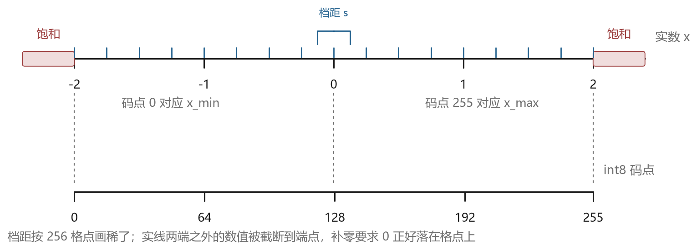
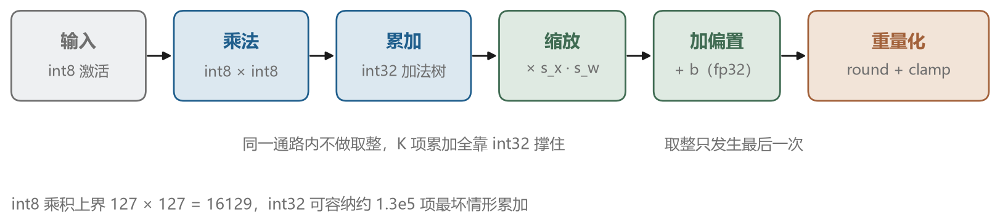

# 定点数与整数运算

有人手写过一个 int8 卷积做实验，量化误差算得很仔细，逐通道 scale 也做对了，跑出来的特征图却带着规律的横条。查了半天发现是累加器用了 int8，卷积核里正负权重一混，和很容易超过 127，溢出之后回绕成负数，横条正是回绕的位置。量化方案没有错，错在他把“存得下”当成了“算得下”。

浮点数的乘法在硬件上要拆成指数相加、尾数相乘、规格化三步，定点数不需要。两个 8 位整数相乘就是一次 8 位乘法器，结果 16 位，加法器累加即可。代价是定点数不会自己缩放，你得事先告诉它小数点在哪，而这个“事先”就是量化参数的全部内容。

## 一条直线把浮点铺成格点

仿射量化用一条直线把实数区间映射到整数集合。给定要表示的区间 `[x_min, x_max]` 和整数范围 `[q_min, q_max]`，步长由区间长度之比决定

$$
s = \frac{x_{\mathrm{max}} - x_{\mathrm{min}}}{q_{\mathrm{max}} - q_{\mathrm{min}}}
$$

零点偏移负责对齐原点

$$
z = \mathrm{round}\left(q_{\mathrm{min}} - \frac{x_{\mathrm{min}}}{s}\right)
$$

量化与反量化是一对互逆的近似

$$
q = \mathrm{round}\left(\frac{x}{s}\right) + z, \qquad \hat{x} = s \cdot (q - z)
$$

一个具体例子能把这几个量钉住。某层权重的取值范围是 -0.031 到 0.047，用非对称量化到 int8，`s = 0.078/255 = 3.06e-4`，`z = round(-128 + 0.031/3.06e-4) = -27`。取一个权重 -0.0123，除以 `s` 得 -40.2，加上 `z` 得 -67.2，四舍五入到 -67，反量化回来是 -0.01224，误差 6e-5，约等于 `s/2`。如果改用对称量化，`s = 0.047/127 = 3.7e-4`，同一个权重量化成 -33，反量化 -0.0122，误差更大一点，但整个张量只需要一个 `s`，不需要 `z`，kernel 里少一次修正。分布不对称时非对称明显更准，分布接近零均值时两者差别很小。

`s` 决定格点的疏密，`z` 决定格点整体平移多少。int8 的整数范围是 -128 到 127，非对称量化用满 256 个格点，对称量化把 `z` 固定成 0，格点变成 -127 到 127 的对称分布，少一个格点，换来的是权重矩阵里不再需要处理零点项。

图 2-1 里的格点画得比实际稀，真实的 int8 在 `[-2, 2]` 上有 256 个格点，间隔 0.0157。画稀之后能看清三件事。第一，格点是等距的，所以定点量化的绝对误差上限是 `s/2`，这一点和浮点完全不同，浮点的绝对误差随数值变大而变大。第二，区间之外的数没有格点可用，只能截断到端点，这个动作叫饱和（clamp）。第三，原点的位置由 `z` 决定，非对称量化里 `z` 一般不等于 0。

零点为什么值得单独占一个参数，答案在卷积和注意力的边角上。补零（padding）送进来的是实数 0，如果 0 不能被精确表示，补零就变成了补一个 0.004 之类的小数，深层网络里这些小偏差会累积成系统性偏移。ReLU 之后大量元素恰好等于 0，量化成非零值会让稀疏激活变成稠密。工程上有一条硬规则，量化方案必须让 0 精确落在某个格点上，对称量化天然满足，非对称量化靠 `z` 的取整来保证近似满足。

## 乘积放得下，和不代表放得下

int8 乘 int8 的结果最大是 `127 × 127 = 16129`，已经超出 int8 的表示范围，所以乘积必须往宽里放。这一步几乎所有框架都做对了，问题出在下一步的累加。

这里说的“放得下”有两层意思，乘积放得下和累加放得下，前者是寄存器位宽，后者是数据通路的位宽。很多芯片把乘积结果暂存到 16 位寄存器，再送进 32 位累加器，看起来没有问题；但如果两级之间插了一个 16 位的中间缓冲，大通道数下就会悄悄截断。这类 bug 在仿真里查不出来，因为仿真器通常用宽整型算，只有上真机才会暴露。

一个输出元素要累加 `K` 个乘积，`K` 是输入通道数乘以卷积核面积。最坏情况下每一项都取到最大绝对值，累加和的界是

$$
\left| \sum_{k=1}^{K} a_k b_k \right| \leq K \cdot q_{\mathrm{max}}^{a} \cdot q_{\mathrm{max}}^{b}
$$

把 16129 代进去，`K = 2` 时就已经逼近 int16 的上限 32767，`K = 1000` 时需要 1.6e7，int32 的 2.1e9 能撑到 `K` 约十三万。真实的网络里正负号会互相抵消，实际和远小于这个上界，但硬件设计按最坏情况留余量，所以 int8 卷积的累加器一律是 int32。Tensor Core 的 int8 矩阵乘也是这个约定，输入 int8，累加 int32，输出再经过 epilogue 转回 int8。

上界只在数学上成立，实践中很少碰到。一个 3×3 卷积、256 个输入通道，`K = 2304`，最坏情况的和是 3.7e7，int32 装得下还有富余；即使把 `K` 放大到 16384，上界也只是 2.6e8，仍在 int32 之内。真正让人栽跟头的是 int16 累加和 int8 累加，这两个在嵌入式 NPU 的某些配置里是可选项，为了省面积把累加器压窄，跑小模型看不出来，换成通道数上千的模型就开始出错。看到“支持 int8”这句话，要追问的是累加器位宽，而不是输入位宽。

工程上真正吃满整数算力的是点积指令，不是标量乘法。CPU 上有 DP4A 和 AVX512-VNNI，GPU 上有 Tensor Core 的 int8 模式，它们共同的做法是把四个或更多 int8 乘积在一个周期里累加进 int32，再接着算下一组。这类指令的存在解释了两件事。位宽必须对齐到 4 或 8，int8 能吃到加速，int7 或者 int6 就只能退回通用路径；累加必须一次到底，中间不能把结果落回 int8 再取出来。也解释了为什么“量化到 int8 就一定快”是错的，如果你的算子形状凑不出对齐的块，硬件只能走模拟路径，反而比 fp16 慢。

图 2-2 里有个容易被忽略的顺序问题。缩放因子 `s_x · s_w` 只在累加结束之后乘一次，不能提前乘到每个乘积上。提前乘会把整数运算变成浮点运算，整数单元省下来的功耗立刻还回去，而且每个乘积都做一次舍入，误差比最后乘一次大得多。偏置加在缩放之后，因为偏置本身是 fp32 或者 int32 存的高精度值，它对应的量纲是输出的实数，不是输入的整数。

## 零点在展开式里被消化掉了

如果权重和激活都带零点，直接算 `(x_q - z_x)(w_q - z_w)` 会引入减法，减法本身不贵，但它让每次乘法的操作数依赖于数据。把括号展开

$$
\sum_{k} (x_k - z_x)(w_k - z_w) = \sum_{k} x_k w_k - z_x \sum_{k} w_k - z_w \sum_{k} x_k + K z_x z_w
$$

等式右边第一项是纯整数点积，可以交给 Tensor Core；后三项只依赖权重之和、输入之和与常数 `K`，全部可以在累加结束后用整数加法补上。权重是静态的，`sum(w)` 可以在导出模型时预先算好；`sum(x)` 在推理时沿着通道方向做一次归约，代价接近零。这条恒等式是 int8 量化能真正跑在整数单元上的数学依据，Jacob 等在 2017 年给出这套方案时专门强调了它（Jacob 等，2017）。

这套展开在 per-channel 的情况下依然成立，只是每一项都要按通道来算。假设权重按输出通道 `j` 量化，每个通道有自己的 `s_w[j]` 和 `z_w[j]`，那么第 `j` 个输出用到的修正量是 `-z_x · sum_k w[j,k]` 与 `-z_w[j] · sum_k x_k`，前者每通道一个常数，后者对每个通道都一样。逐通道多出来的工作量主要是累加结束后的一次向量乘加，长度等于输出通道数，相对于卷积主体的乘加量可以忽略。这也是为什么逐通道量化的精度收益几乎免费，逐张量量化的省事并没有省下多少时间。

实际部署里更常见的组合是权重量化用对称，激活量化用非对称。权重分布近似以 0 为中心，对称量化少一个零点参数，`z_w = 0` 之后上面四项只剩两项，kernel 里连修正都省了一半。激活经过 ReLU 之后全是非负数，用对称量化会把一半格点浪费在负数区间，非对称量化能把 256 个格点全用在 `[0, x_max]` 上，有效精度翻倍。

## scale 放到哪一层

逐张量量化给整个张量一个 `s`，逐通道量化给每个输出通道一个 `s`。后者的代价是要在累加之后按通道做一次缩放，硬件上是一段向量乘，或者干脆折进下一层的权重里。折进去的前提是下一层是线性算子且能吸收对角矩阵，卷积和全连接都满足，LayerNorm 和 softmax 不满足，所以量化图的边界往往切在这些非线性算子前面。

浮点格式在这一点上比定点省事。fp8 的缩放因子只用来把张量压进表示范围，压进去之后每个数自带指数，小数值照样有分辨率。定点没有指数，只有一个全局的尺子，所以它必须靠更细的粒度来补救。同是 8 位，per-tensor 的 int8 在激活上常常掉点，per-tensor 的 fp8 却能基本无损，差别就在这里。

分组量化把通道再切成若干组，每组一个 `s`，是逐张量与逐通道之间的折中。组越小，量化误差越小，元数据越多，int4 时组大小 128 或 64 是常见选择，第 8 章会算这笔账。

选择合适的粒度还要看硬件怎么读元数据。逐通道的 `s` 存在一个小向量里，和权重一起加载，访存开销可以忽略；分组量化在 int4 下的组大小是 32 或 64，元数据占比升到 3% 到 6%，这部分开销必须算进压缩比里。曾经有过把组切到 8 的方案，精度确实更好，但元数据把收益吃光，实际带宽反而不如组大小 128 的方案。

定点数的短板在动态范围。同一个张量里如果有几个元素的绝对值是其余元素的一千倍，`s` 会被最大的那几个撑开，剩下 99.9% 的元素挤在几个格点里，量化误差大到没法用。这不是 scale 选得不好，而是定点表示本身没有能力同时照顾宽范围和高分辨率。激活里的离群值正是这么来的，下一章专门谈它。

一个真实的分布长这样。某层 Transformer 的激活里，99% 的元素落在 `[-0.6, 0.6]`，另有大约 0.05% 的元素绝对值超过 30，最大到 65。按 min-max 定 `s`，`s = 65/127 = 0.51`，于是 `[-0.6, 0.6]` 这段只剩不到三个格点，99% 的元素被量化成七种取值之一。逐通道量化在这里也救不了，因为离群值出现在特定通道上，但也可能出现在所有通道的同一位置，前者能靠通道粒度解决，后者必须换思路。

浮点数在这一点上是宽容的，因为它给每个数单独配指数。定点数则是把所有数按同一个尺子量，尺子的刻度一旦被最大的那个数决定，小数的细节就丢了。理解了这条约束，后面关于校准、per-channel、混合精度的所有手段，都可以看成是在有限的格点预算里给不同的数分配分辨率。
