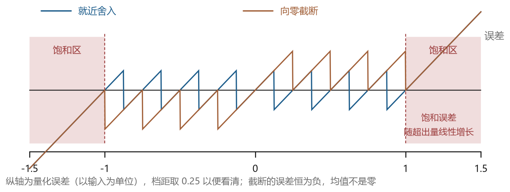
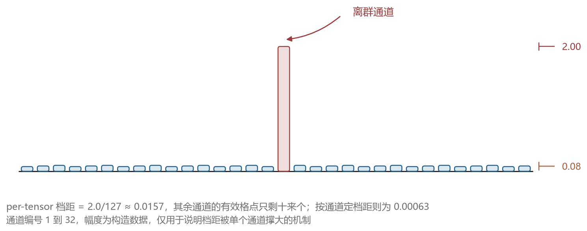

# 误差从哪里来

一个 7B 模型的权重整体量化到 int8，权重的余弦相似度是 0.9993，看起来几乎没有损失。换成激活之后，同一层的余弦相似度掉到 0.98，端到端困惑度从 5.6 涨到 7.1。权重和激活用的是同一套量化参数，位宽也一样，问题只能出在数据本身。

先把两个指标说清楚。余弦相似度（cosine similarity）衡量两个向量的方向是否一致，取值在 -1 到 1 之间，1 表示方向完全相同。它不看长度，只看角度，所以特别适合比较“量化前后的张量是不是指向同一个方向”。困惑度（perplexity）是语言模型最常用的指标，直白地说，它表示模型在预测下一个词时“平均在多少个候选里犹豫”，数值越小越自信、越准。从 5.6 涨到 7.1 意味着模型的犹豫程度增加了约四分之一，这种变化在长文本生成里通常已经能被读出来。

这一章把“误差”拆成几类，看它们各自怎么来、怎么在层与层之间传播，以及为什么一小撮特别大的数能把整层的分辨率吃掉。量化方案做不好的时候，掉点通常不是均匀分布的，而是集中在少数通道、少数 token、少数样本上，平均值会把这些遮挡住。

## 三种误差，三种形状

舍入误差（rounding error）来自把实数挪到最近的格点，误差落在 `[-s/2, s/2]` 之间，符号随机。如果一个张量里的数分布得足够密，跨过许多格点，那么舍入误差可以近似看成均匀分布，方差是

$$
\sigma^{2} = \frac{s^{2}}{12}
$$

这个式子值得解释一下它假设了什么。它假设误差在半个格距里均匀铺开，就像把一把豆子随机撒在每两格之间，平均下来平方偏差是格距平方的十二分之一。均匀近似还有一个前提，误差与信号不相关。低比特量化时这个前提很容易破掉，某个通道的权重如果恰好集中在两个格点之间，量化后所有值都往同一个方向偏，误差和信号强相关，效果相当于给这一层加了一个固定偏移。检测方法是把量化误差和原值画散点，如果看到斜线或者条纹，说明误差不是白噪声，此时按方差估算的信噪比会偏乐观。

这个近似只在“信号变化远大于档距”时成立。真实网络里很多张量的分布很窄，比如某一层的偏置几乎全在零附近，跨不过几个格点，这时误差不再随机，而是一个固定的偏置，量化前后差多少就是多少，不会因为样本多而抵消。工程上遇到整层输出整体平移，先怀疑这一层的分布太窄。

截断误差（truncation error）来自向零取整。`round` 在正负两侧都往最近处走，`trunc` 一律往零的方向走，后者会让所有误差带上同一个符号，均值是 `-s/2`。有偏的误差比无偏的更难缠，因为它在深度网络里会沿着同一方向叠加，几百层之后变成一个系统性偏移。这也是为什么几乎所有量化实现都用就近舍入，哪怕硬件上截断更便宜。

饱和误差（saturation error）来自区间不够宽。超出 `[x_min, x_max]` 的值只能被压到端点，误差可以大到任意倍数。它的分布是重尾的，绝大多数样本误差为 0，少数样本误差极大。平均值看不出来，最坏情况下的单点误差可能比 `s/2` 大两个数量级。

图 3-1 把误差画成输入值的函数。舍入是锯齿，幅度不超过半个档距；截断是同一组锯齿整体下移，均值不再是零；饱和在区间之外变成一条斜线，输入离区间越远，误差越大。三种误差里，只有饱和是不可控的，因为它的上界取决于输入有多离谱，而不是取决于你选了多少位。

衡量误差最常见的是信噪比。假设信号在量化区间内均匀分布，满量程用满 `b` 位，理想情况下的信噪比约为

$$
\mathrm{SQNR} \approx 6.02\,b + 10.8\ \mathrm{dB}
$$

这个式子叫量化信噪比（signal-to-quantization-noise ratio，SQNR），单位是分贝。dB 是对数刻度，加 6 dB 差不多等于幅度翻倍。所以这条经验公式的意思是：每多一位，信噪比提高约 6 dB，也就是误差的幅度减半。反过来，每少一位，噪声翻倍。这条公式在小信号上会失效，因为信号没用到满量程，有效位数就少了几位。一个张量如果 99% 的元素只占了区间的 1%，那它的有效位数是 `b - 7`，int8 实际只有 1 位。这也解释了为什么“我用了 8 位”和“我得到了 8 位的精度”是两件不同的事。

## 逐层误差不叠加，而是被放大或压缩

很多人第一次做敏感度分析会发现一个奇怪的现象，逐层量化时每一层的输出误差都很小，全模型量化后端到端指标却掉得厉害。原因是误差在层间传播时会乘上这一层的增益。

对一个线性层 `y = W x`，如果输入带误差 `δx`，权重量化带来误差 `δW`，输出的误差是

$$
\delta y = W \cdot \delta x + \delta W \cdot x
$$

两项的量级分别由 `||W||` 和输入的能量决定。如果某一层的权重谱范数（最大奇异值，衡量这个矩阵最多能把向量放大多少倍）大于 1，输入误差会被放大；小于 1 则被压缩。可以用一个具体数字感受一下：假设某层输出误差是输入的 1.2 倍，40 层下来放大倍数是 1.2 的 40 次方，约 1500 倍；如果每层是 0.9 倍，40 层之后只剩 0.015 倍。同样的逐层误差，端到端结果能差五个数量级，这就是为什么不能拿单层误差的平均值去估计全局。

Transformer 里放大最厉害的位置是注意力的 softmax，logits 上一个很小的绝对误差，经过指数之后会被放大成概率上的显著偏移，尤其当分布本身很尖锐时。反过来，LayerNorm 会把整体尺度归一化，一定范围内的误差会被它吸收掉，因为除以标准差之后，一个统一的缩放被消掉了。

这条公式解释了两件事。第一，逐层误差不能简单相加，要看增益，一个 40 层的网络里误差可能被放大了几十倍，也可能被压回原样。第二，误差的传播依赖数据，同一个模型在不同输入上的放大倍数不一样，这就是为什么有些样本量化后结果完全正常，有些样本直接崩。做评测时如果只挑简单的样本，量化的问题会被完全掩盖。

还有一个更隐蔽的效应，误差在不同 token 之间的相关性。per-tensor 量化下，同一层所有 token 共享一个 scale，误差的幅度随 token 的幅度变化，幅度大的 token 绝对误差大，幅度小的 token 绝对误差小。如果下游有一个对所有 token 求平均的操作，比如序列池化或者最后的 logits 汇聚，这些误差会部分抵消；如果下游是逐 token 独立的分类，误差就原样传下去。同一套量化参数，在不同任务头上表现的差异经常来自这里。

工程上判断一个量化方案行不行，不能只看权重重建误差，要看端到端输出。中间可以看两个替代指标，一个是输出的余弦相似度，衡量方向是否一致；一个是 top-1 的一致率，衡量排序是否被打乱。这两个指标和最终任务指标的相关性比权重的重建误差高得多，但它们仍然只是代理，校准集上的困惑度涨了 0.2，业务指标可能一点没动，也可能掉了三个点。

## 离群值把格点吃掉了

激活里的离群值（outlier）是量化最头疼的问题。Dettmers 等在 2022 年观察到，参数量到 6.7B 之后，Transformer 的某些隐藏维度会出现幅度远超其他维度的激活，比例大约占 0.1%，幅度可以达到其余维度的二十倍（Dettmers 等，2022a）。这些通道往往集中在特定的 token 位置上，和模型学到的某种“全局信息通道”有关。一个直觉解释是，模型需要一个地方存放“这句话在讲什么主题”这类全局信息，它不随 token 变化，于是被编码成少数几个幅度特别大的维度，在每一层都被反复读写。

按 min-max 定 scale 的时候，这几个值直接决定了整层的档距。设某一层激活的 99.9% 落在 `[-0.5, 0.5]`，另有几个值到 10，那么 `s = 10/127 = 0.0787`，`[-0.5, 0.5]` 这段只剩 12 个格点，中间的值被量化成 13 种取值之一。原本 int8 有 256 个格点，实际用在主体分布上的不到 5%。有效位数从 8 位掉到 2 位多一点，这就是为什么 per-tensor 的 W8A8（权重和激活都量化到 8 位）在 7B 以上的模型上几乎必然掉点。

图 3-2 用构造数据说明这件事。32 个通道里有一个的幅度到了 2.0，其余在 0.08 左右。per-tensor 的档距按 2.0 定，是 0.0157；如果按通道各自定档距，大多数通道的档距是 0.00063，相差 25 倍。换成分辨率，就是 4.6 位的差别，和“用 int8 还是用 int3”差不多。

这些离群值还有一个特征，它们和序列位置相关。同一个通道在句首的几个 token 上可能是正常幅度，在某些实词 token 上突然放大二十倍。这意味着逐 token 的动态量化能缓解一部分问题，但缓解不彻底，因为放大发生在 token 内部，而 per-token 的 scale 仍然按这个 token 的最大值定。真正有效的做法是在通道维上把离群通道单独拿出来，或者干脆在数值上把它压平。

缓解离群值的手段有四种，各自的代价不同。逐通道量化把粒度切细，前提是离群值集中在固定通道上，这在权重里成立，在激活里只部分成立。分组量化在通道维上切块，比逐通道更细，代价是元数据。混合精度把出现离群值的通道单独留在 fp16 里，精度最稳，实现最麻烦，因为要在 kernel 里混合两种精度的矩阵乘。还有一类做法是改数值本身，SmoothQuant 把激活的离群值按通道迁移到权重上，让两边的动态范围接近，这一招在第 9 章详细讲。

## 粒度决定了格点怎么分

per-tensor 只给整个张量一个 scale，per-channel 给每个输出通道一个，per-group 在通道内再分组。粒度越细，误差越小，代价是元数据越多、kernel 越复杂。经验值是权重量化到 int8 时，per-channel 相对 per-tensor 能把重建误差降一个数量级；到 int4 时，per-channel 不够，必须上分组，组大小 128 是常见起点。

为什么粒度细就能降误差，可以用一个极端例子想。假设一个张量里一半的数在 100 附近，一半在 0.01 附近。用一个 scale，格距由 100 决定，0.01 那批全部量化成 0；分成两组各给一个 scale，小数组的格距变成 0.01 的一小部分，它们的细节就回来了。粒度的本质是允许不同的数用不同的尺子，尺子越多，每一段越合身。

per-channel 的收益在权重量化上是确定的，在激活量化上是有条件的。激活的形状通常是“批大小 × 序列长 × 隐藏维”，逐通道这个维度到底指哪一个，不同框架的约定不一样。做 W8A8 时如果按输出通道切，等于给每个隐藏维一个 scale，这能解决通道固定的离群值；如果离群值跟着 token 走，就该按 token 切。看论文里的“per-channel”时先确认切的是哪一维，否则复现出来的结果可能差很远。

选择粒度还要看这个张量的分布形状。权重的分布近似零均值、接近正态，逐通道量化已经能把每个通道压到相近的动态范围，再细分收益递减。激活的分布随 token 变化，同一个通道在不同 token 上的幅度差别很大，逐通道量化解决不了这种“时间维度上的离群”，需要 per-token 或者 per-token-per-channel 的动态量化，代价是每次前向都要现算 scale，多一次归约和一次同步。

一个具体对比可以说明粒度能带来多大差异。假设某个权重矩阵有四行，四行的幅度分别是 100、1、0.1、0.01。用一个 scale，区间由 100 决定，格距约 0.8，后三行的值全部量化成零，这一层等于只剩下一个方向。按行给 scale，每一行的格距都换成自己幅度的 1/127，四行的相对结构都保住了。精度上的差别不是百分点，而是“能用”和“不能用”。

有一类误差容易被忽略，来自 scale 本身的存储精度。scale 是 fp32 还是 fp16，会影响反量化的准确度。int4 的 scale 如果也用很低的位宽存，误差会成倍放大；用 fp16 存，一个通道 2 字节，压缩比立刻从 8 倍掉到 7.8 倍左右。NVFP4 这类格式专门规定了 scale 的格式和分块方式，就是为了把这个账算清楚，不让元数据的精度悄悄吃掉权重的精度。

## 误差的账要在端到端算

把这一章的内容收拢成一句可操作的判断，量化误差的大小取决于三件事，格点是否被浪费（离群值）、误差是否被放大（层增益）、以及档距是否与分布匹配（校准）。这三件事里只有第三件能靠调参解决，前两件要么改数值分布，要么换量化粒度，要么接受掉点。

还有一个观察值得记住，误差的分布形状比误差的平均值重要。两个方案的 MSE 一样，一个把误差均匀摊在所有 token 上，另一个只在 1% 的 token 上产生大误差，端到端表现能差很多，因为下游的注意力机制对某几个位置的错误特别敏感。看量化报告时，除了平均值，还要看最大值和分位数。

落到排查上，可以按三个顺序问自己。误差是不是集中在少数通道，那就调粒度或者做通道平滑。误差是不是集中在少数层，那就把那些层留高精度。误差是不是只在特定输入上出现，那就回到校准集，看这类输入在校准集里有没有被代表。三个问题的答案分别指向粒度、混合精度、校准数据，比漫无目的地调 `alpha` 和组大小有效得多。

最后还有一条容易忽视的账，量化误差会和你后续做的其他压缩叠加。先剪枝再量化，权重分布已经变过一次，原本校准好的区间不再匹配；先量化再蒸馏，学生看到的是量化后的教师，误差被当成知识学进去。每一轮压缩都应该重新跑一遍端到端评估，而不是拿上一轮的结论接着用。这也是量化报告需要写清误差分位数的原因：P50 好看不代表 P99 好看，而线上出问题的往往是后者。看报告时还要先确认样本来源，不同评估集上的两个数字放在一起比大小没有意义。

下一章从最基础的一种量化形式开始，把 scale 和 zero point 的选择讲清楚，包括对称与非对称的取舍、粒度的影响，以及量化算子在计算图上到底插在哪里。
