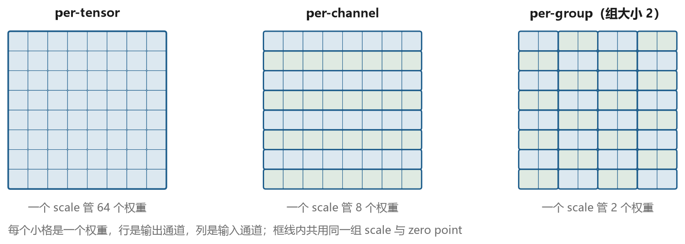
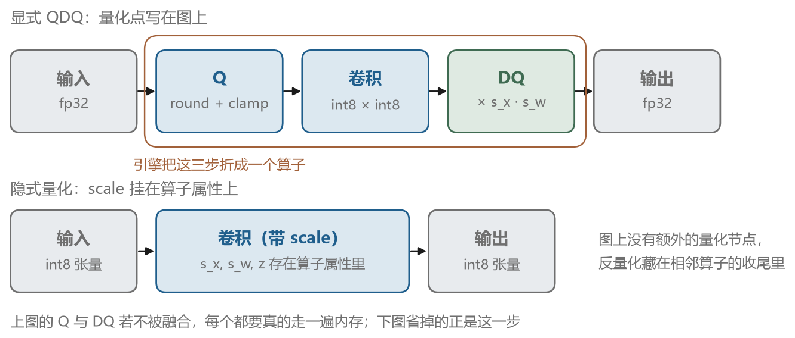

# 均匀量化：scale 与 zero point

同一个模型，两份量化配置，一份是 per-tensor 权重加 per-tensor 激活，一份是 per-channel 权重加 per-token 激活。第一份在 GPU 上跑得很快，精度掉了 1.8 个点；第二份精度只掉 0.2 个点，延迟却高了 12%。把粒度调细不是免费的，它买来的是精度，付出的是元数据、额外的归约和更复杂的 kernel。这一章把这笔交易的每一项摊开算。

均匀量化是今天几乎所有整数推理的基础，原因很实际，只有等距的格点才能用整数乘加高效实现。非均匀量化（比如对数量化、码本量化）能在同样的位宽下拿到更低的重建误差，但每次乘加都要查表，硬件不认。所以工程上的做法固定下来，格点等距，通过调整 scale、zero point、粒度、以及后面的校准来逼近最优。

## 对称还是非对称，看数据有没有被 ReLU 剪掉一半

对称量化把 `z` 固定为 0，格点关于原点对称，int8 的范围是 -127 到 127。非对称量化让 `z` 取任意值，用满 -128 到 127 的全部 256 个格点。选择依据是数据分布是否关于零对称。

权重几乎总是近似零均值、对称分布，初始化时从均值为零的分布采样，训练中的梯度更新也不会系统性地把权重推到一侧。对称量化在这里没有浪费，反而因为 `z = 0` 省掉了第 2 章那四项修正里的两项。

激活不一样。经过 ReLU 或者 GELU 之后，大约一半的值是零，剩下的全为正，分布严重偏斜。用对称量化，`[-x_max, 0]` 这半个区间全空着，等于把 128 个格点扔了。用非对称量化，区间定在 `[0, x_max]`，256 个格点全部用在有效数据上。同样是 int8，后者的有效精度高一倍，实测在 ResNet 这类以 ReLU 为主的网络上，非对称激活量化能比对称少掉一半的点。

$$
s = \frac{x_{\mathrm{max}}}{255}, \qquad \hat{x} = s \cdot q
$$

这是非负激活最常用的形式，`q` 取 0 到 255，`z = 0` 因为原点就在区间端点上。注意这里的 `s` 用的是 255 而不是 256，因为 0 到 255 是 256 个格点，间隔是 255 段。

还有一种介于两者之间的做法，用对称的格点配一个削顶的区间。有些硬件只支持对称量化和零点为零的快速路径，为了让非负激活也能用上，工程上会把区间定成 `[-x_max, x_max]`，但专门把正半轴的格点用满，负半轴只用很少几个。这种折中在早期的移动端 NPU 上很常见，精度介于两种方案之间，代价是校准的时候要多一个“负半轴留多少”的超参。

对一个带符号的激活，非对称量化的 `z` 就不在端点上了。设区间是 `[-0.8, 3.2]`，`s = 4.0/255 = 0.0157`，`z = round(-128 + 0.8/0.0157) = -77`，实数 0 被映射到码点 51。这个 51 很重要，它保证零精确落在格点上，补零和 ReLU 产生的零不会被量化成 0.008 之类的小数。

## 粒度决定了每一格代表多少

per-tensor 给整个张量一个 scale，最省事，精度最差。per-channel 给每个输出通道一个 scale，元数据多了一个长度等于通道数的向量。per-group 在通道内再切块，每块一个 scale，通常还会配一个 zero point。

图 4-1 用一个小矩阵说明切分的位置。per-tensor 的 scale 作用在整个张量上，一旦某个通道的幅度远大于其他通道，所有通道都得迁就它。per-channel 沿着输出通道切，每一行有自己的 scale，行与行之间的幅度差异被吸收。per-group 在行内再切，适合 int4 这种格点特别少的情形。

元数据的成本可以直接算。int8 权重，通道宽 128，per-channel 的 scale 用 fp32 存，每个权重分摊 32/128 = 0.25 位，等效位宽 8.25 位，压缩比从 4 倍降到 3.88 倍。int4 权重，组大小 128，同样 32 位 scale，每权重分摊 0.25 位，等效 4.25 位，压缩比从 8 倍降到 7.53 倍。组大小减半，元数据翻倍，int4 组大小 16 的等效位宽是 6 位，压缩比只剩 5.3 倍。这就是为什么低比特方案不会无限细分，收益很快被元数据吃掉。

粒度还受内存排布约束。卷积的输出通道在 NCHW 里是最外层的慢维，在 NHWC 里是最后一维。整数 kernel 为了提高访存效率，通常按通道方向做向量化，一次读 4 个或 8 个通道，于是 per-channel 的 scale 天然对齐，向量里的每个元素各取自己的 scale，不产生额外开销。如果通道数不是 4 或 8 的倍数，尾部那几个通道得单独处理，这就是为什么部署时经常把通道数从 1000 补到 1008。

还有一类成本不在存储上，在计算上。per-tensor 的 scale 是一个标量，反量化就是一次乘法，可以融进 epilogue。per-channel 的 scale 是一个向量，要求沿通道维对齐，输出通道数不是 8 的倍数时，kernel 得走标量尾巴。per-group 的 scale 要求在每个组的累加结束后乘一次，组内还要处理 zero point 的修正，kernel 的复杂度上一个台阶，很多推理引擎对 per-group 的支持只覆盖特定组大小。

## 量化算子在图上站在哪里

量化的落地方式有两种。显式量化把量化写成图上的算子，即 Q（QuantizeLinear）和 DQ（DequantizeLinear），ONNX 的 QDQ 格式就是这么做的。计算图里能看到每一处量化，工具链可以逐节点检查，调试方便。代价是图上多了很多小算子，如果引擎不把它们和相邻的卷积融合，每个 DQ 都要真的做一次反量化，性能会掉得很厉害。

隐式量化不给量化单独建节点，而是在张量的属性上标注它的 scale 和 zero point，卷积算子自己知道输入是 int8 还是 fp32。TensorRT 的 INT8 模式、以及大多数厂商的离线编译流程走这条路。图更干净，融合更彻底，但量化点对用户不透明，出了问题不好定位。

图 4-2 把两种画法并排放。左边是 QDQ 形式，浮点输入经过 Q 变成 int8，卷积吃 int8 输入输出 int8，再经过 DQ 变回浮点。右边是隐式形式，卷积直接吃 int8，scale 挂在边上。实际部署里左边那种写法通常会被引擎重写成右边那样，识别模式是“Q → 算子 → DQ”，三个算子合成一个。

两种落地方式还决定了激活的 scale 是静态还是动态。静态量化在校准阶段就把激活的区间定死，烧进模型，运行时只做乘加，开销可以忽略。动态量化在每次前向时现算当前张量的最大绝对值，再除出 scale，多一次归约和一次同步。以 Transformer 的矩阵乘为例，动态 per-token 量化需要先把整行的最大值算出来，这一步在 GPU 上是一次跨线程的归约，序列长的时候开销不小。换来的是对输入分布变化的鲁棒性，同一个模型换一种语言、换一种 prompt 风格，静态 scale 可能就不合适了，动态 scale 会自己跟上。

融合能不能成立，取决于量化参数能不能提前确定。卷积后面接 ReLU，ReLU 的输出范围可以从卷积的输出范围推出来，量化参数可以提前算好，融合成立。卷积后面接 LayerNorm，输出的范围依赖整个 token 的统计量，量化参数得运行时算，融合就不成立，图上必须留一个真正的量化节点。这就是为什么 Transformer 的量化图通常在 LayerNorm、softmax、残差相加的边界上断开。

一个容易踩的坑是残差相加。两个分支各自量化之后相加，如果两个分支的 scale 不同，相加之前必须先统一到同一个 scale，否则等于把两个不同刻度的数直接相加。实现上要么在相加前做一次重量化，要么在设计量化方案时就强制残差路径上的 scale 相同，后者更常见，因为重量化会引入额外误差。

## 饱和是唯一的选择，但可以选得更好

定点数没有 inf，超出范围只能截断。截断的方式有两种，一种是饱和（clamp 到端点），一种是回绕（整数溢出，从另一端绕回来）。所有正经的量化实现都用饱和，回绕会让一个很大的正数变成很大的负数，误差比饱和大一个数量级。

饱和的代价取决于有多少值被截断。校准的时候如果把区间定得比实际分布窄，截断的就多，误差集中在尾部；定得宽，格点变粗，误差均匀地摊到所有值上。这两者之间有一个最优点，下一章讲的 KL 校准和百分位截断就是在找这个点。

有一个特例几乎不需要权衡。ReLU 之后的激活非负，上界由校准确定，下界是 0，而且 0 是精确可达的。此时任何负的量化值都是浪费，用无符号的 uint8 表示，把 256 个格点全部铺在 `[0, x_max]` 上，是最优的。工程上见到“激活用 uint8、权重用 int8”的配置，原因就在这里。反过来，如果一个框架只支持 int8 激活，那它在 ReLU 网络上的精度天然比 uint8 差一截，这不是实现 bug，是格式限制。

判断一个框架的饱和策略是否合理，可以看它在校准集之外的表现。拿一批比校准集更大的样本跑一遍，统计每层实际被截断的元素比例。健康的量化方案在训练分布上截断比例应该很低，在分布外样本上略微升高；如果某一层在分布内就截了 2% 以上，说明区间定窄了，或者这一层有离群值需要单独处理。

饱和还有一个不那么明显的用途。有些层（比如注意力里的某些投影）的激活偶尔会出现极端的离群值，把区间撑大到正常值完全失去分辨率。此时主动把区间截在一个百分位上，宁可让那 0.01% 的值饱和，也要保住其余 99.99% 的分辨率，端到端指标反而更好。这个做法在第 5 章会展开，它的前提是你知道哪些值是真正重要的，而不是一刀切。

还有一个常被忽略的细节，权重和激活的量化是两件不同的事。权重的分布在整个推理过程中不变，可以在离线阶段反复优化，甚至用上需要迭代的算法；激活的分布随输入变化，只能在有限次前向里采样，采到的分布未必代表线上。这条差异解释了为什么同一套方法在权重上有效、搬到激活上就失效，也解释了为什么权重量化可以做到 int4 而激活仍然停在 int8。

尺度、零点、粒度、量化点在图上位置，这四件事定下来，一个均匀量化方案就成型了。剩下的关键问题是区间怎么定，也就是 `x_min` 和 `x_max` 取什么值。这个问题的答案不在模型结构里，而在数据里，需要跑一遍校准。
