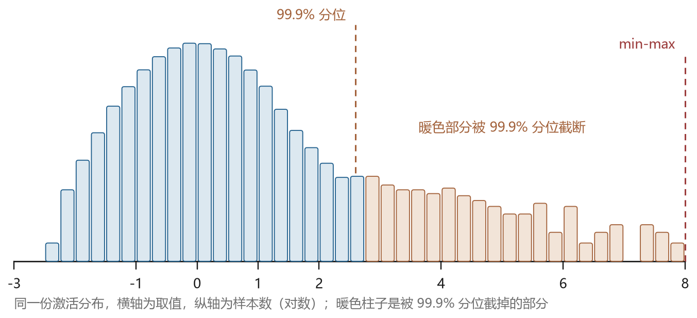

# 校准：怎么确定范围

假设一次内部评测，同一个 W8A8 模型在两个团队手里跑出了不同的结果。量化脚本是同一份，框架版本相同，唯一的差别是校准集。一个团队用了 1024 张来自生产日志的图片，另一个图省事用了 128 张训练集图片。后者掉了 3 个点，前者掉了 0.6 个点。这些数字只为说明差别，不代表任何具体模型。校准不是“跑一遍就行”的固定步骤，它决定了每一层的区间，而区间一旦定错，后面所有环节都救不回来。

先把“校准”（calibration）这个词讲清楚。它指的是拿一批有代表性的输入喂给模型，让模型正常前向一遍，同时记录每个需要量化的张量实际出现了多大的值，然后据此给每一层定一把尺子。它不需要标签，不需要反向传播，也不改权重，只是在“看数据”。可以类比成配眼镜前的验光：镜片度数由你的眼睛决定，而不是由教科书决定。

这一章讲区间怎么定。核心问题只有一个，给定一个激活张量在真实流量下的分布，用什么规则把它压成 `[x_min, x_max]`。规则的选择取决于分布的形状和你对尾部误差的容忍度，不存在对所有层都最优的规则。

## 校准集要像线上，而不是像训练集

校准集的作用是估计每一层张量的取值范围，所以它必须代表推理时真正会出现的输入。训练集通常做过增强、做过采样平衡，分布和线上不一样；验证集更接近，但仍然可能带着标注筛选的偏差。举个具体例子，一个商品图片分类模型，训练集里的图都是白底棚拍，线上用户上传的是自己拍的、带桌面背景、带反光的图。校准集如果只从训练集里抽，模型会以为亮度范围永远是 0.8 到 1.0，上线后遇到 0.2 的暗图，整层被截断。

校准要收集的统计量不止最大值。最少需要每一层的输出张量的分布，很多时候还要记录输入、以及内部累加的状态。有些框架默认只记录算子的输出，导致某些算子（比如加法、拼接）的输入没有区间，只能靠推断，推断错了就是精度悬崖。看到“某几层没有校准数据”的告警不要忽略，那几层要么被跳过了，要么用了默认区间。默认区间往往是一个很宽的对称范围，等于把有效位数直接砍掉一半。

样本数量有经验区间。太少，最大值估计不稳，某个极端样本就能把区间撑开；太多，边际收益递减，跑一遍校准的时间可能超过量化本身。实际项目里 200 到 1000 个样本是常见范围，图像任务按批跑几十个 batch 就够，语言模型取几百条真实 prompt 更有代表性。这里的关键不是数量，是覆盖度，要让校准集里的最大激活接近线上会遇到的最大激活，而不是被几条特别长的 prompt 决定。一个反直觉的做法是故意留几条超长、超短、带特殊符号的样本在校准集里，因为线上的极值往往就来自这些边角输入。

校准集和测试集必须分开，这一点比想象中更容易出错。有些人为了省事，用评估集做校准，然后在同一个评估集上报指标，结果偏乐观，因为区间正好贴合了测试数据的极值。正确的做法是拿一批没有参与评估的数据做校准，再用独立的评估集看掉点。这条规则和机器学习里的老规矩一样，只是量化流程里经常被忘掉，因为校准看起来“不算训练”。

还有一个隐蔽的问题，校准时的批大小和线上不同。批归一化在推理时用滑动统计量，不受影响，但动态量化里的归约、以及某些算子的分块策略会随批大小变化，同一个张量在不同批大小下算出的 amax 可能有百分之一的差别。差别不大，但如果某一层正好卡在饱和的边界上，这点差别会让它的截断比例翻倍。类似地，序列长度也会影响结果，用 512 长度校准的模型拿去跑 4096，注意力那边的统计量完全变了。

## min-max 简单，但被一个值决定

最直接的规则是取整个张量的最小值和最大值。它对均匀分布、对范围稳定的权重都很好用，实现只要一次归约，没有任何超参。问题是它对离群值毫无抵抗力。一个张量里只要有一个元素是其余元素的一百倍，区间就被这个元素撑大一百倍，其余元素的格点数量掉两个数量级。

权重量化用 min-max 通常没问题，权重的分布稳定、离群值少，而且逐通道之后每个通道的极值都在合理范围内。激活量化用 min-max 就危险，第 3 章讲的离群值会直接命中这里。

改进的办法是百分位截断（percentile clipping）。不看最大值，看 99.9% 分位，把最大的那 0.1% 主动截掉。分位数这个概念可以这样理解：把张量里所有值按大小排队，99.9% 分位就是排在第 99.9% 位置上的那个值，它后面还有千分之一的元素比它更大，这些就是被放弃的部分。

图 5-1 用一份构造的激活分布说明差别。分布的主体集中在 -1.5 到 1.5，右侧有一条长尾延伸到 8。min-max 把区间定到 8，主体部分只用到不到五分之一的格点。99.9% 分位把区间定到 2.6，主体用掉大部分格点，被截断的只有千分之一。两种方案的 MSE 相差一个数量级，端到端指标的差距取决于这些被截断的值是否重要。

截断比例怎么选，取决于尾部值的功能。有些层的极值确实携带信息，比如注意力里某些头在特定 token 上的强响应，把它们截掉会让模型“看不见”关键位置；有些层的极值只是数值噪声，截掉毫无影响。判断方法是做一次敏感性实验，把截断比例从 99% 扫到 100%，看端到端指标在哪一点开始掉。多数层在 99.9% 到 99.99% 之间是平的，掉点出现在更激进的截断上。

校准还有一个必须处理的边界情况，死掉的张量。某个通道在整批校准数据上输出恒为零，算出来的最大值是 0，缩放因子也成了 0，反量化时除零直接出 NaN。这种情况在带 Dropout 或者带门控的模型里不罕见，某些专家在某些输入下就是全零。工程上的做法是给缩放因子设一个下限，比如取最大值与 1e-8 中的较大者，输出的零照样映射到码点 0，不会引入误差。

## KL 散度：让量化后的分布最像原来的

百分位是一个固定的规则，它不知道量化之后的分布变成了什么样。KL 校准换了一个思路，直接比较量化前后的分布，选让两者差异最小的那个区间。

KL 散度（Kullback-Leibler divergence）衡量两个概率分布的差异，取值非负，等于零表示两个分布完全一样。它有一个很直观的信息论解释：如果你以为数据服从分布 A，实际数据来自分布 B，那么平均每个样本你要多花多少比特来编码。用在量化上就是：如果量化后的分布和原分布差得远，说明你的格点把数据“编码”错了，浪费了精度。它不对称，`D(P||Q)` 和 `D(Q||P)` 不是一个数，做校准时固定把原分布放前面。

具体做法是把浮点张量的取值范围切成若干区间统计直方图，然后对每一个候选的饱和阈值 `T`，把超出 `T` 的部分全部累加到边界桶里，得到量化后的分布 `Q`，再算它和原始分布 `P` 的 KL 散度

$$
D_{\mathrm{KL}}(P \,\|\, Q) = \sum_{i} p_i \log \frac{p_i}{q_i}
$$

选使这个值最小的 `T`。`p_i` 和 `q_i` 分别是原分布和量化后分布落在第 `i` 个桶里的比例。TensorRT 的熵校准就是这套流程，它对每个激活张量保留一份直方图，遍历若干候选阈值，取 KL 最小的那个。

直方图（histogram）在这里的作用是把“分布”这个连续的东西变成一组可以快速比较的桶计数。想象你把一千个数值按大小丢进 2048 个格子，每格记有多少个，之后算比例、算 KL 都只需要遍历格子。这也是为什么校准必须先跑一遍数据：你得先有这些计数。

KL 校准的实现细节里有一个容易忽略的点，直方图要在反量化之后的网格上重采样。浮点的桶边界和整数的桶边界不对齐，如果直接比较原始直方图，会引入一种“桶错位”的误差，让最优点偏移。TensorRT 的做法是把浮点直方图按候选阈值合并到 128 个整数桶上，再做比较，这样两边在同一个坐标系里。

这个方法的好处是自适应。分布集中，它就选一个窄区间；分布分散，它就放宽。它不会因为一个孤立的大值就把区间拉宽，因为拉宽会让主体部分的桶变粗，KL 散度上升。代价是需要保存直方图，校准时间比 min-max 长，而且直方图的桶数是一个超参，桶太少分辨率不够，桶太多统计噪声大。TensorRT 默认用 2048 个桶，这个数字在多数模型上工作良好。

KL 校准对激活特别有效，对权重反而没那么必要。原因是权重的分布稳定且近似对称，min-max 加上逐通道已经够好；激活的分布随层、随 token 变化剧烈，需要一个能自适应的规则。这也是为什么很多 PTQ 工具对权重用 min-max、对激活用 KL 或百分位。

## 最小化重建误差

还有一类规则直接优化量化误差。给定一个张量，枚举一个缩放系数 `alpha`，把区间定成 `[-alpha, alpha]`，量化再反量化，算和原张量的 MSE，选误差最小的 `alpha`。计算量不大，因为可以在一个粗网格上搜索再细化，而且整个过程只依赖这一个张量，不需要跑前向。

$$
\alpha^{*} = \arg\min_{\alpha} \left\| x - \hat{x}(\alpha) \right\|_{2}^{2}
$$

`arg min` 的意思是“让后面这个量取到最小值的那个 alpha”。`||·||^2` 是平方误差之和，也就是每个元素差多少、平方、加起来。这个目标比 KL 更贴近“这一层的输出会差多少”，但它忽略了误差在层间的传播，局部最优不等于全局最优。实践中它的表现和 KL 接近，在权重上略好，在激活上略差，具体取决于模型。

再往前一步是考虑层输出的重建误差，而不是权重本身的重建误差。GPTQ 用的就是这个思路，它不只最小化权重的误差，而是最小化量化前后层输出的差，把输入的统计信息（Hessian）纳进来，让量化误差落在对输出影响小的方向上。AdaRound 则把舍入方向从“最近格点”改成可学习的二值选择，逐层优化。为什么“最近”不一定“最好”，可以想一个场景：某个权重落在两个格点正中间，往上往下误差一样大，但往上会让这一层输出偏大、往下恰好抵消下一层的偏差，那么往下的实际效果更好。最近的格点在单个数的意义上最优，在整个网络的意义上未必。

用 MSE 规则做权重校准时，逐通道搜索的开销要算清楚。一个 4096×4096 的权重矩阵有 4096 个通道，每个通道搜 20 个候选 alpha，每个候选做一次量化加一次反量化，计算量约等于把权重读 40 遍。相对于训练可以忽略，相对于“五分钟量化完一个模型”的期待就未必。工程上常见的做法是先用 min-max 得到初值，再在初值附近搜几个点，精度损失很小，时间省一个数量级。

这些方法都在同一个框架里，给定一个层的输入统计量，找一个量化参数使这一层的输出误差最小。区别在于优化什么变量，区间（校准）、舍入方向（AdaRound）、还是权重本身（GPTQ）。第 9 章会展开后两种。

## 校准会过期

校准得到的区间是对某一批数据的快照。数据分布变了，快照就失真。最常见的变化是输入长度，一个客服模型上线初期处理的都是短问题，后来用户开始贴长文档，序列长度从 200 涨到 4000，注意力相关层的激活分布整个变形，原来校准的区间窄了一半，截断比例从 0.1% 涨到 8%。另一个常见变化是季节和场景，电商模型在大促期间的商品图和平时不一样，内容平台在热点事件期间的话题分布和平时不一样。

发现这类问题靠监控。线上记录每层实际激活的 amax 和截断比例，和校准时比较，偏差超过阈值就重校。阈值没有通用值，可以看截断比例的变化倍数，也可以看输出分布的变化，后者更直接但更难归因。监控的关键是要能在不增加太多延迟的前提下拿到这些统计量，实践里通常只对少数关键层做，或者按采样率抽样。一个成本很低的做法是记录 amax 的滑动分位数而不存原始值，每天对比一次，存储和计算都几乎可以忽略。

重校的成本不高，跑一遍校准集加上重新编译模型，通常是小时级。真正麻烦的是重校需要新的代表性数据，而线上数据的采集涉及隐私和存储。有些团队的做法是保留一份脱敏的线上样本池，定期更新，这样重校随时可以做。这份样本池同时也是评估集的来源，两个用途共用一份数据，但要保证校准和评估用的不是同一批。

区间的确定是量化流程里最依赖数据的一步，也是最容易被做成一次性动作的一步。把一个校准流程做扎实，比换一个更花哨的量化算法更能稳住精度。有一个迹象可以帮你判断校准做得够不够：如果量化模型的错误总是集中在某几类输入上，而这几类在校准集里很少，那多半不是算法不够好，是校准集没覆盖到。

区间定下来之后，下一步是把整个模型过一遍量化，看哪些层扛得住、哪些层扛不住。这就是 PTQ 的流程，也是下一章的主题。
