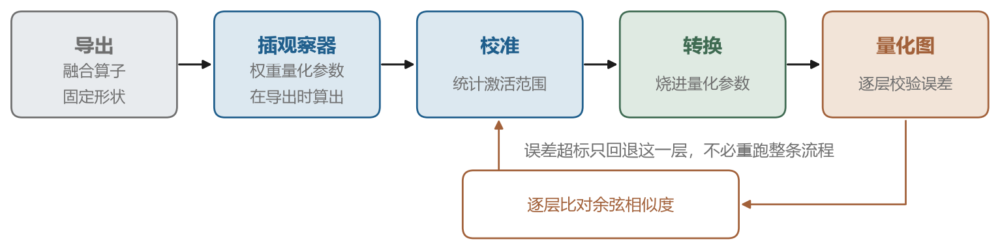
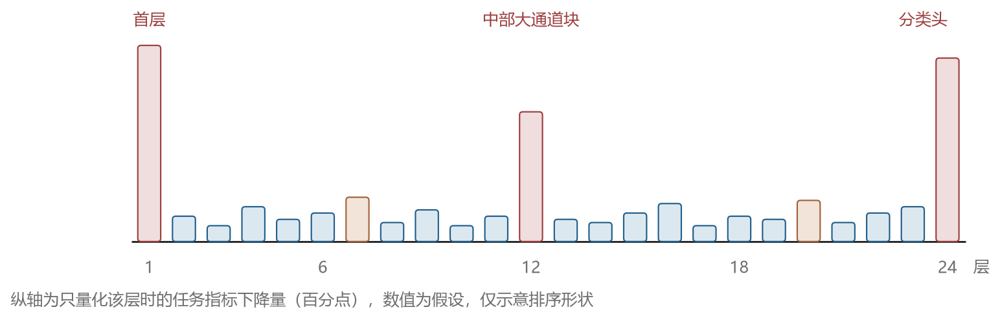

# PTQ：逐层替换与敏感度

全模型 W8A8 量化，ResNet-50 的 top-1 掉了 0.4 个点，看起来很划算。同一个流程搬到 ViT-B/16 上，掉了 3.2 个点。再搬到一个小目标检测模型上，mAP 掉了 11 个点。三个模型用的是同一套工具、同一份校准代码，差别在于每个模型的“哪一层扛不住量化”完全不同。PTQ 的核心工作不是执行量化，而是找出哪些层不能量化。

先说一个判断标准，什么样的掉点算“可以接受”。分类任务里 0.5 个点以内通常能谈，检测任务里 mAP 掉 1 个点相当于漏检率明显上升，生成任务里困惑度涨 3% 往往对应可感知的质量下降。这些阈值不同，因为指标对错误的敏感度不同。跨任务比较“掉了多少点”没有意义，要在任务自己的尺度上判断。

训练后量化（post-training quantization，PTQ）这个说法容易让人以为它是一键操作。实际流程里有四个阶段，每个阶段都可能出问题，而最后一个阶段的失败往往要在前三个阶段里找原因。

## 从浮点图到量化图

第一阶段是准备。把训练好的模型导出成推理图，做算子融合，把批归一化折进卷积，把只用于训练的节点删掉，固定输入的形状。这一步和量化无关，但它决定了量化的边界，融合之后有多少个算子需要量化，哪些张量有名字可以挂观察器。

第二阶段是插入观察器（observer）。观察器挂在每个需要量化的张量上，在前向时记录统计量。权重的观察器在导出时就能算出结果，因为权重已知；激活的观察器必须跑校准数据才能得到统计量。

第三阶段是校准，用校准集跑一遍前向，让观察器收集足够的数据，然后按第 5 章讲的规则确定每一层的区间。

第四阶段是转换。把浮点算子替换成量化算子，把统计量烧进模型，得到量化图。转换之后要立刻做一次数值校验，比较量化图和浮点图在同一个输入上的输出，看相对误差是否在预期范围内。这一步能提前发现大部分问题，比直接跑评测集快得多。

转换阶段的规则比想象中琐碎。能被替换成整数版本的是那些有成熟整数实现的算子，卷积、矩阵乘、以及逐元素的加乘。拼接（concat）要求两个输入共用同一个 scale，否则要先重量化；上采样和插值没有整数版本，只能留在浮点；gather 和 embedding 查表本质上是搬运，量化只影响存储不影响计算。工具链把这些规则写成一张表，表里没列的算子默认回退到浮点，回退本身不报错，只是把一段整数路径切成了两段，性能收益立刻打折。

图 6-1 里有一个容易忽略的分支，校验。校准和转换之间如果发现某一层的输出误差明显偏大，可以只对这一层调整策略，不必重跑整个流程。工程上把这个环节做成逐层对比，量化图和浮点图在每一层输出上的余弦相似度落到 0.99 以下就报警。

## 敏感度分析：一次只动一层

找出“哪一层不能量化”的标准方法是逐层敏感度分析。保持其余层是浮点，只把第 `i` 层换成量化版本，跑评估集，记下指标的变化。变化越大，这一层越敏感。

$$
\Delta_i = M(\mathrm{fp}) - M(\mathrm{q}_i)
$$

这个做法的代价是评估次数等于层数。50 层的模型跑 50 次评估，每次几分钟，一天就没了。所以实践中常做两层简化。一是分组，把结构相同、位置相邻的层合成一组（比如所有 QKV 投影算一组），组数降到十几组。二是换代理指标，用输出余弦相似度或者相对误差代替任务指标，一次前向就能算完，不用等评测。

$$
\epsilon = \sqrt{\frac{\sum (\hat{y} - y)^{2}}{\sum y^{2}}}
$$

`epsilon` 是这一层输出的相对误差，分母取浮点输出的能量，这样不同层的误差可以横向比较。

代理指标还要注意分辨率的极限。1000 张图片的验证集上，准确率的标准误大约是 `sqrt(0.76 × 0.24 / 1000)`，约 1.4 个百分点。两个方案的差距如果是 0.4 个点，那在统计上根本分不出来，多跑一次可能结果反过来。做敏感度分析时如果每组只评估一次，排序结果会被噪声主导。解决办法要么扩大评估集，要么对同一组跑多次取平均，要么用更细的连续指标（比如平均精度、交叉熵）代替离散的准确率。

代理指标和任务指标的相关性不是线性的。有些层的输出误差很小，但对下游影响很大，比如最后一层的分类头；有些层误差很大，下游却不在乎，比如靠近输入的卷积，后面的归一化会吸收掉一部分。所以代理指标只用来排序，最终决策要回到任务指标上。

图 6-2 是一张典型的敏感度排序图。假设数据里最敏感的是第一层卷积、最后一层分类头，以及中间几个通道数特别大的块。这个形状在不同模型上反复出现，原因不神秘。第一层的输入是原始数据，动态范围最宽，量化误差直接进入网络；最后一层的输出直接决定 logits，任何误差都没有后续层来平滑；通道数大的块，累加项多，误差统计上更容易放大。

还有一类层，量化误差很大但端到端无感，原因是下游存在冗余。Transformer 的某些中间层输出可以被相邻层近似重建，量化带来的扰动被后续的残差和归一化吸收。这类层在敏感度排序上位置靠后，可以放心量化到 4 位；但换一个模型，同样的层可能就变成尖刺，因为冗余程度取决于训练时的正则和模型宽度。所以敏感度分析的结果不能跨模型复用，每次换模型都要重跑。

真实项目里更常见的现象是敏感度不成片。某几个块特别敏感，相邻的块完全没事，排序图上像尖刺。这种尖刺往往对应结构上的特殊情况，比如某个块的输入来自残差相加，两个分支的 scale 差很多；或者某个块的权重分布有一条长尾。遇到尖刺要单独看这一层的数据，而不是整体调策略。

## 混合精度怎么分配预算

知道了敏感度，接下来的问题是怎么分配位宽。目标通常是一个平均位宽，比如 4.5 位或者 6 位，然后在这个预算下让精度损失最小。

一个简单有效的贪心策略是，先全部用低精度，按敏感度从高到低逐层升到高精度，每升一层算一次收益（误差下降），直到预算用完。收益递减的层不值得升。这个策略的效果接近最优，实现只要几十行代码。

$$
\bar{b} = \frac{\sum_{i} n_i b_i}{\sum_{i} n_i}
$$

`n_i` 是第 `i` 层的参数量。这个公式说明为什么 embedding 和 lm_head 在预算里占大头。一个 7B 模型的词表是 32000，隐藏维 4096，embedding 一项就有 1.3 亿参数，占 2%。把 embedding 留在 fp16 只多花 1% 的预算，但能避免词表里低频 token 的向量被量化坏，这笔交易几乎总是划算。

混合精度还需要考虑内存布局。int8 的权重按 8 位对齐打包，fp16 的权重是 16 位，两种权重要分开放，或者用一个标记位区分。如果按层分配，每层一个 buffer，管理简单；如果按通道分配，同一层的权重里混着两种格式，访存要跨步读取，kernel 得专门写。这也是为什么大量落地方案停在“整层混合”而没有走到“逐通道混合”，后者在精度上更优，在工程上没人愿意实现。

实际部署里还有一条硬件约束，混合精度的算子要能高效切换。如果一层 int8、下一层 fp16，中间要做一次反量化加一次量化，两次内存往返。相邻的同精度算子应该合并成一段，段与段之间才切换精度。所以混合精度的粒度不宜太细，按块（block）或按模块（module）分配比按单层分配更实际。

## 掉点的常见来源

排查 PTQ 掉点，先看是权重的问题还是激活的问题。把模型设成 weight-only 量化（权重 int8，激活 fp16），如果精度几乎不掉，说明问题在激活。再把激活量化加回来，逐层加，看哪一层开始掉。

激活侧最常见的原因是离群值，第 3 章讲过。第二常见的是 LayerNorm 和 softmax。这两个算子的输入分布随 token 变化，用静态区间很难覆盖，而且它们的输出对数值误差敏感。多数框架默认把这两个算子留在浮点，不是保守，是实测掉点明显。

第三是残差相加。两个分支相加时如果量化参数不一致，必须先统一 scale，这一步的舍入会引入误差。有的工具链在残差路径上强制共享 scale，代价是精度略降；有的允许各自量化再重量化，代价是速度。

第四是权重侧的分布问题。逐通道量化之后，单个通道内的分布仍然可能有一条长尾，min-max 会把这一通道的格点浪费掉。这种情况要靠分组量化，或者换用考虑输出的校准方法（GPTQ 那一类）。

还有一类掉点不在数值上，在图结构上。量化之后某些算子被替换成了不支持的形式，或者某个融合没有生效，导致实际执行的是另一条路径。这类问题在数值校验里看不出来，只能靠对比转换前后的图，或者直接看推理日志里每个算子走的 kernel。

把所有环节串起来，PTQ 的实际工作量大头在排查而不是执行。一个成熟的流程跑完量化只要十几分钟，找出那三层不能量化的层可能要两天。这也是为什么很多团队把敏感度分析做成固定的流水线，每次模型更新自动跑一遍，把结果和上一版对比，只关注变化的部分。

PTQ 的优点是简单，不需要训练，几个小时能出结果。缺点是它的上限受限于浮点模型本身，遇到对量化特别敏感的模型，怎么调都差一截。这时候只能上 QAT，把量化误差放进训练过程里，让模型自己适应。下一章讲这件事怎么做，以及为什么它没有想象中那么贵。
