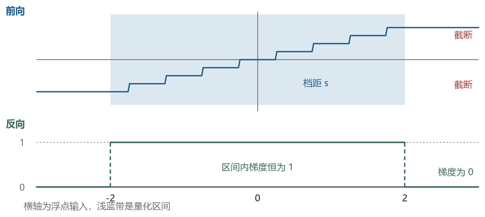

# QAT：伪量化与直通估计

一个检测模型的 PTQ 方案怎么调都差 2 个点，团队决定上 QAT。他们准备了完整训练集，按原来的配方重训 100 个 epoch，结果不但没恢复，还比 PTQ 更差。问题出在预期上。QAT 不是重新训练一遍模型，它是在一个已经收敛的模型上做微调，学习率要小两个数量级，轮数通常个位数，动的东西很少。

量化感知训练（quantization-aware training，QAT）要解决的是一个很具体的问题，量化里的取整操作不可导，梯度传不过去。所有 QAT 的技巧都在绕开这一点，让训练时能感知到量化的存在，同时保留一条可用的梯度通路。它和 PTQ 的分工可以这样理解：PTQ 是给一个已经定型的模型配一副合适的眼镜，QAT 是让模型从小学着戴眼镜长大，后者效果更好，但要重新养一遍。

## 训练时先假装量化

QAT 的做法是在前向里插入一个伪量化节点（fake quant）。这个节点把浮点输入按量化规则处理一遍，再反量化回浮点，输出仍然是浮点，但数值已经落在量化格点上。后续的卷积仍然用浮点算，所以整个训练过程不需要整数 kernel。

$$
\hat{x} = s \cdot \left( \mathrm{clamp}\left( \mathrm{round}\left( \frac{x}{s} \right) + z,\ q_{\mathrm{min}},\ q_{\mathrm{max}} \right) - z \right)
$$

这个函数把 `x` 先除以 `s` 得到整数坐标，四舍五入，加上零点，截断到整数范围，再减回零点乘上 `s`。前向看，输出和真的量化再反量化完全一致，网络“感受到”的误差是真的。反向量化不看这一步，看的是梯度怎么回传。

“假装”这个词在这里很关键。训练时显存里存的还是 fp32 权重，算的还是浮点乘加，只有数值被推到了格点上。这样做的好处是不需要整数算子，任何训练框架都能加进去；坏处是训练的数值行为和部署时的整数 kernel 不完全一样，尤其是累加顺序和舍入时机，所以训练完之后仍然要拿真实量化模型跑一遍验证。

伪量化节点一般插在两个位置，权重侧和激活侧。权重侧的伪量化在每次前向时把 fp32 权重压一遍，梯度通过 STE 回传到原始权重；激活侧的伪量化插在线性层或卷积的输入上，需要一个观察器实时维护区间，因为激活分布随 batch 变化。两边都插上之后，训练时的算子图就和部署时的量化图一一对应，模型学到的适应性才能用上。只插一边也能训，但效果相当于只修了一半的问题。

图 7-1 左边是前向的阶梯，输入连续变化，输出只在格点处跳变，跳变点的导数在数学上不存在，其余位置的导数为零。如果按真实导数回传，梯度全是零，训练立刻停摆。右边是实际用的梯度，区间内恒等于 1，区间外等于 0。

可以把这理解成“在格点上走楼梯”。你想让一个参数往上走一点，但楼梯只有整级，参数只能在台阶之间挪。前向告诉你现在站在哪一级，反向告诉你“这个方向是上”，却不告诉你坡度是多少。虽然信息粗糙，但方向对了，多走几步总能到位。

## 直通估计

直通估计（straight-through estimator，STE）的做法是把舍入的导数近似成 1

$$
\frac{\partial \hat{x}}{\partial x} = 1, \qquad x_{\mathrm{min}} < x < x_{\mathrm{max}}
$$

区间外取 0，因为被截断的值再怎么调也不会改变输出，梯度应该为零。这个近似明显是错的，真实导数在几乎所有点都是 0，在跳变点不存在。但它给出了一个方向正确的信号，如果某个权重量化后偏小，梯度会告诉优化器把它调大，虽然梯度的大小不对，符号是对的。

为什么这样也能收敛，有一个直观解释。STE 相当于把量化看成加了一个有界的扰动，训练时用浮点的梯度去更新参数，参数移动的方向和没有量化时一样，只是每一步之后被重新吸附到格点上。经过若干步，参数会漂移到那些量化后误差较小的位置，也就是每个格点的中心附近。这个过程不需要精确梯度，只需要方向。

用一个极简例子感受一下。假设某个权重的真值是 1.03，`s = 0.1`，它被量化到 1.0，反量化回来是 1.0，误差 -0.03。如果这一层需要更大的输出，梯度会让真值继续往上走，走到 1.06 时量化结果变成 1.1，误差变成 +0.04。参数就这样在格点边界附近来回跳，最后倾向于停在能让这一层输出最接近目标的那个格点附近，而不是精确的 1.03。也就是说，训练的目标变成了“量化之后好用”，不是“数值上接近”。

这条梯度还有一个性质容易被忽略，它的尺度不对。真实的损失对参数的敏感度随 `x` 的位置变化，格点中心处最不敏感，格点边界处最敏感，而 STE 对所有位置给同样的梯度。结果是在格点边界附近的参数被推得过于猛烈，容易在两格之间震荡。缓解办法是在训练后期降低学习率，或者给 STE 乘一个小于 1 的系数，让有效步长变小。

代价是偏差。STE 的梯度忽略了量化误差对参数的依赖，严格说它优化的不是量化后的损失，而是一个代理损失。实践中这个代理足够好，因为量化误差相对参数本身很小，一阶近似成立。当量化误差变大，比如降到 2 位，偏差就不可忽略，训练会震荡或者收敛到次优点。这也是为什么极低比特的 QAT 往往要配合别的技巧，比如可学习的缩放因子、或者把权重分解成多个低比特项相加。

还有一层更细的解释。STE 等价于假设“量化误差对参数的导数为零”，而这个假设的破坏程度和格距成正比。格距小时，参数在格内移动几乎不改变量化结果，假设成立；格距大时，参数一动就跳格，量化结果阶跃变化，梯度给的方向可能直接错判。所以同样是 STE，int8 上几乎不用管，int4 上就开始需要配合，int2 上几乎必须换方法。

有几条改进路线值得知道。软量化把 `round` 换成一个可导的近似，比如在几个格点之间做线性插值或者用 tanh 平滑，这样梯度是真实的但函数不再严格等于量化，训练和推理之间有偏差。加噪声的做法是在训练时给权重加均匀噪声再量化，让模型对量化误差更鲁棒，本质上是数据增强。还有一类做法让缩放因子可学习，`s` 也参与梯度更新，这能补偿一部分 STE 的偏差。把 `s` 当作可训练参数时，它的梯度来自所有被它量化的元素之和，量化误差大的方向把 `s` 推大，误差小的方向推小，每层的分辨率于是自动调整。代价是每个 step 都要算一次这个和，而且 `s` 必须保持正数，实现上一般存它的对数，这样梯度更新自动保证正数。

## 训练配方和几个坑

QAT 的初始化很重要。从浮点模型直接开始，前几个 step 的损失会突然跳高，因为所有权重同时被量化，误差一次全部注入。常见的做法是先用 PTQ 校准出缩放因子，用它初始化伪量化节点，这样起点就是“量化后但还没适应”的状态，损失跳变小得多。这一步几乎没有成本，因为 PTQ 校准本来就要跑，顺手把参数存下来就行。

训练的参数范围也要选。全参数微调在数据充足时效果最好，但显存占用和浮点训练一样，量化省下来的资源全被优化器吃回去。只训练量化参数（缩放因子、零点）和少量适配层，显存占用小一个数量级，在数据只有几千条的场景里反而更稳，因为大模型在小数据上全参数微调容易过拟合。介于两者之间的做法是冻结主干、只训练每个块的最后一层和所有量化参数，这是很多开源实现默认的配置。

学习率要小。浮点训练的 1e-4 对 QAT 太大，参数一步就走过了格点的吸引域，训练在格点之间来回跳。经验值是浮点训练的十分之一到百分之一，配合余弦退火，轮数 5 到 20。开头几百 step 最好再加一段很短的预热，让缩放因子先稳定下来，再放大学习率，否则第一批梯度会用尚未校准的区间去推参数。数据量不需要全量，十分之一到三分之一通常够，因为要学的是“适应量化噪声”，不是学新任务。判断是否训够了一个简单办法，看训练损失和验证损失的间隔，如果验证损失已经连续几轮不降，继续训只是在拟合校准数据。

观察器的更新策略也要定。训练时激活的分布会变，如果观察器固定在 PTQ 校准得到的区间上，训练到后期模型已经适应了这个区间，反而学不到“扩大区间”这件事。常见做法是让观察器按滑动平均继续更新，窗口长一点，避免被单个 batch 的极值带偏；也有做法是前几个 epoch 更新、后几个 epoch 冻结，让模型在固定的区间上收敛。两种都能用，前者的最终精度略好，后者的训练更稳定。

批归一化要特别处理。训练模式下 BN 用当前 batch 的统计量，QAT 时这些统计量会被量化误差污染，和推理时用的滑动统计量不一致。做法有两种，一是冻结 BN 的统计量只训缩放和平移，二是训练结束后用一批数据重新估计 BN 统计量。后者更稳，代价是多一遍前向。

还有一个容易忽略的点，伪量化节点的位置要和实际部署的量化点一一对应。如果训练时在卷积前插入伪量化，而部署时量化的是卷积的输入和输出，两边的误差模式不一样，训练出来的适应性就用不上。工程上的做法是从部署配置反推 QAT 图，保证两边同构，这件事比调超参重要。图和部署不一致时，QAT 甚至会给人一种“训了没用”的错觉，实际上是训的东西没用上。

## 什么时候值得上 QAT

QAT 的成本可以量化。一次完整的 QAT 需要训练框架、可用的训练数据、以及一个人盯着收敛，时间从几小时到几天。PTQ 的成本是几分钟加上校准数据。两者的差距在两个数量级，所以决策标准很清楚，PTQ 的掉点是否可接受。

还有一个隐性成本，验证。QAT 训练出来的模型必须重新做一轮完整的精度与性能验证，因为它和浮点模型的行为差异比 PTQ 更大，量化参数是训练出来的，不再是单纯的统计量，某些层可能出现意外的大误差。团队如果没有自动化回归测试，QAT 引入的风险可能大于它带来的收益。

如果 PTQ 的掉点在阈值内，没有理由上 QAT。如果超出阈值，先试混合精度，把敏感层留在高精度，这通常能挽回大部分损失，成本只是推理速度的一部分。混合精度也救不回来，才考虑 QAT。

位宽越低，QAT 的必要性越高。8 位量化时 PTQ 和 QAT 的差距通常在 0.5 个点以内，4 位量化时差距可以到 5 个点以上，因为 4 位的格点太少，浮点模型的最优点离量化后的最优点很远，只靠改缩放因子挪不过去。到 2 位或者二值网络，几乎必须 QAT，否则模型根本不能用。这条规律的机制很简单：格点越稀，网络需要主动把权重挪到格点附近，而这件事只能靠训练做。

还有一个实践中的顺序问题。如果模型在部署前要折叠批归一化，最好在 QAT 之前折叠，让训练时的图就是部署时的图；如果折叠放在 QAT 之后，卷积权重的分布会变一次，原来训练出来的缩放因子可能不再匹配，需要重新校准。有些框架在 QAT 阶段就保留 BN 并把它当作可训练层，转换时再折叠，这时要确认折叠后的权重仍在原来的量化区间内，否则会引入额外截断。

混合 QAT 是资源有限时的折中。只对敏感度最高的几层做 QAT，其余层保持 PTQ 的结果，训练量降到几分之一，效果能拿到大半。实现上要小心，QAT 层的输入来自 PTQ 层的输出，两边的量化误差会叠加，训练时要把前一层也插上伪量化，保证输入分布一致。这类拼装方案在工程上很常见，代价是图更复杂、难以整体验证。

QAT 还有一个副产品，它可以和剪枝、蒸馏一起做。联合训练的时候，量化噪声和稀疏约束同时施加，模型学到的是一种对两者都鲁棒的表示，比先剪枝再量化、或者先量化再剪枝的效果好。代价是训练更不稳定，超参更难调，通常只在资源充足的项目里做。

需要说清 QAT 修不好什么。它能修的是“模型没适应格点”这类问题，修不了“某一层的输出对数值误差天然敏感”这类结构问题，比如某些检测头里的回归分支，坐标偏移几个最小单位就会让框错位。遇到这种情况，QAT 训完可能还是那几个点，该做的是把这一层留在高精度，而不是继续加轮数。另一个修不好的是校准数据与线上不一致，QAT 用的是同一批数据，数据本身有偏，训得再久也只是在这批数据上更好，线上依旧掉点。

到这里，量化的两条主线都讲完了，PTQ 靠校准和混合精度，QAT 靠伪量化和直通估计。两者都假设位宽是 8。当位宽降到 4 或者更低，格点数量掉一个数量级，原来那些经验开始失效，需要新的数值格式和新的算法。下一章讲这件事。
