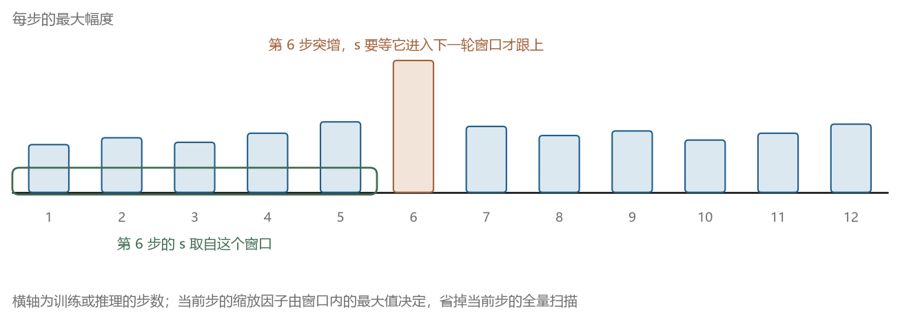
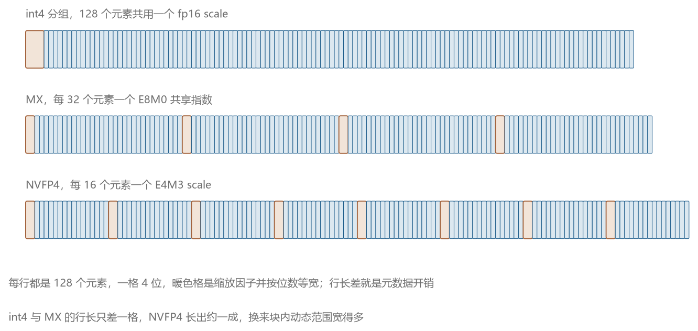

# 低比特：int4、fp8 与微缩放

把一个 70B 模型的权重量化到 int4，显存从 140 GB 降到 35 GB，一张 48 GB 的卡就能装下，这是过去两年里最直接的一次硬件解放。上线之后团队发现，单条请求的生成速度确实快了一倍多，把并发提到 32 之后，吞吐反而不如 fp16 版本。原因不复杂，int4 权重省的是显存带宽，不是计算。并发一高，瓶颈从读权重变成算矩阵乘，反量化那一步又多出来一次访存，账就翻过来了。

位宽降到 8 以下，量化的性质变了。格点从 256 个降到 16 个，任何“按距离取整”的方案都变得粗糙，必须靠更细的粒度、更聪明的缩放、或者训练来补。这一章讲格式和算法层面的应对，硬件层面的账放在最后算。

先把三种位宽配置的记号写清楚，后面会反复用到。W8A8 指权重 8 位、激活 8 位，两边都量化，可以走整数矩阵乘。W4A16 指权重 4 位、激活 16 位，只有权重被压缩，计算仍然是浮点。W4A8 是中间的形态，权重 4 位、激活 8 位。这三个不是同一个东西的强弱版本，它们的实现路径、加速来源、精度难点都不一样。W4A16 省的是显存和带宽，W8A8 省的是带宽也算力，W4A8 想两头都占，代价是工程复杂。

## int4 的两种玩法

权重量化到 int4、激活留在 fp16 的方案，通常写作 W4A16。它不需要整数矩阵乘，运行时把 int4 权重反量化成 fp16 再做浮点乘。听起来多了一步，实际上省下的带宽远超这一步的开销，因为 decode 阶段的瓶颈就是把权重从显存搬到计算单元。参数量 70B 的模型，fp16 每生成一个 token 要读 140 GB，int4 只要 35 GB，理论上快四倍，实际受限于反量化和访存效率，通常是两到三倍。这个倍数是常见量级，具体取决于硬件和 kernel。

把权重压到 4 位的动机不只是显存。一个 7B 模型在 fp16 下占 14 GB，int4 下 3.5 GB，前者需要两张 24 GB 的卡做张量并行，后者一张卡装得下，通信开销和部署复杂度一起消失。对边缘设备更直接，手机上 2 GB 的可用内存装不下 fp16 的 3B 模型，int4 之后刚好。这里的关键不是“4 位比 16 位好”，而是“刚好跨过一个部署门槛”，跨过去和跨不过去是两种产品形态。

4 位到底能做到多好，Dettmers 和 Zettlemoyer 在 2022 年做过一次系统的扫描，用小模型拟合出“位数与困惑度”的经验曲线，结论是 4 位在多数模型规模上是可用的拐点，再往下掉得很快（Dettmers 等，2022b）。这条曲线给了一个心理预期，4 位不是随便挑的数字。W4A16 的精度靠分组来保证。整层的权重分布差异大，一个 scale 不够，于是把每行权重切成若干组，每组一个 scale，组内共享。组大小 128 时，一个 fp16 的 scale 是 16 位，分摊到每个权重上是 0.125 位。

$$
b_{\mathrm{eff}} = 4 + \frac{16}{g}
$$

`g` 是组大小，`16` 是 fp16 scale 的位数，`b_eff` 是等效位宽，也就是把元数据摊进去之后每个权重实际占多少位。组大小 128 时等效 4.125 位，压缩比从 8 倍降到 7.76 倍；组大小 32 时等效 4.5 位，压缩比 7.1 倍；组大小 16 时等效 5 位，压缩比 6.4 倍。这个公式解释了为什么 int4 的压缩比总是小于 8。实践中最常见的是 128 和 64 两个档，因为再往下元数据涨得太快。

weight-only 的收益有明确边界。prefill 阶段一次处理整段 prompt，矩阵乘是“序列长 × 隐藏维 × 隐藏维”，计算量大，瓶颈在算力。此时权重读一次要用很多次，把权重从 16 位压到 4 位省下的带宽摊薄到每次乘法上，收益很小；反量化反而多了一次访存。实测里 prefill 阶段的 W4A16 常常比 fp16 慢一点，decode 阶段快两倍多，端到端取决于输入输出长度比。这就是为什么长 prompt 的问答场景里 4 位量化的加速不明显，而长文本生成场景里效果很好。同一套权重，用在两种业务上收益能差三倍。

另一条路是 W4A4，权重和激活都量化到 4 位。显存省得更多，计算也能走低位宽的整数单元，但精度极难保住。激活的动态范围大、有离群值，4 位格点根本不够分。要在 W4A4 上拿到可用精度，几乎必须上 QAT，或者用后面讲的微缩放格式，让每个小块有自己的 scale。

## fp8 的两条通道

fp8 的定位和 int4 完全不同。它不是压缩格式，而是计算格式，目标是让训练和推理都能在 8 位浮点上跑，同时保持接近 fp16 的稳定性。int4 的思路是“把数压小”，fp8 的思路是“用更少的位表示浮点”，前者牺牲分辨率换带宽，后者靠浮点的指数结构维持动态范围。e4m3 有 4 位指数 3 位尾数，最大 448；e5m2 有 5 位指数 2 位尾数，范围接近 fp16 但精度更差。

分工很清楚。前向的权重和激活用 e4m3，因为它们需要精度，范围可以靠一个全局缩放压进 448。反向的梯度用 e5m2，因为梯度动态范围大，量级能低到 1e-8，e4m3 的下界装不下。这套格式在提出时就是按这个分工设计的，一个管精度，一个管范围（Micikevicius 等，2022）。可以记成一句口诀：前向要细，反向要宽。

fp8 与 int8 的差别可以用一组数字说清。int8 对称量化有 255 个格点，均匀铺在 `[-x_max, x_max]`，相对精度取决于数值落在哪一段，靠近零的相对误差可以很大。e4m3 的格点不等距，3 位尾数让它在同一个数量级内只能分出 8 档，但每个值的相对精度固定，大致在 2 的 -4 次方上下，也就是 6% 左右。所以 int8 在分布均匀时更细，fp8 在分布跨越多个数量级时更稳。激活恰好属于后者，这也是为什么 W8A8 的激活侧用 fp8 往往比用 int8 更容易调。

缩放的方式决定了 fp8 能不能用好。最简单是 per-tensor scaling，整个张量除一个 `s` 再乘回来，`s` 由这个张量的最大绝对值决定

$$
s = \frac{\mathrm{amax}}{448}
$$

`amax` 是这个张量里绝对值最大的元素，448 是 e4m3 的上限。这个式子的意思是：把最大的那个数正好顶到量程上限，其余按比例缩。问题在于 `amax` 要在运行时算，而算 `amax` 需要先读完整个张量，等于多一次全量扫描。延迟敏感的推理路径上这一步不便宜。延迟缩放（delayed scaling）绕开了它，用过去若干个 step 的 `amax` 历史来估当前 step 的 `s`，多留一点余量防止溢出。

图 8-1 里窗口长度是一个超参。窗口太短，`s` 跟不上分布变化，遇到突发的极值就溢出；窗口太长，`s` 偏保守，长期偏大，浪费了表示的动态范围。训练时通常取 16 到 1024 步，推理时如果分布稳定可以直接用校准得到的固定值。

训练侧的 fp8 还有一层额外的复杂度，反向的两条通道要分别缩放。对权重的梯度、对激活的梯度，量级可以差好几个数量级，共用一套缩放会有一边溢出。主流框架的做法是每条通道一个 amax 历史，各自维护自己的缩放因子。这也是 fp8 训练要改框架的原因，不是换个 dtype 那么简单。

fp8 的精度损失比 int8 小，因为浮点的相对精度在整个范围里均匀，不会像 int8 那样被一个离群值把格点吃光。代价是 fp8 的硬件事先要支持，而且累加必须是 fp32 或者更高的精度，否则累加过程的舍入会毁掉低比特的所有好处。这一条在移植时最容易被忽略：把输入改成 fp8、累加也改成 fp8，速度是快了，精度直接崩。

## 微缩放：给每个小块一个指数

int4 的问题出在一个 scale 要覆盖太多元素。微缩放格式（microscaling，简称 MX）把这个粒度推到极限，让每 16 个或者 32 个元素共享一个缩放因子，而且这个因子本身是指数形式，乘起来只要移位。

MX 格式是开放标准里最典型的一种。元素是 E2M1，1 位符号、2 位指数、1 位尾数，能表示 `0, 0.5, 1, 1.5, 2, 3, 4, 6` 这几个绝对值再乘上符号。块大小固定为 32，每块一个 E8M0 的共享指数，8 位全是指数位，只能表示 2 的整数次幂。

$$
x_i = 2^{e_{\mathrm{block}} - 127} \cdot v_i
$$

`v_i` 是 E2M1 的值，`e_block` 是块共享指数，减去 127 是它的偏置。这个设计的好处是解码极快，乘一个 2 的幂不需要乘法器，指数相加即可，硬件上可以折进下一次乘法的指数处理里。还有一个隐含好处，块内所有元素的指数是同一个，所以块内相对大小完全由 4 位的 `v_i` 表达，硬件只要看这 4 位就知道相对关系。

NVFP4 是另一套方案，块大小 16，缩放因子用 E4M3 存，另外还有一个 fp32 的全局缩放。块更小，缩放因子更精细，代价是元数据占比更高。块大小 16 时，每个元素分摊 8/16 = 0.5 位，等效位宽 4.5 位；块大小 32 的 MX 分摊 0.25 位，等效 4.25 位。

图 8-2 把三种布局画在一起。最上面是 int4 分组加 fp16 scale，每 128 个权重一个 scale；中间是 MX，每 32 个元素一个共享指数；下面是 NVFP4，每 16 个元素一个 E4M3 的 scale。越往下粒度越细，元数据越多，能包的动态范围越宽。

这两种格式也不是只有推理在用。QLoRA 用 4 位正态浮点（NF4）存基础模型的权重，反向只更新低秩适配器，把 65B 模型的微调压到一张 48 GB 的卡上（Dettmers 等，2023）。NF4 的分位点按正态分布的分位数设计，在权重近似正态的假设下比均匀格点更合适。这条路线说明 4 位不只是推理压缩，也能作为训练的存储格式，前提是被冻结的那部分不参与梯度计算。

有一类做法介于两者之间，把 4 位权重的组内元素再按“重要性”排一次，重要的用更多有效的表示。这类方法需要额外的元数据记录排列，收益有限，工程上少见。相比之下，把预算花在降低粒度上更直接。

微缩放解决的核心问题是，同一块里的元素幅度差异大时，共享一个 scale 会让小元素失去分辨率。分组只能把差异缩小到组内，微缩放把组缩到 16 或 32，再把 scale 做成指数，于是即使组内还有几十倍的差异，小元素也至少能保留一两位有效信息。LLM-FP4 这类工作证明了 4 位浮点在 Transformer 上可以接近无损（Liu 等，2023），前提就是细粒度的缩放加上对离群值的单独处理。

## 硬件前提和实际收益

低比特能不能变成速度，取决于三个条件。第一，Tensor Core 是否原生支持这个格式的矩阵乘。int4 的原生支持因架构而异，Turing 和 A100 有 INT4 通路，Hopper 主打 FP8，Blackwell 又增加了 FP4；选卡时要查具体规格，不能假设新一代一定支持更低位宽。第二，累加精度是否足够，int4 乘 int4 必须累加到 int32，fp8 必须累加到 fp32，累加器窄了，精度立刻崩。第三，kernel 是否能把这些格式和周围的算子融合，如果每层量化后都要把结果写回 fp16 再做下一个算子，省下的带宽又被写回吃掉。

一条经验判断是看 kernel 的算术强度。算术强度（arithmetic intensity）指每读一字节数据能做多少次运算，单位是“次每字节”。decode 阶段的矩阵乘，每个权重只用一次，算术强度接近 1，属于带宽受限，压位宽直接见效；prefill 阶段的矩阵乘，每个权重被用“序列长”次，算术强度几十到几百，属于算力受限，只有硬件原生支持低比特乘加才有收益。这个判断比看位宽更可靠，也能解释为什么同一套 4 位方案在不同场景下表现差很多。

满足这三个条件之后，收益才和位宽成比例。int4 相对 fp16 的理论加速是 4 倍，在带宽受限的 decode 阶段，常见收益是 2 到 3 倍，prefill 阶段收益小得多，因为那一段是计算受限而不是带宽受限。fp8 相对 fp16 的理论加速是 2 倍，在支持 fp8 的卡上常见收益是 1.6 到 1.9 倍，主要损失在缩放和反缩放的开销上。这些数字是量级估计，不同模型、不同批大小的差别可以很大。

验证一套低比特部署有没有真的走通，不能只看理论加速比。先看权重在显存里占多少字节，反推出实际等效位宽，如果对不上公式，说明元数据或者填充被漏算了。再看单层的 kernel 耗时，如果它和 fp16 版本几乎一样，那反量化很可能是单独一步，没被融进矩阵乘。最后看累加器的类型，很多框架会提供一个开关选择 int32 或 fp16 累加，选错了精度会掉得莫名其妙。这三项检查花不了半小时，能避开大部分“以为量化了其实没量化”的误会。

还有一条容易忽略的约束，4 位权重的打包方式。两个 int4 塞进一个字节，读的时候要解包，解包是位运算，代价不大但要求对齐。如果一个 kernel 一次读 16 字节，也就是 32 个权重，正好对上组大小 32，效率最高；组大小 128 时一次读 32 个权重只覆盖四分之一的组，缩放因子要被重复读取。这就是为什么组大小和访存宽度要对齐，也是为什么“组大小 128 更省元数据”和“组大小 32 访存更顺”这两个结论同时成立，选哪个要看瓶颈在哪。

低比特的算法和格式到这里讲完了。接下来要处理的是大模型特有的问题，激活里的离群值、权重和激活的量纲不匹配，以及 KV cache 这种随序列长度线性增长的显存开销。下一章讲三条主流路线怎么对付这些问题。
