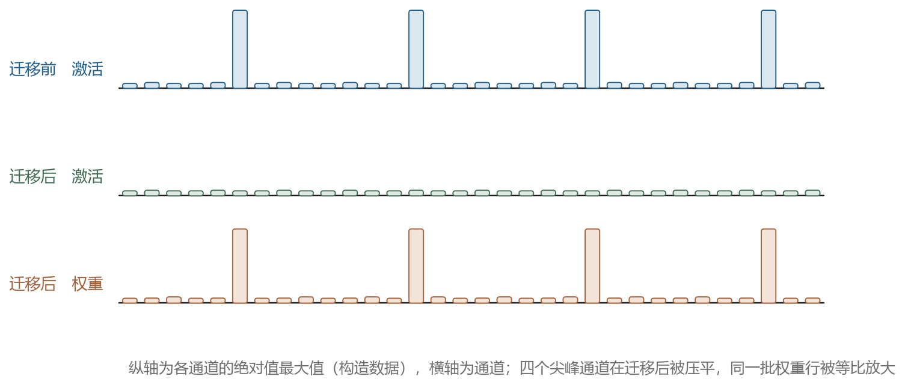
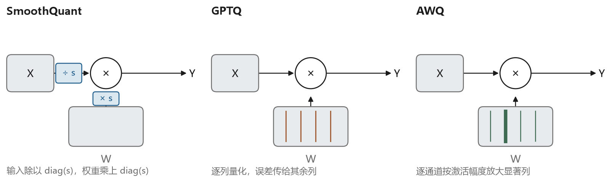

# 大模型量化的三条路

三个工程师在同一个群里讨论 4 位量化。第一个人说 SmoothQuant 效果好，第二个人说 GPTQ 才是主流，第三个人说 AWQ 更简单还更快。争了半天才发现，第一个人说的是 W8A8 的 8 位方案，另外两个人说的是 4 位权重。三条路线解决的问题不一样，位宽配置不一样，能不能混用也有条件，放在一起比“谁更好”没有意义。

这一章把三个方法的问题设定摊开。它们的共同背景是同一个，LLM 的激活里有一小撮值特别大，而权重的分布相对温顺。针对这个不对称，三种方法选择了不同的突破口。

## SmoothQuant：把难度搬到权重那一侧

激活里的离群值是固定的几个通道，幅度能到其他通道的几十倍。权重没有这个问题，它的分布窄、对称、逐通道量化之后很整齐。SmoothQuant 的观察是，既然激活难量化、权重好量化，那就把难度从激活搬到权重。

数学上这是一次等价变换。矩阵乘 `Y = XW` 里，把输入的第 `j` 个通道除以 `s_j`，同时把权重的第 `j` 行乘上 `s_j`，乘积不变

$$
\hat{X} = X \cdot \mathrm{diag}(s)^{-1}, \qquad \hat{W} = \mathrm{diag}(s) \cdot W
$$

`diag(s)` 是对角矩阵，第 `j` 个对角元是 `s_j`。这个变换在实数上是精确的，量化误差却变了，因为 `X` 的动态范围被压小，`W` 的动态范围被放大，两者的量化难度向中间靠拢。

`s_j` 怎么取，决定了往哪边偏。一个被广泛采用的取法是让两边最难的通道幅度接近（Xiao 等，2022）

$$
s_j = \frac{\max |X_j|^{\alpha}}{\max |W_j|^{1-\alpha}}
$$

`alpha` 取 0 时完全不迁移，取 1 时把激活的难度全部推给权重。实践中 `alpha` 在 0.4 到 0.6 之间，让两边的最难通道幅度接近。这个参数可以用一小批数据网格搜索，也可以按经验直接定，因为曲线在最优值附近很平。

图 9-1 用构造数据画出迁移的效果。迁移前激活有几个通道的幅度是其余的二十倍，迁移后这些通道被压到与主体接近，权重的对应行被放大同样的倍数，仍在 fp16 或 int8 的可表示范围内。注意这是一个逐通道的变换，`s` 的长度等于隐藏维，要在推理时保留并作用在输入上。

`alpha` 的选择还有一层含义，它决定了 `s` 的数值稳定性。`alpha` 偏大时 `s_j` 由激活主导，权重被放大得多，某些行的权重可能超出 fp16 的范围；`alpha` 偏小时激活压得不够，outlier 依然存在。工程上会在搜索 `alpha` 之后检查两件事，权重的最大值是否还在可表示范围内，激活的最大值是否落到了目标区间。两边都满足才算可用。

代价有两个。第一，`s` 必须融合进前一个算子，否则每次前向都要多做一次逐通道乘法。前一算子通常是 LayerNorm 或线性层，融合到它的输出缩放里是可行的，但如果中间夹着别的东西（比如残差相加），融合就断了。第二，迁移之后权重的动态范围变大，如果权重也要量化到 8 位以下，被放大的那几行会最先出问题。所以 SmoothQuant 的定位很清楚，它服务的是 W8A8，不是 4 位。

## GPTQ：一列一列地补误差

GPTQ 的出发点完全不同。它不管激活的离群值，它关心的是“权重量化之后，这一层的输出差多少”，并且用二阶信息把这个差补回来。

问题的形式是，给定一层 `Y = XW` 和校准数据算出的输入协方差 `H = 2XX^T`，找一个量化后的 `W_q` 使 `||XW - XW_q||` 最小。逐列量化的时候，第 `j` 列量化完成后，剩下的列可以调整来补偿这一列产生的误差。最优的调整量由 Hessian 的逆给出

$$
\delta = -\frac{w_q - w}{[H^{-1}]_{jj}} \cdot H^{-1}_{:,j}
$$

`w_q - w` 是第 `j` 列的量化误差，`[H^-1]_jj` 是这一列的“敏感度”，误差除以它再乘上 Hessian 逆的这一列，就得到其余各列应该移动多少。做法是把所有列按顺序过一遍（Frantar 等，2022），每列量化、算误差、更新剩余列，整个过程只需要一次 Hessian 逆，复杂度对 7B 模型是可以接受的。

Hessian 从哪里来，是这套方法最容易被忽略的细节。`H = 2XX^T` 用的是这一层输入的协方差，`X` 来自校准数据。如果校准数据的序列长度和线上差很多，协方差的结构会变，Hessian 逆算出来的补偿方向就不再最优。这也是为什么 GPTQ 的校准样本要覆盖真实的输入长度分布，而不是随手拿几条短句。

这个方法的精度收益很明显。4 位权重量化在多数 LLM 上能把困惑度增长控制在很小范围，而同等的 RTN（round to nearest）会掉得很厉害。代价是校准，需要几百条样本算 Hessian，以及一个不短的计算过程，7B 模型在单卡上要几十分钟。

GPTQ 的误差补偿有一个隐含假设，层与层之间可以独立处理。它逐层量化，认为上一层的输出分布在校准时就定了，实际量化后上一层的输出会变，于是这一层的 Hessian 是在“旧输入”上算的。误差因此会累积，层数越多越明显。缓解办法是顺序量化，每量化完一层就用新的输出跑一遍后续层的校准，代价是时间翻倍。多数实现不做这一步，因为收益（通常零点几个点）抵不上时间。

工程上有两个关键参数。组大小决定粒度，128 是默认值，64 更准但更慢。`act-order`（有的实现叫 `desc_act`）决定列的量化顺序，按激活幅度从大到小排，让重要的列先量化、误差更小。后者对某些模型提升明显，对另一些没有差别，需要试。

GPTQ 只量化权重，激活保持 fp16。这一点经常被忽略，看到“GPTQ 4 位”就以为激活也是 4 位，实际上它是 W4A16，运行时要把权重反量化再加到 fp16 的累加里。

## AWQ：只保护那 1%

AWQ 的观察更朴素。权重的每一列重要性不一样，和激活幅度大的通道相连的列更重要，量化坏了影响大。既然只有一小部分权重重要，那就只保护它们。

保护的方式是缩放。对重要通道乘一个大于 1 的系数，让它们在量化时占据更大的动态范围，量化后误差更小；同时把输入的对应通道除以这个系数，保持数学等价。和目标函数的区别在于，AWQ 不优化权重的重建误差，它优化的是激活加权后的误差，权重按激活的幅度加权。

$$
s_j = \left( \max |X_j| \right)^{\beta}
$$

`beta` 是一个在 0 到 1 之间搜索的指数，实际做法是在一个小网格上枚举，用校准数据评估每一组的效果，取最好的。这个搜索很便宜，因为不需要反向传播，也不需要 Hessian，只是反复量化再算一次前向。搜索空间通常只有十几个候选，评估用几十条样本的困惑度，几分钟能跑完。这也是 AWQ 常被选作默认方案的原因，它的失败模式简单，调参空间小。

一个关键发现是，只保护 1% 的显著权重就能挽回大部分 4 位量化的损失，而不敏感的权重即使量化得很粗也无所谓（Lin 等，2023）。这个发现解释了为什么 AWQ 的速度比 GPTQ 快，它把力气花在最要紧的地方，其余的直接量化。

AWQ 还有一项工程优化值得提。量化时权重按通道重排，把重要通道排到一起，让它们在访存时落在同一个块里，减少无效读取。这个重排不改变数学，只是改变内存布局，收益在 10% 到 20% 的加速上。这类优化说明 4 位权重的实际速度不只取决于算法，还取决于 kernel 怎么读那 4 位。

## 三条路的问题设定

把三个方法放在一张表里，差别就清楚了。

表 9-1　三种方法的定位对比

| 方法 | 位宽配置 | 改激活 | 需要校准 | 核心手段 |
|---|---|---|---|---|
| SmoothQuant | W8A8 | 是，逐通道缩放 | 是，几百条 | 把离群值迁到权重 |
| GPTQ | W4A16 | 否 | 是，一百多条 | 二阶误差补偿 |
| AWQ | W4A16 | 否 | 是，几十条 | 保护显著通道 |

表里的“需要校准”一栏容易被低估。校准不只是提供数据，它还决定了量化参数能不能反映线上分布。SmoothQuant 的 `s` 由激活的最大值决定，GPTQ 的 Hessian 由输入的协方差决定，AWQ 的搜索目标由激活幅度加权，三者的质量都直接吃校准集的质量。换一个领域的数据做校准，三种方法都会掉点，只是程度不同。

ZeroQuant 是同一时期的另一条路线，它把激活按 token 动态量化、权重按组量化，再配一套定制的 kernel，在 bert 和 GPT 类模型上都拿到了接近无损的结果（Yao 等，2022）。它的思路和这三者不完全重合，但工程取舍很值得看。SmoothQuant 解决的是“激活量化不了”，GPTQ 和 AWQ 解决的是“权重 4 位精度不够”。前者必须改激活的数值分布，后两者完全不碰激活，只在权重侧做文章。把它们混为一谈，就会出现“为什么 GPTQ 不支持 W8A8”这类困惑，答案很简单，它从来没打算量化激活。

图 9-2 把作用位置画出来。SmoothQuant 的缩放因子落在输入和权重之间的一对对角矩阵上，GPTQ 的补偿落在权重的列上，AWQ 的缩放也落在权重的通道上。三者可以组合，SmoothQuant 加 GPTQ 的 W4A8 就是常见的组合，先用 SmoothQuant 把激活压到 8 位能接受的范围，再用 GPTQ 把权重压到 4 位。组合的时候要注意顺序，先做激活侧的变换，再做权重侧的量化，反过来会把 GPTQ 的补偿算错。

还有一条路线不在表里，基于 Hadamard 变换的旋转方法。它的思路也是等价变换，但用的是正交矩阵而不是对角矩阵，把离群值摊到所有通道上。数学上更彻底，实现上要改 kernel，因为旋转要在矩阵乘前后各做一次，且矩阵是稠密的。这类方法在 2023 年之后陆续出现，效果不错但生态支持还不成熟，选型时要确认推理引擎支持。

选择哪一条，取决于硬件和场景。硬件只支持 int8 矩阵乘，选 SmoothQuant。显存紧张、生成速度是瓶颈、硬件没有 4 位整数单元，选 GPTQ 或 AWQ 的 W4A16，靠带宽收益。要在同一套硬件上同时省显存和算力，才需要考虑 W4A4，而那已经是另一个难度级别的问题，需要 QAT 或者微缩放格式。

三条路线都在权重和激活的分布上做文章，但 KV cache 是另一类对象。它不在权重里，也不在普通的激活里，它随序列长度线性增长，在长上下文场景里能占到显存的七成。下一章专门谈它。
