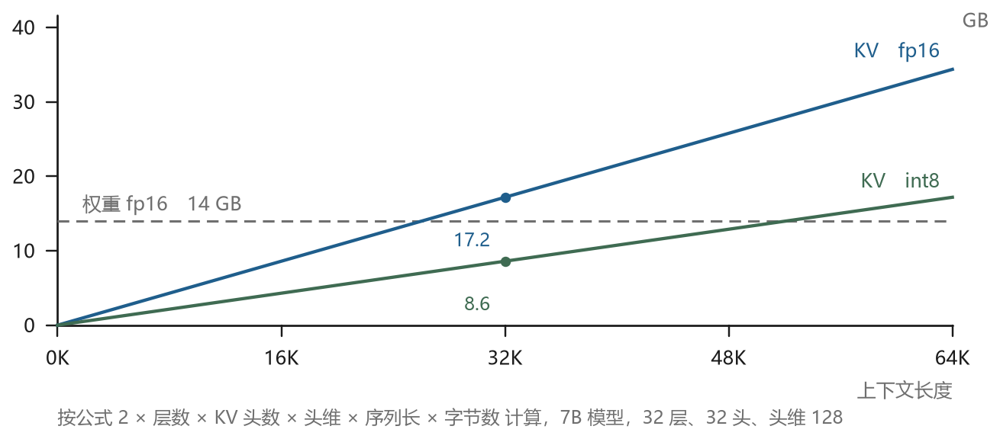
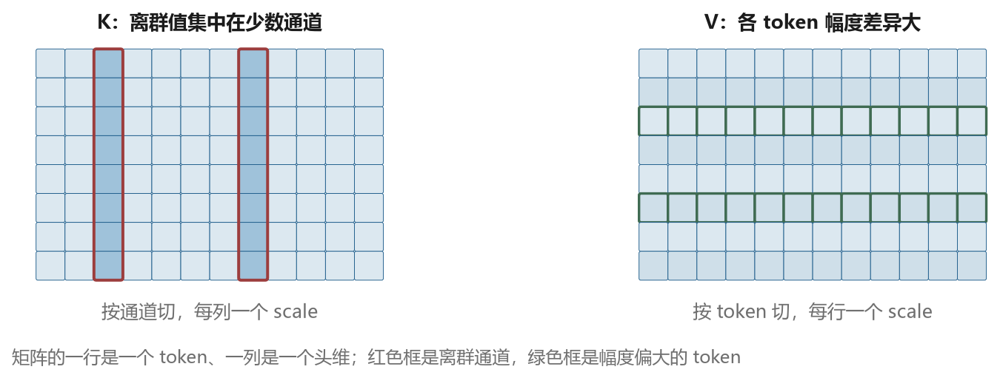

# 激活与 KV cache 的量化

一个客服助手把上下文从 4K 扩到 32K，模型权重占 14 GB，KV cache 占到 40 GB，一张 48 GB 的卡直接不够用。把 KV cache 量化到 int8，显存降到 20 GB，能跑起来了，但回答开始出现重复段落，越到后面越明显。问题不在显存，在误差，量化误差在长序列上被反复累加，最后表现为注意力的分布变形。

这一章分开讲两件事。激活的量化难在分布随 token 变化，KV cache 的量化难在误差沿序列累积。两者的手段有重叠，但评估方法完全不同。

## 激活为什么难量化

还有一个常被忽略的因素，激活的量化和算子的实现绑得很紧。一个逐元素的激活函数（ReLU、GELU）可以在原地量化，几乎不增加访存；一个需要跨通道归约的算子（softmax、LayerNorm）中间会产生临时张量，量化这些中间结果的收益很小，因为它们的生命期只有几十微秒。判断一段激活值不值得量化，先看它活多久、被读几次，再看它的误差对下游有多大影响。同一层，处理短句和处理长文时激活幅度可能差十倍。用一套静态的量化参数，覆盖不住这种变化。

激活里还有离群值。第 3 章讲过，某些通道的幅度能达到其余通道的二十倍，而且这些通道在不同层、不同模型上位置不同。per-tensor 量化被它们毁掉，per-channel 量化能缓解但不能根治，因为离群值有时跟着 token 走。

动态量化是应对分布变化的手段，每次前向现算 `amax`，再定缩放。它解决了分布漂移，代价是每次都要做一次归约。在 GPU 上，跨线程归约要同步，序列长的时候这一步能占到这一层耗时的 10% 到 20%。所以动态量化的粒度要选，per-token 比 per-tensor 贵不了多少（归约沿隐藏维，长度固定），per-token-per-channel 就要做两次归约，成本翻倍。

动态量化还有一个实现细节，缩放因子算出来之后要传给 kernel，这个传参不是免费的。如果每一层都做动态量化，每次前向要发起几十次小的数据传输和同步，在批大小很小的时候，这些开销比计算本身还大。工程上的折中是每隔几层共享一个缩放，或者只在注意力这一类对精度敏感的地方做动态，其余用静态。

softmax 前后的分布差异也是一个坑。softmax 之前是 logits，可以是任意实数，范围宽；之后是概率，落在 0 到 1 之间，而且绝大多数值接近 0。用同一套参数处理这两段显然不合理。工程上的做法是把 softmax 整段留在浮点，只在它的输入输出上做量化边界，或者干脆不量化这一段。

## KV cache 的账要算清楚

KV cache 的大小有一个固定公式

$$
M = 2 \cdot L \cdot H_{\mathrm{kv}} \cdot d \cdot T \cdot b
$$

`2` 是 K 和 V 两份，`L` 是层数，`H_kv` 是 KV 头数，`d` 是每个头的维度，`T` 是序列长度，`b` 是每个元素的字节数。系数 `2` 和 `b` 决定了量化能省多少，剩下的部分决定了它随上下文怎么涨。

代入一个 7B 模型的典型配置，32 层、32 个 KV 头、头维 128、序列 32768、fp16 存储，得到 17.2 GB。同样配置换成 int8，8.6 GB；换成 fp8，也是 8.6 GB。这些数字和权重相比已经不小，权重才 14 GB。序列再长一倍，KV cache 就超过权重，成为显存的主要占用。

这个公式还说明了为什么批大小不在里面。KV cache 的大小按批线性增长，但公式里通常只算单条请求，因为显存规划关心的是“一条请求要多少”，再乘上并发数。规划时的做法是先算出单条请求在最长上下文下的 KV 占用，再反推能同时跑几路。这解释了长上下文服务和并发量之间的直接冲突，两者乘积受显存上限约束，无法同时满足。

分组查询注意力（GQA）在这里起到的作用比量化更大。把 32 个 KV 头减到 8 个，KV cache 直接降到四分之一，4.3 GB。这也是为什么新模型普遍用 GQA，它省的是结构上的冗余，不需要付出任何精度代价。量化是在 GQA 之后再省一半，两者叠加才有 32K 上下文在单卡上跑的可能。

图 10-1 是按公式算出来的，不含任何实测。序列短的时候权重占大头，序列长了 KV cache 反超，两条线的交点决定了这个模型在什么上下文长度上开始受显存限制。把 KV 从 fp16 换成 int8，等于把那条斜线的斜率减半，交点右移一倍。

还有一类省 KV 的手段不属于量化，但经常一起讨论，共享前缀缓存。多个请求如果共享同一段 system prompt，这段的 KV 只算一次，后续请求直接复用。它在数学上无损，收益取决于请求之间的前缀重合度。量化和它在不同的维度上省，两者叠加最划算，先用共享前缀去掉冗余，再用低比特压剩下的部分。

## 按什么维度量化

KV cache 的形状是 `[批, 头, 序列, 维]`。量化可以按 token 切（每个位置一套参数），也可以按通道切（每个维度一套参数），还可以分组。

先看一个数量感的对比。同一段 32K 的上下文，K 用 per-tensor 量化时余弦相似度可能掉到 0.97，per-channel 能回到 0.995，这中间的差距基本就是“能用在检索任务上”和“只能闲聊”的差距。V 的变化小得多，per-tensor 和 per-token 的差别通常在小数点后第三位。把预算花在 K 上，比两边平均分更划算。

选择取决于离群值出现在哪个方向。K 的离群值通常在通道维，也就是某几个固定的维度总是很大，和输入内容关系不大。这种模式适合 per-channel，一个通道一套 scale，离群通道被单独处理。V 的分布相对均匀，离群值不明显，per-token 就够，而且 per-token 的实现更简单，因为每个 token 写入 cache 时可以顺便算好自己的 scale。

图 10-2 画了两种切分。左边 K 的矩阵里有几列明显偏亮，按列切能给这些列单独的 scale；右边 V 的矩阵整体均匀，按行切更自然。实际系统里也有两者都做的，per-token-per-channel，代价是元数据翻倍，收益在长序列上才明显。

KV cache 的访问模式也影响量化的实现。分页注意力把 cache 切成固定大小的块，通常是 16 个 token 一块（Kwon 等，2023），按需分配，避免预留最大长度造成的浪费。这个块大小和量化粒度要对齐，如果量化按 32 个 token 一组，而块是 16，一个量化组会跨两个物理块，读取时要先拼接再反量化，效率立刻掉下来。所以实际系统里 KV 的量化组大小往往就取 16 或 32，跟着分页块走。

按通道量化还有一个副作用，它要求 K 的维度对齐。头维 128 是 4 的倍数，向量化读取一次 16 字节正好覆盖 32 个 int8 元素，对齐良好。如果某个模型的头维是 96 或者 80，读的时候要处理边界，kernel 要么退化到标量路径，要么补零到 128，两种都有代价。选型时看头维数字，比看量化方案更早决定性能上限。

分组量化在 KV 上用得不多，原因是 KV 的元数据开销相对更大。一个 token 只有 `H_kv × d` 个元素，7B 模型是 1024 个，如果组大小 128，每个 token 要 8 个 scale，每个 scale 2 字节，元数据占 1.6%。听起来不多，但 KV cache 的读取是逐 token 的，元数据要和数据一起读，访存模式变复杂，kernel 效率下降。

## 误差在长序列上怎么累积

KV 量化之后，注意力分数的偏差会直接影响 softmax。softmax 对输入的敏感度不均匀，logits 分布尖锐时，一点点偏差就能改变 top-1 的位置；分布平坦时，偏差被平均掉。长序列上这两种情况都会出现，某些头在检索特定位置时分布极尖，另一些头分布很平。

更麻烦的是误差会进 cache，然后被反复使用。一个 token 的 K 被量化错了，它在后续每一个 step 都会被读到，误差影响这一整段的注意力。序列越长，这个错误被“使用”的次数越多。这和权重量化的误差模式不同，权重错了只影响一次前向，KV 错了会影响整个生成过程。

decode 阶段的耗时也值得算一遍。每生成一个 token，注意力要读完整段 KV，32K 上下文、8.6 GB 的 int8 cache，按 2 TB/s 的显存带宽算，光读 KV 就要 4 毫秒，这还没算上其他开销。换成 fp16 是 8 毫秒。这个数字说明，长上下文推理的 decode 速度基本由 KV 的字节数决定，量化 KV 的直接收益就是吞吐翻倍，比优化计算 kernel 有效得多。

评估这类误差不能只看困惑度。困惑度对局部错误不敏感，一个 token 错了，平均下来影响很小。要针对性地测三件事。第一是长文检索，在长上下文里埋一个事实，看模型能不能准确取回，这类任务对 KV 的精度最敏感。第二是输出的重复率，KV 误差累积到一定程度，模型会陷入复读。第三是注意力的熵，量化前后比较每个头的注意力分布，熵变化大的头就是问题所在。

实测里最常见的失败模式是“前几百个 token 正常，之后开始胡说”。这说明 KV 的误差在累积到某个长度后越过了阈值，而不是均匀地影响所有位置。排查方法是把同一段长文截成 4K、8K、16K、32K 分别测，看指标在哪一档开始断崖。如果断崖出现在训练长度的边界，多半是位置编码外推的问题，和量化无关；如果断崖随量化位宽移动，那就是 KV 精度的问题。

fp8 的 KV cache 在支持它的硬件上是目前比较平衡的选择。e4m3 的相对精度比 int8 均匀，不需要为离群通道特殊处理，缩放按 per-token 做，写 cache 时顺便算好。代价是需要硬件支持 fp8 的注意力 kernel，没有的话还是要回到 int8。

显存规划时还要留出中间激活的空间。prefill 阶段一次处理整段 prompt，中间激活的大小和序列长成正比，32K 上下文时这部分能占几个 GB。它和 KV cache 不重叠，但会和权重、KV 抢同一块显存。很多“显存够但跑不起来”的情况，缺的就是这块余量，规划时按峰值算，不要按平均值算。

从权重到激活再到 KV cache，量化覆盖的对象越来越动态。剪枝处理的是另一类冗余，它不改变数值的表示，而是直接把一部分权重变成零。下一章开始讲压缩。
