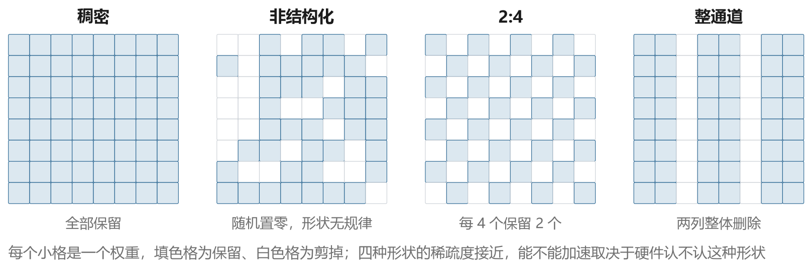

# 剪枝的几种形态

一个 BERT 模型被剪掉了 90% 的权重，剩下的 10% 保持原来的准确率，论文里的表格很漂亮。团队照着做，模型文件确实小了，推理速度一点没变，甚至慢了一点。原因在于那 90% 的零散落在矩阵各处，GPU 的矩阵乘单元不认这种稀疏，它还是按稠密的方式把零读进来、乘一遍、再加起来。零不占存储，但占带宽和算力。

剪枝这件事，减掉多少参数和快多少是两个不同的问题。前者看稀疏度，后者看稀疏的形状和硬件是否支持。这一章按形状分类，讲四种剪枝各自能带来什么。Blalock 等在 2020 年做过一次系统的梳理，把当时的剪枝方法放在统一的基准下比较，结论是很多方法的收益被高估，尤其是那些只报压缩比不报实际延迟的工作（Blalock 等，2020）。

## 非结构化剪枝：先问硬件认不认

非结构化剪枝最简单，把绝对值小的权重置零，形状随意。它的压缩能力最强，同样的精度损失下能剪掉的比例最高，因为它有最大的自由度。Han 等在 2015 年展示过把 AlexNet 剪掉 9 倍参数、VGG 剪掉 13 倍而不掉精度（Han 等，2015）。

存储上确实省了。用压缩稀疏行格式，只存非零值和它们的索引，一个 90% 稀疏的矩阵占用不到原来的两成。但计算不一定省。GPU 的线程按固定形状组织，一个 warp 里的 32 个线程要一起读、一起算，如果它们的非零元素分布不均，有的线程有活干、有的空转，利用率立刻掉下来。稀疏矩阵乘的实测加速比往往远低于稀疏度，10% 的非零只换来 1.5 倍加速是常见结果。

稀疏格式本身也有开销。压缩稀疏行要存列索引，每个非零元素多 4 字节，如果原始权重是 fp16，压缩后每个非零元素占 6 字节，90% 稀疏时总占用是原来的 30%，不是 10%。用 2 字节的索引能压到 20%，但索引范围受限。这个账很少有人算清楚，看到“压缩 10 倍”就以为显存也降 10 倍。真正省 10 倍的是只统计非零值、不带索引的“理论压缩比”。

软件库在进步，稀疏格式的 kernel 也在优化，但根本矛盾没变，随机稀疏的索引无法预测，访存是散的。除非硬件在架构层面支持某种规则的稀疏，否则非结构化剪枝的收益主要在存储，不在计算。这也解释了为什么学术论文喜欢报压缩比，工业部署更关心结构化。

## 结构化剪枝：整块拿掉才算真省

结构化剪枝按整块删除，整个通道、整个注意力头、整个层。剩下的权重仍然是一个稠密的张量，只是形状小了。它对硬件完全友好，因为它等价于换了一个更小的模型。

代价是精度下降更快。非结构化剪枝可以挑挑拣拣，每条连接单独判断；结构化剪枝一刀切掉一整块，块内那些本来还有用的权重也被删了。同样的稀疏度，结构化剪枝的精度损失通常明显更大。经验上，非结构化能剪 90% 的场景，结构化可能只能剪 40%。

但结构化剪枝的收益是实打实的。通道数从 512 减到 384，卷积的计算量按平方下降，显存带宽按比例下降，不需要任何特殊 kernel。工程上判断结构化剪枝是否值得，只要看两点，删掉的部分能不能整齐地对齐到硬件的向量宽度，剩下的形状会不会变成长宽比很奇怪的张量。删到 380 个通道不如删到 384，因为后者能被 8 整除。

结构化剪枝还有一个变体是剪头。Transformer 的注意力头有明显的冗余，多头注意力里总有若干头在几乎所有输入上都不活跃。删掉这些头能直接省下对应的 QKV 投影和注意力计算，代价是头与头之间的信息互补被打破。测量头的活跃度可以用注意力熵、也可以用输出对损失的敏感度，后者更准但更贵。

图 11-1 把四种形状画在一起。随机稀疏的保留位置毫无规律，2:4 的保留位置每四个一组、固定两个，整通道删除则是一整列消失。形状决定了 kernel 能不能高效执行，稀疏度只决定存储。

## 2:4 半结构化：硬件愿意认的那一种

2:4 稀疏是折中方案。约束是每 4 个连续的权重里最多保留 2 个，保留哪个由训练决定。这个约束让稀疏模式有规律，硬件可以在读数据时就知道哪些位置有效，不需要额外的索引。

NVIDIA 从 Ampere 架构开始支持这种模式，稀疏 Tensor Core 的吞吐是稠密的两倍。Mishra 等在 2021 年给出了实现细节，包括如何把一个已经训练好的稠密模型转换成满足 2:4 约束的稀疏模型，以及转换后如何微调恢复精度（Mishra 等，2021）。实测的端到端加速通常在 1.3 到 1.6 倍之间，达不到理论的 2 倍，因为卷积和注意力的其他部分（归一化、激活、访存）不受益。

达到 2:4 约束的方法有两种。一种是在训练时就加约束，每次更新之后把每组四个里最小的两个置零，让模型从一开始就适应。另一种是把训练好的模型直接剪成 2:4，再微调几个 epoch。后者的效果好于预期，因为模型对剪枝的容忍度比想象的高，微调能恢复大部分损失。

2:4 还有一个副作用很少被提到，它改变了权重分布的形状。为了在每组四个里选出两个，训练会把权重推向两极，要么明显大、要么接近零，中间值变少。这个分布对后续的量化不友好，第 4 章的百分位校准在这里会失效，因为分布不再连续。所以“先 2:4 剪枝再量化”的组合需要重新校准，不能直接沿用稠密模型的参数。

2:4 的收益门槛比非结构化低得多，因为硬件原生支持，不需要软件模拟。但它的适用面也窄，只在这一代特定硬件上有效，换到不支持稀疏的加速器上，稀疏模型反而比稠密慢，因为要先把零填回去。选型时要确认目标硬件，不要只看论文。

## 重要性怎么算

剪谁留谁，需要一个分数。最简单的是绝对值，权重越小越不重要。这个方法便宜，效果在中小模型上不错，但在大模型上会失效，因为权重的绝对值分布很宽，小权重未必不重要。

梯度是第二种分数。训练结束时的梯度接近零，用它排序噪声很大；训练过程中的梯度累计更有意义，但需要额外的存储。Hessian 是第三种，它衡量“删掉这个权重，损失涨多少”，理论上最准，OBD 和 OBS 这类早期工作就是这么做的，代价是二阶信息，对大模型不现实。

重要性度量还有一个工程约束，它必须能在合理时间内算完。一个 7B 模型有 70 亿个权重，绝对值排序是 `O(n log n)`，几分钟能跑完；Hessian 近似要 `O(n^2)` 的存储，根本做不了；梯度累计要保存每个权重的历史梯度，显存翻倍。所以大模型上的剪枝实践基本只用一阶信息，二阶方法停留在小模型和论文里。

运动剪枝换了一个视角。它不看权重的绝对值，看权重在训练过程中朝零移动的趋势。Sanh 等在 2020 年提出这个方法，用在 BERT 的微调上，发现它比绝对值剪枝更准，尤其在迁移学习场景（Sanh 等，2020）。原因是预训练权重本身有大有小，绝对值小的可能只是初始化时的随机值，而真正“没用”的权重是那些在微调中一直被往零推的。

还有一类方法把剪枝和训练合并，用 L1 正则或者拉格朗日乘子把稀疏度作为约束写进损失函数，训练过程中权重自然变稀疏。好处是不需要单独的剪枝步骤，坏处是稀疏度难以精确控制，通常要调好几轮才能达到目标。

## 彩票假说与它的边界

Frankle 和 Carbin 在 2018 年提出一个反直觉的观察，一个随机初始化的网络里存在一个子网络，用原来的初始化单独训练，能达到和完整网络相当的精度（Frankle 等，2018）。他们把这个子网络叫“中奖彩票”，把找到它的过程叫彩票假说。

这个发现的意义在于，它说明稠密网络里有大量参数是多余的，训练的作用之一是找到那个有效的子结构。但它也被过度解读过。后续研究发现，所谓的“中奖彩票”在更大的模型和更难的任务上不容易复现，而且找到它的成本（反复训练剪枝）远高于直接训练一个大模型再剪。工业界没有因此改变做法，还是先训练大的、再压缩。

这个方向后来演化出“稀疏预训练”的路线，用一个固定的稀疏掩码从头训练，掩码在训练中周期性重排。它的吸引力在于省训练算力，而不是省推理算力。对推理部署来说，这条路线没有直接价值，因为出来的还是一个稀疏模型，硬件仍然不认。区分“省训练的稀疏”和“省推理的稀疏”，是读这类论文时最容易搞混的地方。

真正有实用价值的推论是另一条，稀疏模型从头训练比“剪完再微调”更难。所以主流流程是稠密训练、剪枝、微调，而不是直接训练一个稀疏结构。这条经验在结构化剪枝上尤其明显。

剪枝和量化可以叠加，顺序有讲究。先剪枝再量化，剪完的模型更稀疏但分布更偏，量化校准要重做；先量化再剪枝，量化后的权重格点稀疏，剪掉的比例不好控制，而且被剪的权重可能是量化误差补偿出来的关键项。多数实践选先剪枝后量化，因为剪枝改变的是结构，量化改变的是数值，结构先定，数值后调。

四种形状讲完，可以给出一条选择顺序。硬件支持 2:4 且能接受 50% 的稀疏度，优先用它；否则用结构化剪枝，收益确定；非结构化只在存储受限、计算不是瓶颈的场景（比如端侧模型加载）才有意义。下一章把结构化剪枝的流程展开，讲怎么决定剪多少、怎么恢复精度。
