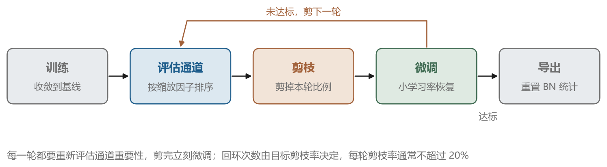

# 通道裁剪与重训练

一次把 ResNet 的通道剪掉一半，top-1 掉了 8 个点，微调 30 个 epoch 也只找回 4 个点。换成每轮剪 12%、剪完微调 5 个 epoch、重复五轮，最终掉 1.2 个点。同样的总剪枝率，过程不同，结果差了三倍。原因在于一次剪太多会把网络推到损失曲面上一个很差的区域，微调爬不回来；分多次剪，每次都在一个还能恢复的位置停手。

通道裁剪（channel pruning）是结构化剪枝里最常用的一种。它删的是卷积的输出通道，删完之后整个张量的形状变化，计算量和显存都跟着降。为什么挑通道下手，因为通道是卷积里最自然的“整块”单位：删掉一个输出通道，等于删掉一个卷积核、一个偏置、一个批归一化的参数，以及下一层对应的一个输入通道，所有相关的参数都能整齐地一起删掉。

一个前置判断是值得先做的，这个模型有没有冗余。看训练好的模型里，每层有多少通道的 `gamma` 绝对值小于 0.01，比例高的层冗余大，比例低的层已经没什么可剪。整体上如果找不到 20% 以上的低值通道，说明这个模型训练得很紧凑，硬剪只会掉点。这个检查花几分钟，能省掉后面几天的无效工作。

## 给通道打分

打分的方法有很多，核心都是估计“删掉这个通道，损失涨多少”。

最常用的是批归一化的缩放因子。如果卷积后面接了批归一化，每个通道有一个可学习的缩放系数 `gamma`，它的绝对值直接反映这个通道的输出幅度。批归一化（batch normalization，BN）做的事是把每个通道的数值标准化到均值 0、方差 1，再乘一个 `gamma`、加一个 `beta`。`gamma` 接近零，意味着这个通道的输出被压成了接近常数，后面几层几乎收不到它的信息。训练时对 `gamma` 加 L1 正则，让不重要的通道的 `gamma` 趋近零，然后按 `gamma` 排序剪掉最小的那些。这个方法出自 Network Slimming 一类工作，实现简单，效果稳定。

$$
I_j = \left| \frac{\partial L}{\partial \gamma_j} \cdot \gamma_j \right|
$$

这个式子是泰勒展开的一阶近似。`gamma` 从当前值变成零，损失的变化近似等于梯度乘以变化量。它同时考虑了缩放因子的大小和它对损失的影响，比单纯看 `gamma` 更准，代价是要算一次反向传播的梯度。名字叫“泰勒”，其实意思很朴素：函数在某点的变化，先用斜率乘上移动距离估一下，距离不大时够用。

这个式子的一个直接推论是，`gamma` 大但梯度也大的通道不能剪。它输出幅度大，删掉损失立刻涨，而单纯看 `gamma` 会把它排在后面。反过来，`gamma` 很小但梯度很大，说明它虽然幅度小，却在关键路径上，也不该剪。两种信号相乘，才能把“小而不重要”和“小而关键”区分开。

缩放因子法有一个前提，网络里必须有批归一化。没有 BN 的模型（比如很多 Transformer 用 LayerNorm）就没有 `gamma` 可用，只能退回到卷积核范数或者激活统计。这也是为什么通道剪枝在 CNN 上成熟得早，在 Transformer 上落地得晚，结构决定了可用的信号。

卷积权重的 L1 范数是另一种分数，不依赖批归一化，适用于没有 BN 的结构。把每个输出通道对应的卷积核展平，算绝对值和，越小的越不重要。这个方法忽略了输入激活的幅度，如果一个通道的权重很小但连接到幅度极大的输入，它的实际贡献可能不小。Li 等在 2016 年用的就是这种做法，逐层剪掉固定比例的通道（Li 等，2016）。

还有一类做法直接测敏感度。把某一层的通道逐个置零，看输出变化多少，排序后剪掉影响最小的。这个方法最准，但代价是每层要做几十次前向，大模型上不可行，通常只在小模型或者关键层上用。

实际项目里常见的组合是先用 L1 范数快速筛一遍，把明显没用的通道去掉，再用敏感度测一下中间那些模棱两可的通道。两轮下来，精度和成本都还能接受。

## 迭代，而不是一次到位

流程本身不复杂，但顺序和节奏决定了结果。

第一轮先在完整模型上训练到收敛，记录每一层通道的重要性。然后按目标剪枝率剪掉一部分，不是全部。剪完之后精度会掉，用一个小学习率微调几个 epoch 恢复。恢复之后重新评估通道重要性，再剪下一轮。重复若干轮直到达到目标。

图 12-1 里有一个容易被忽略的细节，每轮都要重新打分。剪掉一批通道之后，剩下的通道的重要性会变，原来排在中游的通道可能因为承担了被删通道的功能而变得重要。用第一轮的打分一路剪到底，等于假设重要性不变，实际会剪掉不该剪的。这个现象在剪枝率超过 30% 之后特别明显，因为网络开始被迫重组功能。

剪枝率怎么安排有两种做法。线性递增，从 5% 开始，每轮加一点，最后一轮剪得最多；或者指数递增，前几轮剪得少，后面加速。两种都比均匀分配好，因为早期的模型还有冗余，剪一点不影响；后期的模型已经很紧，需要小步走。经验上每轮的剪枝率不要超过 20%，超过之后微调很难恢复。

每轮剪枝的比例还和层的敏感度有关。同一个剪枝率作用在所有层上并不合理，浅层通道少、冗余少，深层通道多、冗余多。常见做法是给每层一个独立的剪枝率，浅层低、深层高，总剪枝率满足预算。这个分配可以搜索，也可以按经验设定，比如第一层不剪、最后几层不剪、中间层按通道数比例分配。第一层不剪的理由是它的输入维度由数据决定，剪了等于改输入表示；最后几层不剪的理由是它们的输出直接对接任务头，容错空间小。

微调的配方和普通训练不同。学习率要小，通常是原训练的十分之一，因为模型已经收敛，大学习率会破坏学到的特征。轮数少，5 到 20 个 epoch，具体看恢复情况，连续两轮指标不涨就停。数据可以用全量，也可以用一部分，剪枝率低的时候十分之一就够。如果剪枝率超过 40%，数据量要加大，否则模型会用少量样本记住细节，泛化变差。

微调时还有一个选择，要不要冻结前面的层。冻结浅层只调深层，训练快、不易破坏底层特征，但在剪枝率较高时不够，浅层也需要调整。多数实践不冻结，靠小学习率和少轮数来控制。

## 为什么不能一次剪太多

一次剪 50% 和分五次剪 50%，最终稀疏度一样，模型的连通性不一样。一次剪掉一半通道，某一层的输出维度骤降，下一层的输入分布整个变了，后面几层等于要重新学。分五次剪，每次都只改变一点点，后面的层有时间适应。

这个经验还有一个量化版本。假设一次剪枝带来的精度损失随剪枝率超线性增长，那么分成 `k` 次、每次剪同样比例，总损失大约是单次剪的 `1/k` 的若干分之一。粗略地说，`k` 取 4 到 6 能在时间和效果之间取到平衡，再多收益递减，因为每轮的微调本身也要时间。这个公式不必算得很准，它只用来说明“分步”这件事的收益是超线性的，而不是线性的。

这个现象有一个更理论的说法。剪枝之后的模型落在损失曲面的另一个盆地里，微调只能在这个盆地内下降。一次剪太多，落点离原来的盆地太远，微调找不到回去的路；小步剪，每次落点都在附近，微调能爬回来。这也是为什么“剪枝 + 微调”本质上是连续的形变过程，而不是一次性的结构改变，数学上叫同伦，意思是把一个函数连续地变形成另一个，中间每一步都保持某种性质。

结构上的连锁反应也要处理。剪掉一个卷积的输出通道，紧接着的批归一化的对应参数要一起删，下一个卷积的输入通道也要删。残差连接更麻烦，如果两条分支的输出通道数不同，相加就不成立，剪枝时必须保证两条分支剪掉相同的通道，或者插入一个投影卷积。这类约束让剪枝工具的实现复杂度远高于“按分数排序删掉”这一句话。投影卷积的办法是给通道少的那条分支加一个 1×1 卷积把维度补齐，代价是多了参数和计算，通常在剪枝率不高时才划算。

还有一个实践中的细节，剪枝之后要重置批归一化的统计量。剪掉的通道改变了每层输出的分布，旧的滑动均值和方差不适用，继续用会让精度虚低。正确做法是剪完先跑一遍前向重新估计 BN 的统计量，再开始微调。这一步经常被忘掉，导致微调一开始指标就很差，误以为剪多了。

## 在 GPU 上能拿到多少

结构化剪枝的收益是确定的，但幅度取决于形状。

通道数裁到能被 8 或 16 整除，kernel 才能走向量化路径。裁到 250 个通道，实际计算可能还是按 256 算，白剪了 6 个。这就是为什么剪枝工具通常提供一个“对齐”选项，把剪枝率向上取整到对齐边界。代价是少剪一点，收益是速度真的降下来。哪些数字好对齐，取决于硬件的向量宽度：GPU 的 Tensor Core 通常按 8 或 16 个通道一组，CPU 的 SIMD 按 4 或 8 个浮点一组，移动端 NPU 各有各的规矩。

分组卷积和深度可分离卷积是另一个坑。深度可分离卷积的每个通道独立卷积，剪掉一个通道直接少一个卷积核，收益线性；但如果通道数不是硬件的向量宽度的倍数，kernel 会退化到标量路径，速度反而更慢。移动端模型大量使用深度可分离卷积，剪枝时要格外注意这一点。

还有一层收益不在单算子层面，在整图层面。通道剪掉之后，某些层的输入通道数可能小到不值得单独占一个 kernel，融合的机会反而变多；反过来，剪枝破坏了原本对齐的形状，一些依赖特定形状的优化（比如 Winograd）就失效了，需要换回直接的卷积实现。所以剪枝之后要重新做一遍图优化，而不是沿用剪枝前的调度。这一点在实际项目里经常被忽略，结果量出来的加速比远低于计算量下降的比例。

显存的节省比计算更直接。通道数减半，激活张量减半，权重减半，中间缓冲减半，不需要任何特殊的 kernel 支持。所以在计算收益不明显的时候，显存收益仍然成立，这对端侧部署有意义。端侧模型的瓶颈常常是内存带宽和可用内存，而不是算力，结构化剪枝正好对上。

还要区分延迟和吞吐这两件事。剪枝后单次请求的耗时下降，这是延迟；同一张卡上能同时跑多少路，这是吞吐。延迟受单层最长耗时支配，如果某一层本来就不是瓶颈，剪它不会改变延迟；吞吐受总计算量和显存占用支配，剪掉的通道都会算进去。所以同一份剪枝结果，在高并发服务里能看到的收益，往往比单请求延迟测出来的更明显。

## 和量化的关系

通道裁剪和量化解决的是不同层面的冗余。裁剪去掉整个通道，量化压低每个权重的位宽，两者可以叠加，叠加的顺序影响结果。

先剪后量是主流。剪枝改变了每层的通道数和权重分布，量化的校准要在剪枝后的模型上做，否则区间对不上。先量后剪的问题在于，量化后的权重已经落在格点上，按绝对值排序会失真，而且剪掉一个通道之后，量化参数要重算，等于白做一遍。

叠加的收益不是简单相乘。一个已经剪掉 40% 通道的模型，再量化到 int8，显存是原来的 0.6 乘 0.25，也就是 15%，但精度损失会比单独做任何一项都大，因为两种压缩都在削弱表示能力。工程上会控制总压缩比，通常不超过 10 倍，超过之后精度很难保住。这里的 10 倍不是硬指标，而是一个经验上的安全区：在它之内，大多数模型还能靠微调和校准撑住；超出之后，通常要重训或者换更强的压缩方法。

为什么叠加会放大损失，因为两种压缩伤的是同一件事：模型的表示余量。剪枝拿掉的是“多余的通道”，量化拿掉的是“每个通道的精度”，两者都在消耗网络对扰动的容忍度。单独做时余量够用，一起做时余量见底，误差就开始互相放大。判断余量还剩多少，可以看同一份评估集上模型对输入扰动的敏感度，敏感度高的层就是余量快用尽的地方。

工程上还要留一条退路。通道裁剪是不可逆的，剪错了只能从头训练。所以实践里会保留每个中间检查点，一旦某一轮微调没有恢复，就退回上一轮的模型，减小这一轮的剪枝率重来。这套流程听起来笨，但比一次剪到底再返工省时间。检查点的粒度按轮次留就够，不必每几百步存一个，因为你要回退的是“剪多了”，而不是“训晚了”。

剪枝的流程讲完，下一类压缩是低秩分解。它不删通道，也不降位宽，而是把一个大矩阵拆成两个小矩阵的乘积，用更少的参数表达近似相同的变换。
