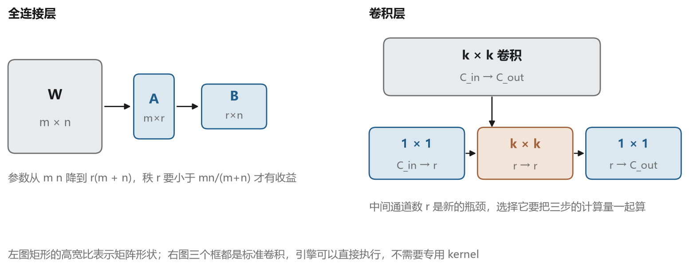

# 低秩分解

一个 4096×4096 的全连接层有 1678 万参数，用 SVD 截断到秩 512，参数降到 419 万，压缩 4 倍，输出几乎不变。团队把这个结论推广到卷积层，做完发现模型反而变慢了。原因在于卷积的权重张量是四维的，直接按矩阵做 SVD 要把通道和空间维展平，展平之后得到的两个小矩阵未必能被硬件高效执行，多出来的两层中间结果还要多占一次显存往返。

先分清三个容易混的概念。低秩分解改的是权重的组织方式，参数量下降但位宽不变；量化改的是每个参数的表示位数，结构不变；剪枝改的是连接的存废，形状可能变也可能不变。三者在数学上独立，在工程上互相影响，这一章只讲第一种。

低秩分解的想法很干净，用两个瘦长的矩阵代替一个胖矩阵。难点不在数学，在于怎么把它映射到卷积上，以及判断哪些层真的值得。

## 截断 SVD 的账

对一个 `m × n` 的权重矩阵做奇异值分解，得到 `W = U Σ V^T`。奇异值按从大到小排列，前面的对应主要方向，后面的对应细节。只保留前 `r` 个奇异值和对应的向量，得到近似

$$
W \approx U_r \Sigma_r V_r^{T}
$$

重构误差由被丢掉的奇异值的平方和决定，还有一个隐含成本容易被漏掉，分解之后多了一层中间激活，形状是 `[批, r]`。如果 `r` 很小而批很大，这个中间张量反而不小，显存和带宽的账要一起算。

这也是为什么低秩分解在“权重谱衰减很快”的层上特别有效。如果奇异值从第一个到最后一个只掉一点点，说明这个矩阵满秩，强行截断会损失大量信息。

奇异值分解本身还有一个工程细节，`m × n` 的矩阵做完整 SVD 的复杂度是 `O(m n min(m,n))`，对 4096 的方阵大约是 700 亿次浮点运算，单核跑几分钟，GPU 上几秒。对一个大模型的上百个矩阵逐个做，时间是小时级，可以接受。但要迭代（分解、微调、再分解）时，这个成本会翻倍，所以要先用一次 SVD 把候选层筛出来，只对候选层做迭代。

参数量的变化可以直接算。原来的参数是 `m n`，分解后是 `r m + r n`，加上奇异值一共 `r (m + n + 1)`。要压缩，需要

$$
r < \frac{m n}{m + n}
$$

对一个 `4096 × 4096` 的矩阵，右边是 2048，也就是说秩低于 2048 才有收益。取 `r = 512` 时压缩 4 倍。对一个 `1024 × 1024` 的矩阵，右边是 512，压缩空间小得多。这条不等式解释了一个常见现象，大矩阵容易压缩，小矩阵压不动。很多模型里最后几层的矩阵本来就不大，做低秩分解得不偿失。

## 卷积怎么分解

卷积的权重是 `[输出通道, 输入通道, 高, 宽]` 四维张量，不能直接 SVD。有三条路。

第一种是空间可分离。把一个 `k × k` 的卷积核近似成 `k × 1` 和 `1 × k` 两个核的乘积，计算量从 `k^2` 降到 `2k`，`3 × 3` 时是 9 降到 6。这个近似对某些核很准（比如高斯型、边缘检测型），对学出来的任意核不准，误差可能很大。Jaderberg 等在 2014 年系统地研究了这类分解，包括如何把任意卷积核近似成若干个可分离核的和（Jaderberg 等，2014）。

空间可分离还有一个变体，把 `k × k` 核分解成若干可分离核的加权和，权重系数也参与训练。这个做法的近似误差比单一可分离核小，但计算量随核的数量线性增长，通常用两三个就够。Jaderberg 的论文里给了详细的误差分析和选核策略，结论是 `3 × 3` 核分解成 2 到 3 个可分离核能在 2 倍加速下保持精度。

第二种是通道低秩，也就是瓶颈结构。Denton 等在 2014 年也给出过一套做法，把卷积核按奇异值分解成若干低秩项的和，并在全连接层上比较了几种不同的低秩近似（Denton 等，2014）。把 `C_in → C_out` 的 `k × k` 卷积拆成三步，先用 `1 × 1` 把输入通道降到 `r`，再做 `k × k` 的卷积保持 `r` 个通道，最后用 `1 × 1` 升回 `C_out`。计算量从 `C_in C_out k^2` 变成 `C_in r + r C_out k^2`，当 `r` 取 `C_out / 4` 左右时能省一半以上。这个结构就是 MobileNet 里 inverted residual 的前身，工程上非常成熟，因为三个算子都是标准卷积，硬件友好。

第三种是把整个四维张量做张量分解，CP 分解把权重拆成若干个秩一张量之和，Tucker 分解拆成一个核心张量乘以各维的因子矩阵。Novikov 等在 2015 年把 Tucker 分解用到卷积上，效果在 VGG 这类网络上不错（Novikov 等，2015）。代价是实现复杂，核心张量的形状不规整，需要专门的 kernel，通用推理引擎支持有限。

图 13-1 对比了两种结构。全连接层的分解是纯粹的矩阵乘法重排，两个小矩阵可以合并成一个，也可以分开执行。卷积的分解多了一层含义，中间的 `r` 个通道是一个新的瓶颈，它同时受输入输出通道数和卷积核大小影响，选 `r` 的时候要把三者的计算量一起算。

## 和 LoRA 的关系

LoRA 的结构和低秩分解一模一样，都是 `W + A B`，`A` 是 `m × r`，`B` 是 `r × n`，`r` 远小于 `m` 和 `n`。区别在目的和使用方式。

低秩分解是压缩，用 `A B` 近似原来的 `W`，原来的权重被丢掉。LoRA 是微调，`W` 冻结不动，只训练 `A` 和 `B`，推理时把 `A B` 加到 `W` 上。前者的目标是少存参数，后者的目标是少训参数。

还有一条更近的关联，QLoRA 把量化基座和低秩适配器放在一起，基座是 4 位的，适配器是高精度的低秩矩阵。这个组合说明了两件事可以同时做，压缩基座省显存，低秩增量保精度。代价是前向要先把基座反量化再加适配器，比纯 fp16 慢一点，但显存差好几倍。

这个区别带来两个实际后果。第一，低秩分解需要重新训练或者至少微调来恢复精度，因为近似误差会累积；LoRA 不需要，因为原始权重还在。第二，低秩分解的秩由重构误差决定，越小越好；LoRA 的秩由任务的复杂度决定，太小会欠拟合。同一个模型上，压缩用的秩通常比微调用的秩大。

Hu 等在 2021 年提出 LoRA 时明确说过它和低秩近似的关系，也指出 LoRA 的低秩约束本身不是瓶颈，真正起作用的是“只更新一小部分参数”（Hu 等，2021）。这句话对理解低秩分解也有用，它提醒我们，低秩之所以有效，前提是被近似的矩阵本身接近低秩，而不是因为低秩这个形式有什么魔力。

## 哪一层值得做

判断标准有三条，冗余度高、矩阵大、下游能容忍误差。

一个具体的操作顺序是这样。导出所有权重矩阵，对每个做一次 SVD，记录 90% 能量所需的秩 `r90`。然后计算这个秩下的压缩比 `(r(m+n))/(mn)`，比值小于 0.7 的层进入候选。候选层按压缩潜力排序，从最大的开始逐个替换并微调，掉点超过阈值的就回退。这个过程自动化程度可以很高，因为判据都是数值，不需要人工看。

冗余度高的层是那些奇异值衰减快的层。对每一层做一次 SVD，看前 10% 的奇异值占了多少能量，占比超过 90% 的层适合压缩，低于 70% 的层压缩会明显掉点。这个统计只要一次 SVD，成本很低，应该在动手之前先做。

矩阵大的层收益才明显。前面那条不等式说明，`m` 和 `n` 接近时压缩空间最大。Transformer 的注意力投影是 `d × d` 的方阵，`d` 通常是 768 到 4096，正是低秩分解的甜点区。这也是为什么很多压缩工作先拿注意力开刀。反过来，`d` 只有 64 的层，压缩空间很小。

下游能容忍误差，指的是这一层的输出误差不会被后面的非线性放大。紧接 softmax 的层通常很敏感，紧接 LayerNorm 的层相对宽容。

判断里还有一个容易被忽略的成本，分解后的两个矩阵如果分开存，推理时要读两次，中间结果要写一次再读一次。原来一个大矩阵乘只读一次权重，现在读了两次小矩阵加一次中间激活。如果这一层本来就受带宽限制，分解之后可能更慢，虽然参数量少了。这就是开头那个团队遇到的问题，他们在小 batch 的全连接层上做分解，参数量降了，读的次数多了，净效果是负的。

有一类层明确不适合，深度可分离卷积。它的每个通道独立卷积，权重张量的秩本来就很低（每通道一个 `k × k` 核），再做低秩分解没有可压缩的空间，反而把原本高效的结构拆散了。同样不适合的是分组卷积，组与组之间没有耦合，组内的矩阵太小。

## 实际收益与它的位置

还有一个硬件层面的因素决定收益能不能落地。分解出来的 `1 × 1` 卷积和 `k × k` 卷积能不能被融合成一个 kernel，直接决定了省下的算力有没有变成时间。多数推理引擎会把连续的 `1 × 1` 和 `k × k` 融合，但如果中间隔着激活函数，融合就断了，中间张量要写回显存。这是低秩分解在真实图上的常见损失点。

低秩分解在实际部署里的地位不如量化。原因是它需要重新训练，收益又依赖具体的层，工程成本高。量化的流程是流水线，低秩分解更像一次针对性的手术。

但它在两个场景里不可替代。一是显存极度受限的端侧，一个已经量化到 int8 的模型还想再小，低秩分解是少数还能叠加上去的手段，而且它和量化不冲突，可以先把矩阵分解再用更低的位宽量化小矩阵。二是和剪枝组合，剪枝去掉通道之后，剩下的权重矩阵可能出现新的低秩结构，此时再做一次分解能榨出额外收益。

低秩分解还有一个变体值得一提，把分解和量化结合，先对权重做低秩分解，再对两个小矩阵做分组量化。两个手段省的是不同维度，低秩省参数量，量化省每参数的位数，叠加之后压缩比可以到 10 倍以上。代价是两处误差叠加，需要更仔细的校准。

从压缩的三条路看，剪枝改结构，量化改数值，低秩改分解方式，三者可以叠加但收益递减。再往下走，还有一条路是改模型本身，用一个小模型学大模型的行为，也就是蒸馏。下一章讲它。
