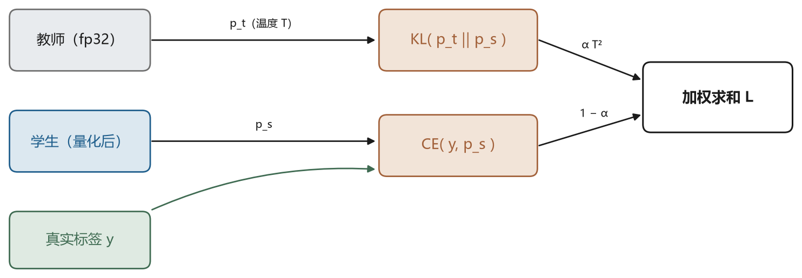

# 蒸馏与稀疏

一个 6 层的小模型单独训练，验证集准确率 78.2%。同样的结构，从 12 层的教师模型蒸馏，准确率到 81.5%，参数量一点没变。多出来的 3.3 个点不是从数据里学来的，是从教师的输出分布里读出来的。这件事的代价是训练成本。教师的前向要和学生的训练同时跑，显存和算力都要翻倍，训练时间比直接训练小模型长得多。所以蒸馏不是“免费的小模型”，它把成本从推理挪到了训练，用一次性的训练开销换长期的推理节省。

硬标签只告诉模型“这张图是猫”，软标签告诉它“这张图像猫的概率 0.92，像猞猁 0.06，像狗 0.01”，后者包含类与类之间的相似性，这些信息在训练集里没有被标注出来。

蒸馏和前面几章的压缩手段不一样。剪枝、量化、低秩都在改一个已有的模型，蒸馏是重新训练一个小模型。它不保证压缩比，但能保证结构干净，部署时没有任何特殊要求。

## 软标签和温度

教师的输出经过 softmax 变成概率，直接用它做目标，梯度会集中在少数几个大类上，因为 softmax 的输出往往很尖，一个类接近 1，其余接近 0。一个被广泛采用的做法是加一个温度 `T` 把分布压平（Hinton 等，2015）

$$
p_i = \frac{\exp(z_i / T)}{\sum_j \exp(z_j / T)}
$$

`T` 大于 1 时分布变平，原本 0.001 的类别被放大到 0.01 量级，这些小概率里携带的“类间关系”才进入损失函数。温度的作用可以用一个例子说明。教师对某张图的 logits 是 `[8.0, 3.0, 2.5]`，`T = 1` 时 softmax 得到 `[0.99, 0.007, 0.004]`，两个次类的信息几乎为零；`T = 4` 时得到 `[0.62, 0.19, 0.15]`，次类的相对关系清晰可见。学生从这个分布里能学到“第二类和第三类比第一类更接近”，这种结构信息在硬标签里完全没有。

`T` 取 1 就退化成普通的 softmax，取太大会把所有类压成均匀分布，信息也没了。经验值在 2 到 10 之间，分类任务上 4 左右最常见。

损失函数是两项的加权

$$
L = (1 - \alpha) \cdot \mathrm{CE}(y, p_s) + \alpha T^{2} \cdot \mathrm{KL}(p_t \| p_s)
$$

第一项是学生和真实标签的交叉熵，保证基本正确；第二项是学生和教师分布的 KL 散度，传递类间关系。`T^2` 这个因子不是装饰，因为对 `T` 求导时 softmax 的梯度里带一个 `1/T`，乘上 `T^2` 之后两项梯度的量级才对得上，`alpha` 才能真正起到权重的作用。

图 14-1 画了这两个来源。硬标签是一条独热向量，只有一个位置是 1；软标签是一个分布，很多位置有非零值。学生同时向两边靠，前者让它别答错，后者让它学得像。

## 不止输出，中间层也能学

输出层的蒸馏只用到最后的信息，中间层的特征没有被利用。特征蒸馏把学生的某一层输出和教师的某一层输出对齐，用 L2 距离或者余弦相似度做损失。前提是两边的维度一致，不一致的话要加一个线性投影层，这个投影只用于训练，不进入部署。

特征蒸馏还有一个变体，用注意力转移。不比较特征的绝对值，比较特征之间的相似度矩阵，也就是 `X X^T` 的归一化版本。这个做法规避了维度不匹配的问题，因为相似度矩阵的形状只和批大小、序列长度有关，和学生教师的隐藏维无关。代价是丢掉了尺度信息，只剩方向。

TinyBERT 是这条路线上的代表工作。它把蒸馏拆成四部分，词嵌入的输出、注意力矩阵、中间隐藏状态、以及最后的预测分布，每一部分都有对应的损失，加权求和（Jiao 等，2019）。注意力的蒸馏不考虑值向量，只对齐注意力权重矩阵，因为权重矩阵反映“看哪里”，是更本质的知识。

特征蒸馏的另一个代价是显存。训练时要同时保留教师和学生的中间激活，教师通常比学生大好几倍，显存占用主要由教师决定。解决办法有两个，一是冻结教师并用更小的批，二是把教师的前向放到单独的卡上，代价是多一次通信。

难点在层与层怎么对应。学生 6 层、教师 12 层，哪个学生层学哪个教师层？TinyBERT 的做法是按比例映射，第 `i` 个学生层学第 `2i` 个教师层。这个映射是人为定的，不同任务上最优映射不一样，有的工作会搜索映射关系。

特征蒸馏的收益不稳定。在 BERT 这类编码器上效果明显，因为它有清晰的层级结构；在生成模型上收益小，因为生成的每一步都依赖前面所有 token，中间特征的语义不像编码器那样规整。

## 蒸馏和量化的组合

两条路线可以叠加，顺序有两种。

有一个前置问题要先回答，教师和学生差多少层合适。差一倍（12 层到 6 层）是常见配置，差三倍以上学生就学不动了，因为容量不足以拟合教师的函数。这时候要么加宽学生（层少但通道多），要么分阶段蒸馏，先蒸馏到中等模型，再蒸馏到小模型。分阶段的效果通常比一步到位好，代价是训练时间翻倍。

先蒸馏再量化。把大模型的知识传给一个小模型，再对小模型做量化。好处是每个环节的目标清晰，坏处是两次损失叠加，小模型本身已经弱一些，量化再削一层，可能掉出可接受范围。

把量化模型当学生。教师是浮点的大模型，学生是量化后的小模型，训练时学生带着伪量化节点，一边学知识一边适应量化噪声。这个组合在 4 位量化上特别有用，因为 QAT 需要模型自己找量化友好的解，而教师的软标签提供了一个更平滑的目标，不容易陷进局部最优。

$$
L = (1-\alpha) \cdot \mathrm{CE}(y, p_s) + \alpha T^{2} \cdot \mathrm{KL}(p_t \| p_s)
$$

这条式子在这里的含义和前面一样，只是 `p_s` 来自一个带伪量化的学生。梯度经过 STE 回传，量化误差和蒸馏误差在同一个优化过程里被一起处理。实测里这种组合比“先 QAT 再蒸馏”或者“先蒸馏再 QAT”都好，因为两个目标从一开始就在互相妥协，而不是一个接一个地施加。

代价是训练复杂度。要同时管教师的前向、学生的前向、伪量化、两套损失权重，显存占用是普通训练的两倍左右。工程上通常只在关键模型上用，不是默认流程。

## 稀疏训练

这三类组合之下还有一条更省事的路线，用教师做数据增强。让教师在一个大语料上生成软标签，存成离线数据，学生训练时直接读。好处是学生训练时不需要同时加载教师，显存减半；坏处是软标签一旦存下来就不能随学生变化而调整，交互式蒸馏的一些好处丢了。数据量大的时候这个方案更实际。

稀疏训练是另一条路，它不压缩已有模型，而是在训练过程中让模型自己变稀疏。

最简单的做法是加 L1 正则，惩罚权重的绝对值之和，训练中权重被推向零。问题是 L1 只能让权重变小，不能让它精确等于零，除非加一个阈值截断，而阈值一加，精度就掉。所以 L1 正则通常只作为辅助，真正产生稀疏的是后面的剪枝步骤。

更直接的做法是维护一个掩码，每若干步更新一次，把绝对值最小的那部分权重永久置零，其余正常更新。掩码更新时可以把已经剪掉的权重放回来（如果它们变大了），这叫动态稀疏。Frankle 等后来把这种动态重排和彩票假说结合起来，发现周期性重排掩码比固定掩码效果好（Frankle 等，2018）。

稀疏训练的评估方式和剪枝不同。剪枝之后模型是静态的，评估一次就够；稀疏训练是一个过程，要观察稀疏度和精度的曲线，判断在哪个稀疏度上还是划算的。这条曲线通常在某个点之后陡降，那个点就是这套方法在这个模型上的上限。

还有一类做法从稀疏度入手，训练初期稀疏度低，随着训练推进逐步提高，最后达到目标。学习率和稀疏度一起退火，模型有足够时间适应。这类方法在 2:4 稀疏上用得很多，因为目标稀疏度是固定的 50%，只需要控制什么时候达到。

## 什么时候用哪一条

评估蒸馏效果要用教师的分布做参照，不能只看准确率。两个学生可能准确率一样，但对教师分布的拟合程度差很多，后者才是决定“能不能继续压缩”的关键。常用的指标是学生和教师输出分布的 KL 散度，以及 top-k 一致率。

蒸馏适合“有大模型、要小模型、数据够”的场景。它的上限由教师决定，教师强学生就强，但压缩比不能随便定，学生太小会欠拟合。

稀疏训练适合“结构不能变、但要省算力”的场景，比如已经适配了某个硬件，只能通过稀疏来提速。它的效果依赖硬件对稀疏的支持，不支持的话白做。

两者也可以组合，先蒸馏出一个小模型，再对这个小模型做稀疏训练，最后量化。三步走完，模型可能只有原来的十分之一大，精度掉两三个点。这条流水线在很多实际项目里出现过，每一步的技术选择取决于目标硬件和可接受的掉点。

到这里可以把四条压缩路径的代价放在一起看。剪枝和量化不需要重新训练（微调即可），低秩分解需要微调，蒸馏需要从头训练。代价越大的方法往往效果越好，工程风险也越高。选型应该按代价从小到大试，而不是按论文里的效果排序。

压缩的四条路讲完了。剪枝改结构，量化改数值，低秩改分解，蒸馏改模型本身。四条路都有各自的评估方式，但没有一条能替代端到端的验证。最后一章讲怎么评估、怎么监控、以及上线之后要盯什么。
