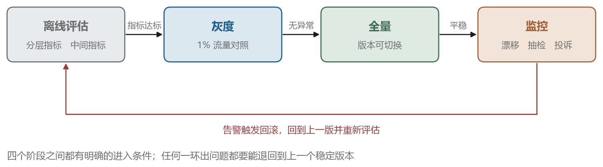

# 精度评估与上线监控

一个量化模型在离线评估集上的 top-1 掉 0.3 个点，团队判定可上线。上线第三天，客服转来一批投诉，说某些商品识别错了。查下来是一个长尾类别的召回从 82% 掉到 61%，这个类在评估集里只占 0.4%，整体指标上看不出来，在线上却占了 7% 的流量。

评估这件事最容易犯的错，是把一个数字当成结论。量化模型的误差不是均匀分布的，它集中在少数类别、少数样本、少数输入长度上。整体指标掩盖了这些，分层看才看得见。

这一章从“怎么量”讲到“上线之后盯什么”。两者是一件事的两端，离线评估决定能不能上，线上监控决定上了之后还能不能维持。

## 指标不是一个数

分类任务看 accuracy，但 accuracy 在不平衡数据上会骗人，一个 99% 是负类的数据集，全预测负类也有 99%。F1 看的是精确率和召回率的调和平均，多分类时要用宏平均和微平均两个版本，前者对少数类更敏感。精确率（precision）是“说是正类的里面有多少真是”，召回率（recall）是“真是正类的里面找回来多少”，两者经常此消彼长，F1 用调和平均把这对矛盾压成一个数。宏平均是先算每个类的 F1 再平均，微平均是把所有类的样本混在一起算，前者让少数类有同等权重，后者被大类主导。

检测任务看 mAP，它本身已经是按类别平均的，但还会被小目标的性能拖低。mAP 的全名是平均精度均值，做法是对每个类别算精度-召回曲线下的面积，再对所有类别取平均。生成任务看 BLEU、ROUGE，这些指标衡量生成文本和参考文本的 n-gram 重合度，和人工判断的相关性有限，只能作为相对比较的参考。语言模型看困惑度，它衡量模型对文本的“意外程度”，对量化的数值扰动比任务指标更敏感。

指标之间的取舍也要想清楚。W8A8 量化经常让准确率掉一点点，但让延迟降一半，这个交易在多数场景里划算；如果业务是离线批处理，延迟不值钱，那就不该换。同一个量化方案，在实时服务和离线任务里的价值完全不同。评估之前先明确这件事，否则算出来的数字没有比较对象。

对量化模型，还有一类中间指标值得看，输出分布的偏移。同一个输入，量化前后输出的 JS 散度、top-1 一致率、以及 logits 的余弦相似度。这些指标不需要标注，能在大规模无标注数据上算，适合做上线前的快速筛查。JS 散度是 KL 散度的对称化版本，两个分布互换位置结果一样，比 KL 更适合做“差异有多大”的度量。

$$
\mathrm{SE} = \sqrt{\frac{p(1-p)}{n}}
$$

这个式子决定了评估的精度上限，它叫标准误（standard error），衡量“换一批同样大小的样本重测，指标会晃动多少”。`p` 是准确率，`n` 是样本数。1000 个样本、准确率 0.76 时，标准误约 1.4 个百分点。也就是说，两个模型差 0.3 个点，在这个样本量下完全可能是噪声。要看出一致的 0.3 个点差异，样本量要上万。很多量化报告的“掉了 0.2 点”其实没有统计意义，只是恰好抽到了不同的样本。这条公式的解释很朴素：样本越多，平均值越稳，稳的程度按样本量的平方根改善，所以样本翻四倍，标准误才减半。

## 分层看，才看得见

把评估集切成若干层，每层单独算指标，是发现问题的基本手段。切法有几种。

按类别切，看每个类的准确率变化。量化模型的掉点往往集中在少数类上，尤其是样本少、特征不典型的类。按类别看能定位到具体的类，再顺着看这个类的样本有什么共同点。

按类别切还有一个变体，按混淆对切。量化之后模棱两可的样本往往集中在特定的类别对上，比如把“哈士奇”认成“阿拉斯加”，把“卡车”认成“公交车”。统计量化前后混淆矩阵的差异，找出差异最大的几个类对，比看单一类别的准确率更有指向性，因为它直接说明模型把哪两类混起来了。

按难度切，看置信度分层。把样本按模型的预测置信度分成高、中、低三档，量化模型在高置信度样本上几乎不掉，在低置信度样本上掉得很厉害。这说明量化放大了模型本来就不确定的地方，这类样本在线上往往就是容易出错的那批。这个发现有一个直接用途：如果业务允许对低置信度样本走人工或大模型兜底，那你真正要关心的是高置信度那档的准确率，因为只有它会直接呈现给用户。

按输入特征切，比如图像任务按分辨率、亮度、目标大小；文本任务按长度、领域、语言。量化对极端输入更敏感，短文本、长文本、低照度图片，这些边界样本上的掉点经常是整体掉点的好几倍。

生成任务的评估还要多一层。困惑度只看下一个 token，不看整段输出是否自洽。量化模型的典型失败是长输出里的重复和自相矛盾，这类问题在困惑度上几乎看不出来。做法是加人工或模型打分的维度，比如一致性、事实准确率、格式合规率。这些指标贵，但它们是用户真正感知到的东西。

分层评估的代价是每层的样本变少，统计噪声变大。一个 1000 样本的评估集切成 20 类，每类 50 个样本，标准误涨到 6 个百分点，什么都没法判断。所以分层评估需要更大的评估集，或者把不重要的类合并。这条约束经常被忽略，于是有人在小评估集上做出几十个分层的表，每格都标了数字，实际每一格都在噪声里。

## 评估集要代表线上

评估集的采样方式和训练集、校准集都不一样，这三者的关系要理清楚。

训练集用来学参数，分布反映的是“我们希望模型会处理什么”。校准集用来定量化参数，分布应该反映“线上真正会来什么”。测试集用来判断好坏，分布也应该反映线上，而且不能和校准集重叠。三者的分工可以类比成三个不同的岗位：训练集是教材，校准集是施工现场的样本，测试集是验收标准。教材和施工现场不一样是正常的，验收标准和施工现场不一样就会出事。

最容易出错的是用测试集做校准。这样校准出来的区间正好覆盖测试集的极值，指标偏乐观，上线之后分布一变就掉。另一个错误是用训练集的验证划分做评估，验证集和训练集同分布，但和线上不同分布，线上出现的新样式它测不出来。

线上分布会漂移。同一批用户，节假日的输入和平时不一样；同一个产品，新版本上线后用户行为变了。评估集如果是一年前采的，测出来的指标和线上体验会脱节。做法是定期用新采样的数据刷新评估集，同时保留一份固定不变的“基准集”，用来做跨时间的可比。基准集的价值在于它不随时间变，任何两次改动的对比都在同一把尺子上；刷新集的价值在于它贴近当下，能发现新出现的问题。两个都要有，只留一个都会缺一半信息。

还要注意一个时间上的陷阱，评估集如果和训练数据在时间上交叉，指标会偏高。比如你要上线的是下个月的模型，评估集却抽了上个月的数据，而那部分数据早在训练时被模型见过，测出来的准确率自然好看。正确做法是按时间切分，用更早的数据训，用更晚的数据评，模拟真的“用过去预测未来”。

分层评估对评估集的绝对大小很敏感，一个实用的折中是“少分几层、每层留够样本”。比如先按三个大维度各切一次，而不是三个维度交叉切，每个切面至少留两百个样本，低于这个数就不要单独出数字。

## 上线之后盯什么

离线指标通过只是起点。线上要盯的东西有四类。

输入漂移。比较当前批次的输入分布和基线分布的差异，用 PSI 或者 KL 散度量化。PSI 是群体稳定性指数（population stability index），做法是把两个分布的直方图对齐，逐桶比较比例，再把差异加起来，数值越大说明偏移越大。图像任务看尺寸、亮度、清晰度的分布；文本任务看长度、词表外比例、语言分布。漂移超过阈值就报警，因为下游的所有指标都会跟着变。

输出漂移。看预测类别的分布、置信度的分布、拒识率。量化模型的一个典型症状是置信度整体偏移，原本 0.9 的输出变成 0.85，虽然 top-1 没变，但下游如果用阈值做决策，行为就变了。

精度抽检。每天抽一批线上请求，人工标注，算小样本的准确率。抽检的样本量不足以发现 0.3 个点的差异，但能发现 5 个点以上的崩坏，这是它的定位。

业务指标。点击率、转化率、投诉率，这些是最终标准。它们的变化滞后，归因困难，但只有它们能说明模型到底有没有用。

灰度是评估和监控之间的过渡。先放 1% 的流量，跑一天，对比这一部分流量和其余流量的业务指标。灰度能发现离线测不出来的问题，比如某些特定用户群的输入格式异常、某些边缘设备上的精度差异。灰度的样本量小，只适合发现大问题，不适合验证小差异。灰度的另一个作用是给回滚留空间，先让 1% 的人踩坑，比让所有人一起踩要便宜得多。

这四类监控的采样频率不一样。输入漂移要高频，每小时甚至每分钟算一次，因为它是最早的预警信号。输出漂移次之，按天算。精度抽检最慢，按周算，因为人工标注有成本。业务指标按天到周，取决于业务的反馈周期。频率排错了，要么告警太晚，要么被噪声淹没。

回滚条件要提前定好，不能等出事再讨论。常见的组合是，抽检准确率下降超过 3 个点，或者输入漂移指标连续三天超阈值，或者投诉率翻倍，任一条件触发就回滚到上一版。回滚要能在几分钟内完成，所以模型版本、配置、量化参数都要能一键切换。

## 一张检查清单

把这一册的内容收拢成一份上线前的检查清单。

还有一个常被忽略的检查项，量化模型和浮点模型的输出对比有没有留档。上线之后出问题，第一个要回答的问题是“这是量化引入的，还是模型本身的问题”。有一份同一批输入的浮点输出做对照，定位时间能从几天缩到几小时。留档的成本很低，把校验时的那份逐层对比结果存下来就行，但它决定了出问题时你是从零开始查，还是从一半开始查。

模型层面，量化方案确定了吗，权重和激活的位宽、粒度、校准方法写清楚了吗。敏感层是否留在高精度，混合精度的切换点有没有性能测试。剪枝的稀疏度是否和硬件的支持对齐，低秩分解的层是否重新微调过。

数据层面，校准集和评估集是否独立，评估集是否覆盖了长尾和边界样本，样本量是否足以支撑要判断的差异幅度。分层指标是否都算了，最差的那一层掉多少。

性能层面，延迟、吞吐、显存在目标硬件上实测过吗，批大小变化时曲线是否稳定。量化后的 kernel 是否真的走了整数路径，有没有回退到浮点。延迟要看分位数，平均值会被少数慢请求掩盖，P99 才是用户能感知到的那个数。

监控层面，输入和输出的分布指标接入了吗，告警阈值定了吗，回滚流程演练过吗。

这份清单没有新奇的东西，它的价值在于强制把每一件事写下来。量化项目的失败很少因为算法选错，多数因为某一环没验证就上线了。

图 15-1 画的是这个闭环。离线评估、灰度、全量、监控，四个阶段之间都有明确的进入条件，出问题往回退。

还有一件事值得在项目开始时就做，把评估流程脚本化。同样一份评估集，同样一套指标，每次改动都跑一遍，结果存成表格。这样量化方案的迭代才有对照，也才能在出问题时回看是哪一次改动引入的。手工评估的项目，两周之后没人能说清上一版的数字是多少。

精度这件事没有终点。模型会更新，数据会漂移，硬件会换代，每一轮都要重新验证。把流程固化下来，比记住某一个具体的最优参数更有用。这一册讲的是方法，具体到你的模型和你的业务，参数都要重新调一遍。想看得更全，Zhou 等在 2024 年的综述把推理效率的各个方向都梳理了一遍，可以当作索引（Zhou 等，2024）。
